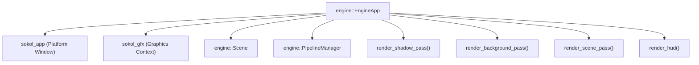
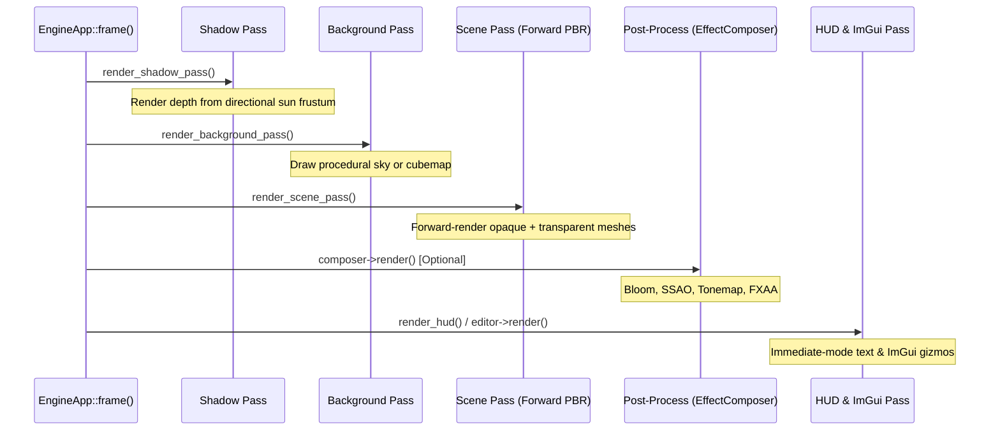

# Core C++20 Engine (`engine::*`)

This document covers the core C++20 architecture of the Velocity 3D Engine, focusing on `EngineApp`, the Sokol GFX rendering pipeline passes, `PipelineManager` GPU pipeline caching, and `Scene`.

---

## Architectural Hierarchy



---

## 1. `engine::EngineApp`

Defined in `core/include/engine/app.hpp`.

The central orchestration class responsible for window initialization, the Sokol event pump, frame timing, offscreen render targets, and rendering pass sequencing.

### Class Definition

```cpp
namespace engine {

struct WindowConfig {
    std::string title = "VelocityEngine v0.2-beta";
    int width = 800;
    int height = 600;
    std::array<float, 4> clear_color = { 0.43137f, 0.62745f, 0.82353f, 1.0f };
    bool vsync = true;
};

class EngineApp {
public:
    using UpdateCallback = std::function<void(double)>;

    EngineApp();
    EngineApp(const std::string& title, int width, int height);
    virtual ~EngineApp();

    void init(const std::string& title, int width, int height);
    void run();
    void close();

    bool is_running() const;

    // Viewport and Window
    int width() const;
    int height() const;
    const std::string& title() const;
    void set_title(const std::string& title);

    // Color & Mode
    void set_clear_color(float r, float g, float b, float a = 1.0f);
    std::array<float, 4> get_clear_color() const;
    EngineMode mode() const;
    void set_mode(EngineMode mode);
    void toggle_mode();

    // Scene & Camera
    Scene& scene();
    Camera& camera();
    InputManager& input();
    AudioManager& audio();
    EditorManager& editor();

    // Callbacks & Performance
    void set_update_callback(UpdateCallback cb);
    const RenderStats& stats() const;
    double fps() const;
    double frame_time_ms() const;

    // Post-Processing & Offscreen Rendering
    void set_composer(std::shared_ptr<EffectComposer> composer);
    void render_target(Scene& scene, Camera& camera, RenderTarget& target);
    std::vector<uint8_t> read_pixels(RenderTarget& target);
    std::vector<float> read_depth_pixels(RenderTarget& target);
};

} // namespace engine
```

### Lifecycle Flow
1. **Instantiation**: Sets up default `WindowConfig`, initializes input listeners, audio devices, and scene defaults.
2. **`init(title, width, height)`**: Prepares `sapp_desc` struct configuring callbacks: `init_cb`, `frame_cb`, `cleanup_cb`, `event_cb`.
3. **`run()`**: Passes descriptor to `sapp_run(&desc)`. This hands control over to the platform-specific event pump.
4. **Per-Frame Loop (`frame_cb`)**:
   - Computes delta time $\Delta t$.
   - Polls keyboard and mouse deltas via `InputManager`.
   - Fires user `UpdateCallback(dt)`.
   - Executes multi-pass rendering sequence.
   - Flushes ImGui editor UI or 2D HUD text overlay.
   - Commits Sokol frame via `sg_commit()`.

---

## 2. Rendering Passes (`Renderer`)

Velocity separates frame rasterization into distinct, modular render passes within `EngineApp`:



### Key Render Passes in `core/src/app.cpp`

| Pass Function | Buffer Target | Description |
|:---|:---|:---|
| `render_shadow_pass()` | Offscreen Shadow Depth Target | Orthographic depth rasterization from the key directional light viewpoint for shadow mapping. |
| `render_background_pass()` | Swapchain or Offscreen HDR | Renders distant horizon gradient or skybox cubemap with depth-write disabled. |
| `render_scene_pass()` | Swapchain or Offscreen HDR | Forward-renders all visible entities, instanced meshes, and skinned characters with view-frustum culling. |
| `render_debug_hitboxes()` | Active Viewport | Draws wireframe bounding volumes (AABBs/OBBs) using 3D line primitives. |
| `render_hud()` | Swapchain | Orthographic bitmap font rendering for score, hints, crosshairs, and performance metrics. |

### `RenderStats` Diagnostics

```cpp
struct RenderStats {
    uint32_t draw_calls{0};
    uint32_t vertices{0};
    uint32_t triangles{0};
    uint32_t entities_rendered{0};
    uint32_t culled_entities{0};
};
```

---

## 3. `engine::PipelineManager`

Defined in `core/include/engine/material.hpp`.

Sokol GFX pipelines (`sg_pipeline`) are immutable GPU state objects encapsulating shader programs, vertex layouts, depth-stencil states, blend functions, face culling, and primitive topologies. Creating pipelines dynamically during the frame causes significant GPU driver stalls.

`PipelineManager` caches and deduplicates pipelines using a 64-bit bitmask hash key.

### Class Definition

```cpp
namespace engine {

class PipelineManager {
public:
    static PipelineManager& instance();

    sg_pipeline get_or_create(uint64_t key, const sg_pipeline_desc& desc_template);
    void release_all();
    ~PipelineManager();

    static uint64_t make_key(
        uint32_t shader_id,
        SideMode side,
        bool depth_write,
        bool depth_test,
        BlendMode blend_mode,
        bool wireframe = false,
        bool is_instanced = false,
        int sample_count = 1,
        uint32_t pixel_format = 0
    );

private:
    std::unordered_map<uint64_t, sg_pipeline> cache_;
};

} // namespace engine
```

### 64-bit Bitmask Key Packing Scheme

The `make_key()` static method encodes material rasterization states into distinct bit fields:

```text
Bits  0 - 15: Shader Program ID (uint16_t)
Bits 16 - 17: SideMode (0=Front, 1=Back, 2=Double)
Bit       18: Depth Write (0=Disabled, 1=Enabled)
Bit       19: Depth Test (0=Disabled, 1=Enabled)
Bits 20 - 22: BlendMode (0=Opaque, 1=Alpha, 2=Additive, 3=Multiply)
Bit       23: Wireframe Mode (0=Solid Triangles, 1=Lines)
Bit       24: Instanced Rendering Flag (0=Standard, 1=Instanced Step Rate)
Bits 25 - 28: MSAA Sample Count (1, 2, 4)
Bits 29 - 34: Framebuffer Pixel Format (Default / RGBA16F / Depth)
Bits 35 - 63: Reserved for future render states
```

---

## 4. `engine::Scene`

Defined in `core/include/engine/scene.hpp`.

The scene manages the root transform hierarchy and collects all renderable items and lights.

### Class Definition

```cpp
namespace engine {

class Scene {
public:
    DirectionalLight light;

    Scene();

    std::shared_ptr<Group> root_node() const;

    void add(std::shared_ptr<Node3D> node);
    void remove(std::shared_ptr<Node3D> node);

    // Entity & Model Factories
    std::shared_ptr<Model> load_model(const std::string& filepath);
    std::shared_ptr<Entity> create_cube(const glm::vec4& color = glm::vec4(1.0f));
    std::shared_ptr<Entity> create_box(const glm::vec3& size = glm::vec3(1.0f), const glm::vec4& color = glm::vec4(1.0f));
    std::shared_ptr<Entity> create_sphere(float radius = 1.0f, int rings = 32, int sectors = 32, const glm::vec4& color = glm::vec4(1.0f));
    std::shared_ptr<Entity> create_cylinder(float radius = 0.5f, float height = 2.0f, int segments = 32, bool capped = true, const glm::vec4& color = glm::vec4(1.0f));
    std::shared_ptr<Entity> create_plane(float size = 10.0f, float uv_tiling = 5.0f, std::shared_ptr<Material> material = nullptr);
    std::shared_ptr<Entity> create_entity(const std::string& name = "Entity");

    // Container Management
    void add_entity(std::shared_ptr<Entity> entity);
    void remove_entity(std::shared_ptr<Entity> entity);
    void add_instanced_mesh(std::shared_ptr<InstancedMesh> mesh);
    void remove_instanced_mesh(std::shared_ptr<InstancedMesh> mesh);
    void add_light(std::shared_ptr<Light> l);
    void remove_light(std::shared_ptr<Light> l);
    void clear();

    // Physics & Raycasting
    RaycastHit raycast(const Ray& ray, float max_distance = 1000.0f) const;

    // Collections Accessors
    const std::vector<std::shared_ptr<Entity>>& entities() const;
    const std::vector<std::shared_ptr<InstancedMesh>>& instanced_meshes() const;
    const std::vector<std::shared_ptr<Light>>& lights() const;
    const std::vector<std::shared_ptr<SkinnedMesh>>& skinned_meshes() const;

    // Environment & Sky
    void set_background_color(const glm::vec4& color);
    void set_background_cube(std::shared_ptr<CubeTexture> cube);
    void set_environment(std::shared_ptr<CubeTexture> cube, float intensity = 1.0f);
    void set_procedural_sky(const SkyParams& params);
};

} // namespace engine
```

---

## C++ Quickstart Example

```cpp
#include "engine/app.hpp"
#include "engine/scene.hpp"
#include "engine/mesh.hpp"
#include "engine/material.hpp"
#include "engine/light.hpp"

int main() {
    // 1. Initialize engine application
    engine::EngineApp app("Velocity Engine C++ Core", 1280, 720);
    app.set_clear_color(0.1f, 0.12f, 0.15f, 1.0f);

    // 2. Add directional light
    auto sun = std::make_shared<engine::DirectionalLight>();
    sun->direction = glm::normalize(glm::vec3(-1.0f, -2.0f, -1.0f));
    sun->intensity = 2.0f;
    app.scene().add_light(sun);

    // 3. Create procedural sphere entity with PBR material
    auto mat = std::make_shared<engine::StandardMaterial>();
    mat->base_color = glm::vec4(0.9f, 0.3f, 0.2f, 1.0f);
    mat->metallic = 0.9f;
    mat->roughness = 0.2f;

    auto mesh = engine::Mesh::create_sphere(1.0f, 32, 32);
    auto entity = std::make_shared<engine::Entity>(mesh, mat);
    app.scene().add_entity(entity);

    // 4. Register update callback
    app.set_update_callback([entity](double dt) {
        entity->transform.rotation.y += static_cast<float>(1.0 * dt);
    });

    // 5. Start main loop
    app.run();
    return 0;
}
```
