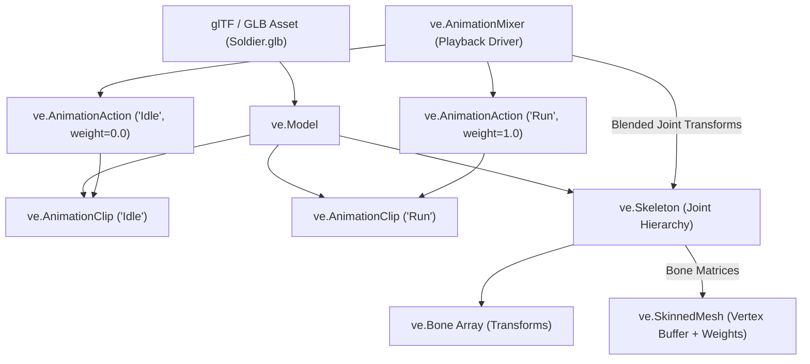

# Skeletal Animation (`VelocityEngine.animation`)

The skeletal animation subsystem provides glTF 2.0 joint hierarchy loading, inverse bind matrix propagation, multi-clip blending, smooth crossfading, and CPU linear blend skinning (LBS).

---

## Animation Pipeline Overview



---

## Classes

### `Bone`
Derived from `ve.Node3D`. Represents an individual joint in the skeletal tree. When child bones move, transformations propagate down the kinematic hierarchy.

#### Properties & Methods

| Property / Method | Type | Description |
|:---|:---|:---|
| `bone_index` | `int` | Joint index mapping into the `Skeleton` bone array. |
| `name` | `str` | Joint name from glTF node (e.g. `"mixamorig:RightHand"`). |
| `transform` | `ve.Transform` | Local position, quaternion rotation, and scale relative to parent bone. |
| `set_bone_index(index)` | Method | Assigns joint array index. |

---

### `Skeleton`
Manages an array of bones and computes skinning matrices:
$$\text{SkinMatrix}_i = \text{WorldMatrix}_{\text{bone}_i} \cdot \text{InverseBindMatrix}_i$$

#### Properties & Methods

| Property / Method | Type | Description |
|:---|:---|:---|
| `bones` | `list[ve.Bone]` | Array of all joints participating in the character rig. |
| `num_bones` | `int` | Total joint count. |
| `bone_matrices` | `list[ve.Mat4]` | Current active skinning matrices uploaded to shader/CPU. |
| `inverse_bind_matrices` | `list[ve.Mat4]` | Matrices transforming from model space to joint local space. |
| `update()` | Method | Recalculates all bone world transforms and skinning matrices. |
| `pose()` | Method | Resets all bones to their resting bind pose. |
| `get_bone_by_name(name)` | Method | Finds bone node by name. |
| `get_bone_by_index(idx)` | Method | Fast $O(1)$ indexed bone lookup. |

---

### `AnimationClip`
A reusable, immutable container of keyframe tracks representing a captured motion sequence (e.g., Walk, Run, Jump, Idle).

#### Properties & Methods

| Property / Method | Type | Description |
|:---|:---|:---|
| `name` | `str` | Identifier (e.g. `"Run"`). |
| `duration` | `float` | Total length of the animation sequence in seconds. |
| `tracks` | `list[ve.KeyframeTrack]` | Array of vector/quaternion translation, rotation, and scale tracks. |
| `add_track(track)` | Method | Appends a new animation channel track. |
| `find_track(name)` | Method | Searches for a track target by bone name. |

---

### `AnimationAction`
Controls the active playback state, speed, loop mode, and blend weight for a specific `AnimationClip`.

#### Properties

| Property | Type | Default | Description |
|:---|:---|:---:|:---|
| `clip` | `ve.AnimationClip` | Read-only | Target animation clip resource. |
| `name` | `str` | Read-only | Name of the animation clip. |
| `time` | `float` | `0.0` | Current playback timestamp in seconds. |
| `time_scale` | `float` | `1.0` | Playback speed multiplier ($1.0$ = normal, $2.0$ = 2x speed, $-1.0$ = reverse). |
| `weight` | `float` | `1.0` | Blend weight factor $[0.0, 1.0]$. Used to blend multiple animations. |
| `paused` | `bool` | `False` | True if playback is temporarily frozen. |
| `is_playing` | `bool` | Read-only | True if action is currently active. |
| `loop` | `bool` | `True` | Loop playback automatically when reaching clip duration. |

#### Methods

##### `play() -> ve.AnimationAction`
Starts or resumes playback from the current time.

##### `stop() -> ve.AnimationAction`
Stops playback and resets current time to zero.

##### `pause() -> ve.AnimationAction` / `resume() -> ve.AnimationAction`
Toggles pause without resetting timestamp.

##### `fade_in(duration: float) -> ve.AnimationAction`
Smoothly increases blend `weight` from $0.0$ to $1.0$ over `duration` seconds.

##### `fade_out(duration: float) -> ve.AnimationAction`
Smoothly decreases blend `weight` from $1.0$ to $0.0$ over `duration` seconds.

##### `crossfade_to(target_action: ve.AnimationAction, duration: float, warp: bool = False) -> ve.AnimationAction`
Fades out this action while simultaneously fading in `target_action` over `duration` seconds. If `warp=True`, synchronizes normalized relative time between clips.

##### `set_weight(weight: float) -> ve.AnimationAction`
Sets blend weight multiplier.

##### `set_time_scale(scale: float) -> ve.AnimationAction`
Sets playback speed.

---

### `AnimationMixer`
The master player coordinator. Drives time progression, evaluates tracks, interpolates keyframes, blends weighted poses, and applies result transforms to the target `Skeleton` or scene hierarchy.

```python
mixer = ve.AnimationMixer(root_node: ve.Node3D)
```

#### Key Methods

##### `clip_action(clip: ve.AnimationClip) -> ve.AnimationAction`
Creates or retrieves the cached `AnimationAction` associated with `clip`.

##### `get_action(name: str) -> Optional[ve.AnimationAction]`
Looks up an active action by clip name.

##### `update(dt: float) -> None`
Advances mixer timeline by `dt` seconds, evaluates all active actions, blends joint poses, and updates bone matrices.

##### `crossfade_to(from_action: ve.AnimationAction, to_action: ve.AnimationAction, duration: float) -> None`
High-level helper for smooth transition between two actions.

##### `stop_all_action() -> None`
Immediately halts all running actions.

---

## Complete Working Example

```python
import VelocityEngine as ve
from pathlib import Path

app = ve.App(title="Skeletal Animation & Crossfading", width=1280, height=720)
app.camera.set_position(0.0, 2.5, 5.0)
app.camera.look_at(ve.Vec3(0.0, 1.2, 0.0))

app.scene.set_sun(direction=(-1.0, -2.0, -1.0), color=ve.WARM_WHITE, intensity=2.0)
grid = app.scene.create_grid(size=20.0, step=1.0)

# 1. Load rigged character model (Soldier.glb)
soldier_path = str(Path(__file__).resolve().parent.parent / "assets" / "Soldier.glb")
soldier_model = app.scene.load_model(soldier_path)

# 2. Setup AnimationMixer from model
# Model automatically initializes AnimationMixer with all embedded glTF clips
mixer = soldier_model.mixer
idle_clip = soldier_model.get_clip_by_name("Idle")
run_clip = soldier_model.get_clip_by_name("Run")

action_idle = mixer.clip_action(idle_clip)
action_run = mixer.clip_action(run_clip)

# Start in Idle
action_idle.play()
is_running = False

# 3. Dynamic transition on Key press (SPACE to toggle run)
@app.on_update
def on_frame(dt: float) -> None:
    nonlocal is_running
    
    # Check space key trigger
    if app.input.is_key_pressed(ve.Key.SPACE):
        is_running = not is_running
        if is_running:
            action_idle.crossfade_to(action_run, duration=0.35)
            action_run.play()
        else:
            action_run.crossfade_to(action_idle, duration=0.35)
            action_idle.play()
            
    # Advance mixer timeline
    mixer.update(dt)
    
    # Display HUD status
    current_state = "RUNNING" if is_running else "IDLE"
    app.hud_title = f"State: {current_state} (Press SPACE to toggle)"

if __name__ == "__main__":
    app.run()
```
