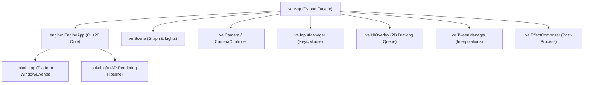

# Application & Windowing (`VelocityEngine.app`)

The `app` module provides the primary high-level lifecycle orchestrator and windowing facade for the Velocity 3D Engine. It encapsulates the native Sokol GFX context, platform event loop, camera management, input routing, UI overlay dispatch, audio system, and frame delta time timing.

---

## Architecture Overview



---

## Classes & Enums

### `Mode`
Defines the engine execution mode.

```python
import VelocityEngine as ve

mode = ve.Mode.GAME
```

| Member | Value | Description |
|:---|:---:|:---|
| `Mode.GAME` | `0` | Standard runtime game mode. Mouse capture and game scripts are active. |
| `Mode.EDITOR` | `1` | Visual editor mode. Dear ImGui hierarchy, scene inspect panels, and 3D transform gizmos are active. |

---

### `WindowConfig`
Low-level C++ window creation configuration structure.

| Field | Type | Default | Description |
|:---|:---|:---|:---|
| `title` | `str` | `"VelocityEngine v0.2-beta"` | Window title bar text |
| `width` | `int` | `1280` | Client viewport width in pixels |
| `height` | `int` | `720` | Client viewport height in pixels |
| `clear_color` | `tuple[float, float, float, float]` | `(0.431, 0.627, 0.824, 1.0)` | Viewport background clear color (RGBA) |
| `vsync` | `bool` | `True` | Vertical synchronization toggle |

---

### `App`
The master application controller for creating, configuring, and executing 3D applications.

```python
app = ve.App(
    title: str = "VelocityEngine v0.2-beta",
    width: int = 1280,
    height: int = 720,
    mode: Optional[ve.Mode] = None,
    clear_color: Optional[Union[Sequence[float], str, ve.Color]] = None,
    target_fps: int = 0,
    show_crosshair: bool = True,
    vsync: bool = True
)
```

#### Constructor Parameters

| Parameter | Type | Default | Description |
|:---|:---|:---|:---|
| `title` | `str` | `"VelocityEngine v0.2-beta"` | OS window title bar caption. |
| `width` | `int` | `1280` | Window client area width in pixels. |
| `height` | `int` | `720` | Window client area height in pixels. |
| `mode` | `ve.Mode` | `ve.Mode.GAME` | Initial execution mode (`GAME` or `EDITOR`). |
| `clear_color` | `Color / tuple / str` | `None` | Background fill color (hex `#RRGGBB`, RGBA tuple, or `ve.Color`). |
| `target_fps` | `int` | `0` | Frame rate limiter cap. `0` disables capping. |
| `show_crosshair` | `bool` | `True` | Toggles standard HUD center crosshair. |
| `vsync` | `bool` | `True` | Hardware vertical synchronization. |

#### Properties

| Property | Type | Access | Description |
|:---|:---|:---:|:---|
| `scene` | `ve.Scene` | Read-only | Active 3D scene holding entities, meshes, and lights. |
| `camera` | `ve.Camera / Controller` | Read/Write | Active perspective/orthographic camera or attached controller. |
| `camera_controller` | `Any` | Read/Write | Active camera navigation controller (`OrbitController`, `FirstPersonController`, etc.). |
| `ui` / `overlay` | `ve.UIOverlay` | Read-only | 2D immediate-mode HUD draw command queue. |
| `tweens` | `ve.TweenManager` | Read-only | Active tween interpolation manager. |
| `input` | `ve.InputManager` | Read-only | Keyboard and mouse query subsystem. |
| `audio` | `ve.AudioManager` | Read-only | miniaudio-powered spatial sound manager. |
| `editor` | `ve.EditorManager` | Read-only | ImGui scene hierarchy and gizmo manager. |
| `mode` | `ve.Mode` | Read/Write | Current execution mode (`ve.Mode.GAME` or `ve.Mode.EDITOR`). |
| `is_running` | `bool` | Read-only | `True` if application loop is currently executing. |
| `stats` | `ve.RenderStats` | Read-only | Diagnostics: `draw_calls`, `vertices`, `triangles`, `culled_entities`. |
| `width` | `int` | Read-only | Current viewport width in pixels. |
| `height` | `int` | Read-only | Current viewport height in pixels. |
| `title` | `str` | Read-only | Window title string. |
| `fps` | `float` | Read-only | Smoothed real-time frames per second. |
| `frame_time_ms` | `float` | Read-only | Smoothed frame duration in milliseconds. |
| `vsync` | `bool` | Read/Write | VSync hardware synchronization state. |
| `target_fps` | `int` | Read/Write | Target frame rate limit (0 for uncapped). |
| `fog` | `Optional[Union[ve.Fog, ve.FogExp2]]` | Read/Write | Atmospheric depth distance fog. |
| `composer` | `ve.EffectComposer` | Read/Write | Active post-processing pipeline composer. |
| `tone_mapping` | `bool` | Read/Write | Enable ACES filmic tonemapping. |
| `show_crosshair` | `bool` | Read/Write | Toggle center viewport crosshair overlay. |
| `show_hud` | `bool` | Read/Write | Toggle HUD text rendering. |
| `hud_title` | `str` | Read/Write | Header text displayed in the HUD. |
| `hud_score` | `int` | Read/Write | Score integer value displayed in the HUD. |
| `hud_hint` | `str` | Read/Write | Bottom hint message displayed in the HUD. |
| `debug_hitboxes` | `bool` | Read/Write | Render wireframe bounding boxes (AABB/OBB). |

#### Methods

##### `run()`
```python
def run(self) -> None
```
Launches the Sokol native event loop and opens the platform window. This method blocks the calling thread until the window is closed or `app.close()` is invoked.

##### `close()`
```python
def close(self) -> None
```
Requests immediate termination of the application loop and frees GPU and audio resources.

##### `on_update(func: Callable[[float], None]) -> Callable`
Decorator for registering a per-frame update callback. The wrapped function receives `dt` (elapsed delta time in seconds).

```python
@app.on_update
def update(dt: float) -> None:
    cube.transform.rotation.y += 1.5 * dt
```

##### `on_click(func: Callable[[ve.RaycastHit], None]) -> Callable`
Registers a callback invoked when the user clicks the left mouse button. Performs an automatic screen-to-world raycast and passes the `ve.RaycastHit` to the handler.

##### `on_hover(func: Callable[[ve.RaycastHit], None]) -> Callable`
Registers a callback invoked every frame the mouse moves, passing the raycast result under the cursor.

##### `set_clear_color(r: float, g: float, b: float, a: float = 1.0) -> None`
Sets the viewport background color.

##### `set_mouse_locked(locked: bool) -> None`
Locks the mouse cursor to the center of the window and hides it for first-person camera control.

##### `load_texture(filepath: str) -> ve.Texture`
Loads an image file (`.png`, `.jpg`, `.bmp`, `.tga`) into a GPU texture.

##### `create_checkerboard_texture(width: int = 64, height: int = 64, tile_size: int = 8) -> ve.Texture`
Generates a procedural black-and-white checkerboard texture on the GPU.

##### `render_target(scene: ve.Scene, camera: ve.Camera, target: ve.RenderTarget) -> None`
Renders an offscreen scene pass into an explicit `RenderTarget` texture buffer.

---

## Complete Working Example

```python
import VelocityEngine as ve

# 1. Initialize the application window
app = ve.App(
    title="Velocity Engine - App Reference Demo",
    width=1280,
    height=720,
    clear_color=(0.1, 0.12, 0.15, 1.0),
    vsync=True,
    target_fps=60
)

# 2. Configure camera
app.camera.set_position(0.0, 3.0, 6.0)
app.camera.look_at(ve.Vec3(0.0, 0.0, 0.0))

# 3. Add light and rotating entity
app.scene.set_ambient_light(ve.Vec3(0.1, 0.1, 0.15))
sun = ve.DirectionalLight(
    direction=ve.Vec3(-1.0, -2.0, -1.0),
    color=ve.Vec3(1.0, 0.95, 0.8),
    intensity=2.0
)
app.scene.add_light(sun)

mat = ve.StandardMaterial()
mat.base_color = ve.Vec4(0.2, 0.7, 0.9, 1.0)
mat.roughness = 0.3
mat.metallic = 0.8

mesh = ve.Mesh.create_cube(size=1.5)
box = ve.Entity(mesh=mesh, material=mat)
app.scene.add_entity(box)

# 4. Attach per-frame update logic
@app.on_update
def on_frame(dt: float) -> None:
    box.transform.rotation.y += 1.0 * dt
    box.transform.rotation.x += 0.5 * dt
    app.hud_hint = f"FPS: {app.fps:.1f} | Draw Calls: {app.stats.draw_calls}"

# 5. Start the engine loop
if __name__ == "__main__":
    app.run()
```
