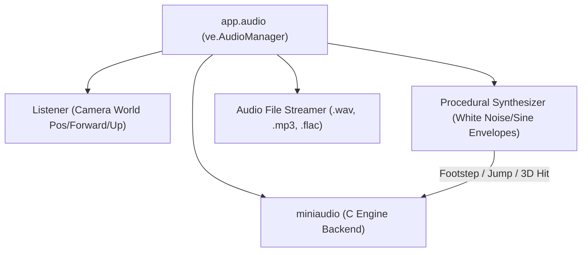

# Audio System (`VelocityEngine.audio`)

The audio subsystem provides 3D spatial attenuation, dynamic listener orientation, procedural sound effect synthesis, and audio file streaming powered by `miniaudio`.

---

## Audio Architecture Overview



---

## Classes

### `AudioManager`
Manages the hardware audio output device, listener head tracking in 3D world space, and sound playback channels.

Accessible directly via `app.audio`.

```python
import VelocityEngine as ve

audio = app.audio
```

#### Lifecycle Methods

| Method | Return Type | Description |
|:---|:---:|:---|
| `init()` | `bool` | Initializes the low-level audio device. Automatically called on engine startup. |
| `shutdown()` | `None` | Closes audio device threads and frees sound buffers. |
| `is_initialized()` | `bool` | Returns `True` if an active audio playback device is open. |

#### Listener Tracking

##### `update_listener(position: ve.Vec3, forward: ve.Vec3, up: ve.Vec3) -> None`
Updates the spatial listener's 3D position and orientation vectors in world space.

> [!NOTE]
> The engine automatically synchronizes the audio listener with the active `app.camera` every frame. Manual calls are only needed for custom multi-listener or split-screen audio configurations.

#### Sound Playback Methods

##### `play_footstep() -> None`
Synthesizes a short, low-frequency contact impulse representing a player or character footstep. Used by `FirstPersonController` during ground traversal.

##### `play_jump() -> None`
Synthesizes an upward pitch-modulated whoosh impulse representing a jump takeoff.

##### `play_hit_3d(world_pos: Union[ve.Vec3, tuple[float, float, float]]) -> None`
Plays a 3D localized impact sound at `world_pos`. Spatial panning and distance attenuation are calculated automatically based on the listener's relative distance and orientation.

##### `play_sound_file(filepath: str, volume: float = 1.0) -> None`
Loads and plays an external audio file (`.wav`, `.mp3`, `.flac`, `.ogg`).
- `filepath`: Relative or absolute path to audio asset.
- `volume`: Gain factor ($1.0$ = standard volume, $0.0$ = silent, $2.0$ = double gain).

---

## Complete Working Example

```python
import VelocityEngine as ve

app = ve.App(title="Spatial 3D Audio Demo", width=1280, height=720)
app.camera.set_position(0.0, 3.0, 8.0)
app.camera.look_at(ve.Vec3(0.0, 1.0, 0.0))

app.scene.set_sun(direction=(-1.0, -2.0, -1.0), intensity=2.0)
app.scene.create_grid(size=20.0, step=1.0)

# 1. Target bell entity
bell_mat = ve.StandardMaterial()
bell_mat.gold()
bell = ve.Entity(mesh=ve.Mesh.create_sphere(radius=0.6), material=bell_mat)
bell.set_position(2.0, 1.5, 0.0)
bell.has_collision = True
app.scene.add_entity(bell)

# 2. Left-click to shoot ray and play 3D localized sound at impact point
@app.on_click
def on_user_click(hit: ve.RaycastHit) -> None:
    if hit.hit:
        # Trigger spatial 3D audio at exact world hit location
        app.audio.play_hit_3d(hit.point)
        # Visual pulse effect
        bell.animate_scale(ve.Vec3(1.3, 1.3, 1.3), duration=0.1, easing=ve.out_quad)
        app.tweens.to(bell.transform.scale, {"x": 1.0, "y": 1.0, "z": 1.0}, duration=0.3, easing=ve.out_bounce)
        app.hud_hint = f"Hit bell at ({hit.point.x:.2f}, {hit.point.y:.2f}, {hit.point.z:.2f})!"

@app.on_update
def on_frame(dt: float) -> None:
    # Trigger jump sound when Space is pressed
    if app.input.is_key_pressed(ve.Key.SPACE):
        app.audio.play_jump()
        app.hud_hint = "Jump sound triggered!"

if __name__ == "__main__":
    app.run()
```
