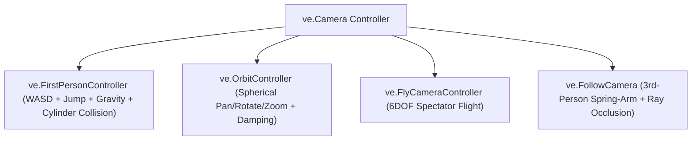

# Camera Controllers (`VelocityEngine.controllers`)

The controllers module provides ready-to-use navigation rigs for first-person gameplay, CAD/inspector model viewing, 6DOF spectator flight, and third-person spring-arm character tracking.

---

## Controllers Taxonomy



---

## Classes

### `FirstPersonController`
A full-featured first-person player character controller featuring physics sub-stepping, gravity, jumping, stair-stepping, minimum translation vector (MTV) cylinder-AABB collision depenetration, and spatial footstep audio cues.

```python
controller = ve.FirstPersonController(
    camera: ve.Camera,
    input_manager: ve.InputManager,
    scene: Optional[ve.Scene] = None,
    audio: Optional[ve.AudioManager] = None,
    move_speed: float = 5.0,
    mouse_sensitivity: float = 0.14,
    gravity: float = 16.0,
    jump_speed: float = 6.0,
    player_height: float = 1.7,
    player_radius: float = 0.35,
    step_height: float = 0.20
)
```

#### Constructor Parameters & Tuning Properties

| Parameter | Type | Default | Description |
|:---|:---|:---:|:---|
| `camera` | `ve.Camera` | *Required* | Active perspective camera manipulated by the controller. |
| `input_manager` | `ve.InputManager` | *Required* | Keyboard and mouse query subsystem (`app.input`). |
| `scene` | `Optional[ve.Scene]` | `None` | Scene used to query entity collision boxes (`app.scene`). |
| `audio` | `Optional[ve.AudioManager]` | `None` | Audio manager for automatic footstep and jump playback. |
| `move_speed` | `float` | `5.0` | Maximum ground traversal velocity in meters/second. |
| `mouse_sensitivity`| `float` | `0.14` | Mouse look angular multiplier (degrees per pixel). |
| `gravity` | `float` | `16.0` | Downward vertical acceleration ($m/s^2$). |
| `jump_speed` | `float` | `6.0` | Initial upward impulse velocity when jumping ($m/s$). |
| `player_height` | `float` | `1.7` | Eye height of the player cylinder in meters. |
| `player_radius` | `float` | `0.35` | Radius of the collision cylinder in meters. |
| `step_height` | `float` | `0.20` | Maximum obstacle elevation player can step up without jumping. |

#### State Properties

| Property | Type | Description |
|:---|:---|:---|
| `is_grounded` | `bool` | `True` when standing firmly on a floor surface or entity AABB. |
| `velocity_y` | `float` | Current vertical speed ($m/s$). |
| `enabled` | `bool` | Toggles input processing and motion updates. |
| `custom_colliders`| `list[ve.AABB]` | List of explicit obstacle bounding boxes checked during physics sub-steps. |

---

### `OrbitController`
Three.js-style spherical coordinate orbit rig designed for inspecting 3D models, CAD assets, and scene compositions.

```python
orbit = ve.OrbitController(
    camera: Optional[ve.Camera] = None,
    target: Sequence[float] = (0.0, 0.0, 0.0),
    distance: float = 5.0,
    min_distance: float = 0.5,
    max_distance: float = 500.0,
    yaw: float = -90.0,
    pitch: float = 20.0,
    min_pitch: float = -89.0,
    max_pitch: float = 89.0,
    damping: float = 0.1,
    rotate_speed: float = 0.3,
    zoom_speed: float = 1.0,
    pan_speed: float = 0.005
)
app.camera = orbit
```

#### Interaction Controls

| Mouse Action | Operation |
|:---|:---|
| **Left Click + Drag** | Orbit around the `target` point (yaw / pitch). |
| **Right Click + Drag** / **Middle Click + Drag** | Pan the `target` point perpendicular to view axis. |
| **Mouse Scroll Wheel** | Zoom in / out smoothly within `[min_distance, max_distance]`. |

#### Tuning Properties

| Property | Type | Default | Description |
|:---|:---|:---:|:---|
| `target` | `tuple[float, float, float]` | `(0, 0, 0)` | 3D coordinate point the camera orbits around. |
| `distance` | `float` | `5.0` | Distance between camera eye and target. |
| `damping` | `float` | `0.1` | Inertial smoothing coefficient ($0.0$ for instant snapping). |
| `min_pitch` / `max_pitch` | `float` | `-89.0 / 89.0` | Vertical orbit angle limits (prevents gimbal flip). |
| `rotate_speed` | `float` | `0.3` | Rotation responsiveness. |
| `zoom_speed` | `float` | `1.0` | Scroll sensitivity. |

---

### `FlyCameraController`
Unconstrained 6-degrees-of-freedom spectator flight camera.

```python
fly = ve.FlyCameraController(
    camera: Optional[ve.Camera] = None,
    input_manager: Optional[ve.InputManager] = None,
    app: Optional[ve.App] = None,
    move_speed: float = 8.0,
    mouse_sensitivity: float = 0.12,
    auto_lock_on_click: bool = True
)
app.camera = fly
```

#### Key Controls

- **W / A / S / D**: Translate forward, left, backward, right.
- **Space**: Ascend vertically ($+Y$).
- **Left Shift**: Descend vertically ($-Y$).
- **Left Click**: Lock mouse cursor to window center for free look.
- **Escape / Tab**: Release mouse cursor to return to system cursor.

---

### `FollowCamera`
Third-person spring-arm follow camera that smoothly tracks a moving game entity while damping jitter and avoiding geometry occlusion via raycasting.

```python
follow = ve.FollowCamera(
    camera: Optional[ve.Camera] = None,
    target_entity: Optional[ve.Entity] = None,
    offset: Sequence[float] = (0.0, 3.0, 6.0),
    look_at_offset: Sequence[float] = (0.0, 1.2, 0.0),
    spring_arm_length: float = 6.0,
    stiffness: float = 12.0,
    damping: float = 0.85,
    min_arm_length: float = 0.5,
    max_arm_length: float = 50.0,
    scene: Optional[ve.Scene] = None
)
app.camera = follow
```

#### Tuning Properties

| Property | Type | Default | Description |
|:---|:---|:---:|:---|
| `offset` | `tuple` | `(0, 3, 6)` | Rest position offset relative to target entity. |
| `look_at_offset` | `tuple` | `(0, 1.2, 0)` | Target focus point offset (e.g. character head/torso). |
| `stiffness` | `float` | `12.0` | Spring constant pulling camera towards target offset. |
| `damping` | `float` | `0.85` | Oscillation damping coefficient preventing overshooting. |

---

## Complete Working Example

```python
import VelocityEngine as ve

app = ve.App(title="First-Person Controller Sandbox", width=1280, height=720)

# 1. Environment & Obstacles
ground = app.scene.create_plane(size=40.0, uv_tiling=10.0)
app.scene.set_sun(direction=(-1.0, -2.0, -1.0), color=ve.WARM_WHITE, intensity=2.0)

# Build a series of obstacle boxes to test collision depenetration
box_mat = ve.StandardMaterial()
box_mat.base_color = ve.Vec4(0.8, 0.3, 0.2, 1.0)
for x in [-4.0, 0.0, 4.0]:
    b = ve.Entity(mesh=ve.Mesh.create_box(width=1.5, height=2.0, depth=1.5), material=box_mat)
    b.set_position(x, 1.0, -5.0)
    b.has_collision = True # Register for controller collision
    app.scene.add_entity(b)

# 2. Attach FirstPersonController to App
fps_ctrl = ve.FirstPersonController(
    camera=app.camera,
    input_manager=app.input,
    scene=app.scene,
    audio=app.audio,
    move_speed=6.0,
    mouse_sensitivity=0.14,
    gravity=18.0,
    jump_speed=6.5,
    player_height=1.8,
    player_radius=0.4
)
app.camera = fps_ctrl
app.set_mouse_locked(True)

@app.on_update
def on_frame(dt: float) -> None:
    # Toggle mouse lock with Escape
    if app.input.is_key_pressed(ve.Key.ESCAPE):
        app.set_mouse_locked(not app.is_mouse_locked())
        
    app.hud_hint = f"WASD Move | Space Jump | Grounded: {fps_ctrl.is_grounded}"

if __name__ == "__main__":
    app.run()
```
