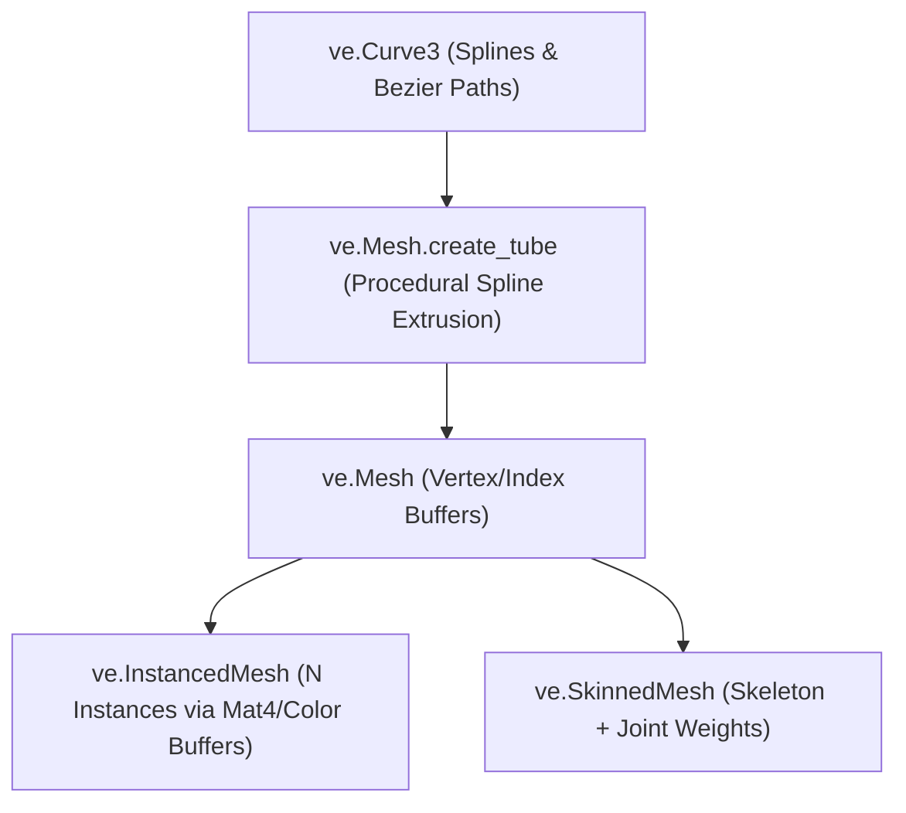

# Geometry & Meshes (`VelocityEngine.geometry`)

The geometry module provides procedural primitives, custom polygon buffers, high-throughput GPU instancing (`InstancedMesh`), skeletal characters (`SkinnedMesh`), and 3D parametric splines (`CatmullRomCurve3`, `CubicBezierCurve3`).

---

## Architecture Overview



---

## Classes

### `Mesh`
Represents an index-driven 3D polygon surface composed of vertex attributes (`position`, `normal`, `uv`, `tangent`, `color`, `joints`, `weights`).

#### Procedural Factory Methods

```python
import VelocityEngine as ve

# Box and Primitives
box = ve.Mesh.create_box(width=2.0, height=1.0, depth=0.5)
cube = ve.Mesh.create_cube(size=1.0)
sphere = ve.Mesh.create_sphere(radius=1.0, rings=32, sectors=32)
cylinder = ve.Mesh.create_cylinder(radius=0.5, height=2.0, segments=32, capped=True)
capsule = ve.Mesh.create_capsule(radius=0.5, height=2.0, rings=16, sectors=32)
cone = ve.Mesh.create_cone(radius=1.0, height=2.0, segments=32)
plane = ve.Mesh.create_plane(width=10.0, height=10.0, sub_x=10, sub_y=10)
circle = ve.Mesh.create_circle(radius=1.0, segments=32)
ring = ve.Mesh.create_ring(inner_radius=0.5, outer_radius=1.0, segments=32)
torus = ve.Mesh.create_torus(radius=1.0, tube=0.3, radial_segments=16, tubular_segments=32)
knot = ve.Mesh.create_torus_knot(radius=1.0, tube=0.3, tubular_segments=64, radial_segments=16, p=2, q=3)

# Platonic Solids
tetra = ve.Mesh.create_tetrahedron(radius=1.0)
octa = ve.Mesh.create_octahedron(radius=1.0)
dodeca = ve.Mesh.create_dodecahedron(radius=1.0)
icosa = ve.Mesh.create_icosahedron(radius=1.0)
```

#### NumPy Buffer Integration & Procedural Wave Deformations

```python
import numpy as np

# Create mesh from NumPy arrays
# Structured array with position (3f), normal (3f), uv (2f), color (4f)
vertices = np.zeros(1000, dtype=ve.Vertex.dtype)
indices = np.array([0, 1, 2, 2, 3, 0], dtype=np.uint32)

mesh = ve.Mesh.from_numpy(vertices, indices)
mesh.mark_dynamic()

# In update loop: high-speed CPU-to-GPU dynamic buffer upload
mesh.update_vertices_from_numpy(modified_vertices)
```

#### Static File Loaders

| Method | Supported Format | Description |
|:---|:---:|:---|
| `ve.Mesh.load_obj(filepath)` | Wavefront `.obj` | Loads polygonal geometry, normals, and texture coordinates. |
| `ve.Mesh.load_stl(filepath)` | StereoLithography `.stl` | Loads binary and ASCII CAD/3D print meshes. |
| `ve.Mesh.load_ply(filepath)` | Stanford Triangle `.ply` | Loads point clouds and polygonal PLY data. |

#### Properties

| Property | Type | Access | Description |
|:---|:---|:---:|:---|
| `num_vertices` | `int` | Read-only | Total count of vertices in buffer. |
| `num_indices` | `int` | Read-only | Total count of triangle indices. |
| `aabb` | `ve.AABB` | Read-only | Axis-Aligned Bounding Box. |
| `is_dynamic` | `bool` | Read-only | `True` if created with dynamic GPU buffer usage flags. |
| `vbuf_id` | `int` | Read-only | Sokol GFX vertex buffer handle ID. |
| `ibuf_id` | `int` | Read-only | Sokol GFX index buffer handle ID. |

---

### `InstancedMesh`
High-throughput instancing pipeline. Capable of drawing up to 100,000+ instances of the same base `Mesh` in a single GPU draw call using a dynamic instance buffer of 4x4 transform matrices and tint colors.

```python
instanced_mesh = ve.InstancedMesh(base_mesh: ve.Mesh, count: int)
```

#### Methods

##### `set_matrix_at(index: int, matrix: ve.Mat4) -> None`
Assigns the 4x4 world transform matrix for instance `index`.

##### `set_color_at(index: int, color: ve.Vec4) -> None`
Assigns the RGBA color tint multiplier for instance `index`.

##### `set_instance(index: int, matrix: ve.Mat4, color: ve.Vec4) -> None`
Atomically assigns both transform matrix and color tint.

##### `ensure_gpu_buffers() -> None`
Uploads dirty instance buffers to the GPU. Automatically called before rendering.

---

### `SkinnedMesh`
Rigged character surface driven by a hierarchical `Skeleton` and glTF joint influences.

#### Methods & Properties

| Method / Property | Type | Description |
|:---|:---|:---|
| `bind(skeleton, bind_matrix)` | Method | Binds skeleton bones and establishes inverse bind matrices. |
| `pose()` | Method | Resets all joints back to their bind resting pose. |
| `compute_cpu_skinning()` | Method | Computes linear blend skinning (LBS) on CPU vertex buffers. |
| `skeleton` | `ve.Skeleton` | Associated joint hierarchy. |
| `material` | `ve.Material` | Shading material applied to the character skin. |

---

### Parametric Curves & Splines

#### `CatmullRomCurve3`
Smooth, interpolating cubic Hermite spline passing through a series of control points.

```python
curve = ve.CatmullRomCurve3(
    points: list[ve.Vec3],
    closed: bool = False,
    curve_type: str = "centripetal", # "centripetal", "chordal", "catmullrom"
    tension: float = 0.5
)
```

#### `CubicBezierCurve3`
Cubic 3D Bézier curve with start point, end point, and two control handles.

```python
bezier = ve.CubicBezierCurve3(
    v0: ve.Vec3, # Start
    v1: ve.Vec3, # Control 1
    v2: ve.Vec3, # Control 2
    v3: ve.Vec3  # End
)
```

#### Curve Common Methods

| Method | Return Type | Description |
|:---|:---|:---|
| `get_point(t: float)` | `ve.Vec3` | Returns point along the curve for $t \in [0.0, 1.0]$. |
| `get_tangent(t: float)` | `ve.Vec3` | Returns normalized velocity tangent vector at $t$. |
| `get_points(divisions: int)` | `list[ve.Vec3]` | Samples curve uniformly into $N$ line segments. |
| `get_length()` | `float` | Returns total arc length of the spline. |

#### Spline Geometry Generation

##### `Mesh.create_tube(curve, tubular_segments=64, radius=0.2, radial_segments=8, closed=False)`
Extrudes a circular tube profile along any 3D curve to build procedural pipes, rollercoaster rails, cables, and tree trunks.

---

## Complete Working Example

```python
import VelocityEngine as ve
import math

app = ve.App(title="Geometry & Instanced Spline Demo", width=1280, height=720)
app.camera.set_position(0.0, 12.0, 20.0)
app.camera.look_at(ve.Vec3(0.0, 0.0, 0.0))

app.scene.set_sun(direction=(-1.0, -2.0, -1.0), color=ve.WARM_WHITE, intensity=2.0)

# 1. Procedural CatmullRom Rollercoaster Spline
points = [
    ve.Vec3(-10.0, 0.0, -10.0),
    ve.Vec3(-5.0, 4.0, 0.0),
    ve.Vec3(0.0, 1.0, 8.0),
    ve.Vec3(6.0, 5.0, 4.0),
    ve.Vec3(10.0, 0.0, -8.0),
]
spline = ve.CatmullRomCurve3(points, closed=True)

# Generate Tube mesh along spline
tube_mesh = ve.Mesh.create_tube(spline, tubular_segments=128, radius=0.35, radial_segments=12, closed=True)
tube_mat = ve.StandardMaterial()
tube_mat.base_color = ve.Vec4(0.8, 0.2, 0.2, 1.0)
tube_mat.metallic = 0.9
tube_mat.roughness = 0.2

rail_entity = ve.Entity(mesh=tube_mesh, material=tube_mat)
app.scene.add_entity(rail_entity)

# 2. Instanced Mesh: 500 decorative crystals
base_crystal = ve.Mesh.create_octahedron(radius=0.4)
instanced = ve.InstancedMesh(base_crystal, count=500)

for i in range(500):
    t = i / 500.0
    pos = spline.get_point(t)
    # Offset radially
    angle = i * 0.5
    offset_x = math.cos(angle) * 1.5
    offset_y = math.sin(angle) * 1.5
    
    mat = ve.Mat4.translation(pos.x + offset_x, pos.y + offset_y, pos.z)
    color = ve.Vec4(0.2 + 0.8 * t, 0.8 * (1.0 - t), 1.0, 1.0)
    instanced.set_instance(i, mat, color)

app.scene.add_instanced_mesh(instanced)

# 3. Animate cart along the track
cart_entity = app.scene.create_box(size=(0.8, 0.5, 1.2), color=ve.YELLOW)
current_t = 0.0

@app.on_update
def on_frame(dt: float) -> None:
    nonlocal current_t
    current_t = (current_t + 0.15 * dt) % 1.0
    cart_pos = spline.get_point(current_t)
    cart_tangent = spline.get_tangent(current_t)
    
    cart_entity.set_position(cart_pos.x, cart_pos.y + 0.4, cart_pos.z)

if __name__ == "__main__":
    app.run()
```
