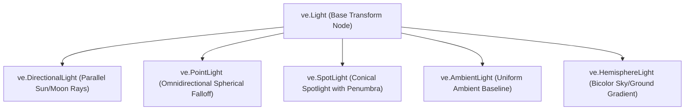

# Illumination & Lighting (`VelocityEngine.lights`)

The lighting subsystem provides dynamic light emitters for PBR and Blinn-Phong shading pipelines, shadow map generation, and atmospheric irradiance models.

---

## Lighting Architecture Overview



---

## Classes & Enums

### `LightType`
```python
import VelocityEngine as ve

LightType.Directional
LightType.Point
LightType.Spot
LightType.Ambient
LightType.Hemisphere
```

---

### `Light` (Base Class)
Base light node derived from `ve.Node3D`. Inherits spatial transforms (`position`, `rotation`, `scale`), hierarchical parenting, and tag queries.

#### Common Properties

| Property | Type | Default | Description |
|:---|:---|:---:|:---|
| `color` | `ve.Vec3` | `(1, 1, 1)` | Linear RGB emission color. |
| `intensity` | `float` | `1.0` | Brightness multiplier. |
| `cast_shadows` | `bool` | `False` | Enables shadow map rasterization pass. |
| `visible` | `bool` | `True` | Toggles whether this light affects scene shading. |
| `type` | `ve.LightType` | Read-only | Identification enum for shader dispatch. |

---

### `DirectionalLight`
Simulates an infinitely distant light source emitting parallel rays (such as the Sun or Moon).

```python
sun = ve.DirectionalLight(
    color: ve.Vec3 = ve.Vec3(1.0, 1.0, 1.0),
    intensity: float = 1.0,
    direction: ve.Vec3 = ve.Vec3(0.0, -1.0, 0.0)
)
```

#### Key Properties & Methods

| Property / Method | Type | Description |
|:---|:---|:---|
| `direction` | `ve.Vec3` | Orientation vector pointing towards the scene surface. |
| `cast_shadow` / `cast_shadows` | `bool` | Enables orthographic shadow map cascade rendering. |
| `set_direction(x, y, z)` | Method | Sets light propagation direction vector. |

---

### `PointLight`
Omnidirectional point emitter radiating light uniformly in all directions from its 3D position with inverse-square physical distance attenuation.

```python
bulb = ve.PointLight(
    color: ve.Vec3 = ve.Vec3(1.0, 0.9, 0.7),
    intensity: float = 2.0,
    range: float = 15.0,
    decay: float = 2.0
)
```

#### Key Properties

| Property | Type | Default | Description |
|:---|:---|:---:|:---|
| `range` | `float` | `10.0` | Maximum illumination cutoff radius. Beyond this distance, attenuation reaches zero. |
| `decay` | `float` | `2.0` | Attenuation exponent ($2.0$ represents physically accurate inverse-square falloff). |

---

### `SpotLight`
Conical light source originating from a 3D position and shining along a direction vector, bounded by an inner hot spot and outer penumbra cone.

```python
spot = ve.SpotLight(
    color: ve.Vec3 = ve.Vec3(1.0, 1.0, 1.0),
    intensity: float = 3.0,
    range: float = 20.0,
    inner_cone_angle: float = 0.35, # ~20 degrees (hotspot)
    outer_cone_angle: float = 0.52, # ~30 degrees (falloff boundary)
    direction: ve.Vec3 = ve.Vec3(0.0, -1.0, 0.0)
)
```

#### Key Properties & Methods

| Property / Method | Type | Description |
|:---|:---|:---|
| `inner_cone_angle` | `float` | Inner beam angle (radians) with full intensity. |
| `outer_cone_angle` | `float` | Outer cone cutoff boundary (radians). |
| `penumbra` | `float` | Smooth transition factor between inner and outer cones $[0.0, 1.0]$. |
| `set_cone_angles(inner, outer)` | Method | Sets inner and outer angle thresholds simultaneously. |

---

### `AmbientLight`
Uniform non-directional baseline radiance applied identically to all surfaces regardless of normal orientation.

```python
ambient = ve.AmbientLight(
    color: ve.Vec3 = ve.Vec3(0.1, 0.1, 0.15),
    intensity: float = 0.4
)
```

---

### `HemisphereLight`
Natural outdoor ambient model interpolating between a top sky color and a bottom ground reflection color based on surface normal orientation:
$$\text{Color} = \text{sky\_color} \cdot \left(\frac{N_y + 1}{2}\right) + \text{ground\_color} \cdot \left(1 - \frac{N_y + 1}{2}\right)$$

```python
hemi = ve.HemisphereLight(
    sky_color: ve.Vec3 = ve.Vec3(0.4, 0.6, 0.9),   # Sky blue
    ground_color: ve.Vec3 = ve.Vec3(0.2, 0.15, 0.1),# Warm earth brown
    intensity: float = 0.8
)
```

#### Key Properties

| Property | Type | Description |
|:---|:---|:---|
| `sky_color` | `ve.Vec3` | Radiance received by surfaces with upward-facing normals ($+Y$). |
| `ground_color` | `ve.Vec3` | Radiance received by surfaces with downward-facing normals ($-Y$). |

---

### Debug Light Helpers
Velocity provides visual wireframe gizmos to preview light positions, directions, and ranges inside the viewport:
- `ve.DirectionalLightHelper(light, size=1.0, color=ve.YELLOW)`
- `ve.PointLightHelper(light, sphere_size=0.5, color=ve.WHITE)`
- `ve.SpotLightHelper(light, color=ve.CYAN)`

```python
helper = ve.PointLightHelper(bulb, sphere_size=0.3)
app.scene.add(helper)
```

---

## Complete Working Example

```python
import VelocityEngine as ve
import math

app = ve.App(title="Dynamic Multi-Light Arena", width=1280, height=720)
app.camera.set_position(0.0, 6.0, 12.0)
app.camera.look_at(ve.Vec3(0.0, 1.0, 0.0))

# 1. Ground Plane
ground_mat = ve.StandardMaterial()
ground_mat.roughness = 0.2
ground_mat.metallic = 0.1
ground = app.scene.create_plane(size=30.0, uv_tiling=10.0, material=ground_mat)

# 2. Hemisphere ambient fill
hemi = ve.HemisphereLight(
    sky_color=ve.Vec3(0.1, 0.15, 0.3),
    ground_color=ve.Vec3(0.05, 0.04, 0.02),
    intensity=0.5
)
app.scene.add_light(hemi)

# 3. Overhead SpotLight
spot = ve.SpotLight(
    color=ve.Vec3(1.0, 0.9, 0.7),
    intensity=4.0,
    range=20.0,
    inner_cone_angle=0.3,
    outer_cone_angle=0.6,
    direction=ve.Vec3(0.0, -1.0, 0.0)
)
spot.set_position(0.0, 8.0, 0.0)
spot.cast_shadows = True
app.scene.add_light(spot)

# 4. Orbiting Dynamic PointLights (Red, Green, Blue)
colors = [
    (ve.Vec3(1.0, 0.1, 0.1), "RedLight"),
    (ve.Vec3(0.1, 1.0, 0.1), "GreenLight"),
    (ve.Vec3(0.1, 0.4, 1.0), "BlueLight")
]
point_lights = []

for col, name in colors:
    pl = ve.PointLight(color=col, intensity=3.0, range=10.0, decay=2.0)
    pl.name = name
    app.scene.add_light(pl)
    
    # Small visual marker sphere
    marker_mat = ve.StandardMaterial()
    marker_mat.emissive_color = col
    marker_mat.emissive_intensity = 3.0
    marker = ve.Entity(mesh=ve.Mesh.create_sphere(radius=0.15), material=marker_mat)
    pl.add(marker)
    point_lights.append(pl)

# Center pillar
pillar_mat = ve.StandardMaterial()
pillar_mat.metallic = 0.8
pillar_mat.roughness = 0.2
pillar = ve.Entity(mesh=ve.Mesh.create_cylinder(radius=0.8, height=3.0), material=pillar_mat)
pillar.set_position(0.0, 1.5, 0.0)
app.scene.add_entity(pillar)

time_elapsed = 0.0

@app.on_update
def on_frame(dt: float) -> None:
    nonlocal time_elapsed
    time_elapsed += dt
    
    # Orbit point lights
    for i, pl in enumerate(point_lights):
        phase = time_elapsed * 1.5 + (i * 2.0 * math.pi / 3.0)
        radius = 4.5
        x = math.cos(phase) * radius
        z = math.sin(phase) * radius
        y = 1.5 + math.sin(time_elapsed * 2.0 + i) * 0.8
        pl.set_position(x, y, z)

if __name__ == "__main__":
    app.run()
```
