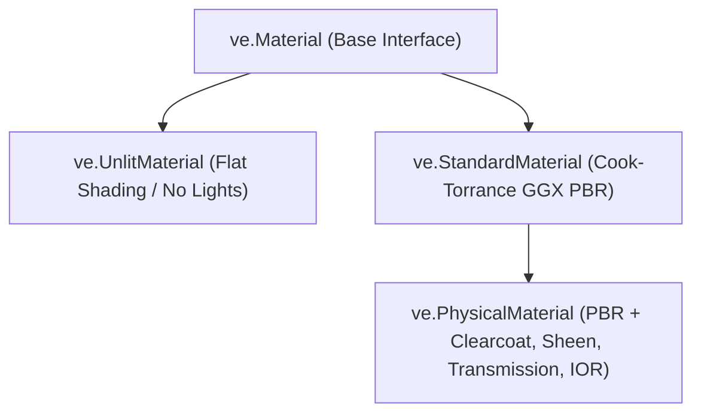

# Shading & Materials (`VelocityEngine.materials`)

The materials subsystem implements physically based rendering (PBR) using the Cook-Torrance GGX microfacet specular model, unlit flat shading, 2D GPU textures, and environment cubemaps for image-based lighting (IBL).

---

## Shading Models Overview



---

## Classes & Enums

### Enums

#### `SideMode`
Controls polygon backface culling.
- `SideMode.Front`: Render only front-facing triangles (default).
- `SideMode.Back`: Render only back-facing triangles.
- `SideMode.Double`: Disable culling; render both sides (e.g. leaves, cloth, paper).

#### `BlendMode`
Alpha blending operation against existing framebuffer pixels.
- `BlendMode.Opaque`: Overwrite destination pixels.
- `BlendMode.Alpha`: Standard alpha blending (`src_alpha * src + (1 - src_alpha) * dst`).
- `BlendMode.Additive`: Additive blending for fire, sparks, lasers, and magical shields.
- `BlendMode.Multiply`: Multiplicative blending for decals and soft shadows.

#### `TextureWrap`
- `TextureWrap.Repeat`: Tile texture coordinates across $[0.0, 1.0]$.
- `TextureWrap.ClampToEdge`: Clamp UVs to edge texels.
- `TextureWrap.MirroredRepeat`: Tile with alternating mirrored reflections.

#### `TextureFilter`
- `TextureFilter.Linear`: Bilinear filtering.
- `TextureFilter.Nearest`: Nearest-neighbor point filtering (pixel art).

---

### `StandardMaterial`
Industry-standard metallic-roughness Physically Based Rendering (PBR) material.

```python
mat = ve.StandardMaterial()
```

#### Properties

| Property | Type | Default | Description |
|:---|:---|:---:|:---|
| `base_color` | `ve.Vec4` | `(1, 1, 1, 1)` | Albedo surface tint (RGBA). |
| `roughness` | `float` | `0.5` | Surface microfacet roughness $[0.0, 1.0]$. $0$ = mirror, $1$ = diffuse chalk. |
| `metallic` | `float` | `0.0` | Metalness factor $[0.0, 1.0]$. $0$ = dielectric (plastic, wood), $1$ = conductor (gold, iron). |
| `emissive_color` | `ve.Vec3` | `(0, 0, 0)` | Self-illumination color. |
| `emissive_intensity`| `float` | `1.0` | Multiplier for emissive bloom brightness. |
| `normal_scale` | `float` | `1.0` | Normal map perturbation strength. |
| `ao_intensity` | `float` | `1.0` | Ambient occlusion darkening factor. |
| `opacity` | `float` | `1.0` | Opacity value $[0.0, 1.0]$. |
| `transparent` | `bool` | `False` | Enables alpha blending queue sorting. |
| `wireframe` | `bool` | `False` | Renders polygon wireframe edges. |
| `depth_test` | `bool` | `True` | Tests fragment depth against depth buffer. |
| `depth_write` | `bool` | `True` | Writes depth value to depth buffer. |
| `side` | `ve.SideMode`| `Front` | Triangle face culling mode. |
| `blend_mode` | `ve.BlendMode`| `Opaque` | Framebuffer blending operation. |
| `uv_scale` | `ve.Vec2` | `(1, 1)` | UV coordinate tiling multiplier. |
| `uv_offset` | `ve.Vec2` | `(0, 0)` | UV coordinate translation offset. |

#### Texture Slot Maps

| Map Property | Expected Texture Format | Description |
|:---|:---|:---|
| `albedo_map` | sRGB RGBA | Base diffuse color map. |
| `normal_map` | Tangent-space Normal RGB | Surface bump and micro-geometry normals. |
| `metallic_roughness_map` | Linear RGB | Blue channel = Metallic, Green channel = Roughness (glTF standard). |
| `emissive_map` | sRGB RGB | High dynamic range self-emissive light map. |
| `ao_map` / `occlusion_map` | Linear Grayscale | Prebaked ambient occlusion contact shadows. |

#### Built-in Material Presets

```python
mat.gold()     # base_color=(1.0, 0.766, 0.336), metallic=1.0, roughness=0.1
mat.metal()    # base_color=(0.95, 0.95, 0.95),  metallic=0.9, roughness=0.2
mat.plastic()  # base_color=(0.8, 0.1, 0.1),     metallic=0.0, roughness=0.5
mat.rubber()   # base_color=(0.2, 0.2, 0.2),     metallic=0.0, roughness=0.9
```

---

### `PhysicalMaterial`
Advanced extension of `StandardMaterial` introducing glass, car paint, fabric, and clearcoat lacquer layers.

#### Additional Properties

| Property | Type | Default | Description |
|:---|:---|:---:|:---|
| `clearcoat` | `float` | `0.0` | Clear protective outer layer intensity (e.g. car paint, varnish). |
| `clearcoat_roughness`| `float` | `0.0` | Roughness of the clearcoat layer. |
| `transmission` | `float` | `0.0` | Optical light transmittance for glass and gems $[0.0, 1.0]$. |
| `ior` | `float` | `1.5` | Index of refraction (Air: 1.0, Water: 1.333, Glass: 1.5, Diamond: 2.417). |
| `sheen` | `float` | `0.0` | Microfiber specular reflectance for cloth, velvet, and satin. |
| `sheen_roughness` | `float` | `0.5` | Roughness of the sheen microfibers. |

---

### `UnlitMaterial`
Flat, unshaded material that ignores lighting calculations. Ideal for GUI elements, reticles, debug visualization, lasers, and cartoon cel art.

```python
unlit = ve.UnlitMaterial()
unlit.base_color = ve.Vec4(0.0, 1.0, 0.0, 1.0)
unlit.wireframe = True
```

---

### `Texture`
Represents an immutable 2D GPU image resource.

#### Creation Methods

```python
# Load from file (PNG, JPG, BMP, TGA)
tex = ve.Texture.load_from_file("assets/textures/rock_diffuse.png")

# Procedural checkerboard
checker = ve.Texture.create_checkerboard(width=128, height=128, tile_size=16)

# Solid single-color 1x1 texture
red_tex = ve.Texture.create_solid_color(r=1.0, g=0.0, b=0.0, a=1.0)

# Raw RGBA bytes
raw_tex = ve.Texture.create_from_rgba(width=256, height=256, data=byte_buffer)
```

#### Properties

| Property | Type | Description |
|:---|:---|:---|
| `width` | `int` | Texture width in pixels. |
| `height` | `int` | Texture height in pixels. |
| `channels` | `int` | Color channels (e.g. 4 for RGBA, 3 for RGB). |
| `is_valid` | `bool` | True if GPU resource handle is successfully allocated. |
| `wrap_s` / `wrap_t` | `ve.TextureWrap` | Horizontal and vertical texture coordinate wrapping mode. |
| `filter_min` / `filter_mag` | `ve.TextureFilter` | Minification and magnification sampling filter. |

---

### `CubeTexture`
6-face cubemap texture ($+X, -X, +Y, -Y, +Z, -Z$) used for skyboxes, environment reflections, and Image-Based Lighting.

```python
# 1. Load from 6 separate face images
cubemap = ve.CubeTexture.load_from_files(
    posx="assets/textures/sky_posx.png",
    negx="assets/textures/sky_negx.png",
    posy="assets/textures/sky_posy.png",
    negy="assets/textures/sky_negy.png",
    posz="assets/textures/sky_posz.png",
    negz="assets/textures/sky_negz.png"
)

# 2. Procedural vertical atmosphere gradient
sky_grad = ve.CubeTexture.create_gradient(
    top_color=ve.Vec3(0.2, 0.4, 0.8),
    bottom_color=ve.Vec3(0.9, 0.95, 1.0)
)

# Apply to Scene as environment and reflection map
app.scene.set_environment(sky_grad, intensity=1.5)
```

---

## Complete Working Example

```python
import VelocityEngine as ve

app = ve.App(title="PBR Materials Showcase", width=1280, height=720)
app.camera.set_position(0.0, 3.0, 7.0)
app.camera.look_at(ve.Vec3(0.0, 0.0, 0.0))

# 1. Image-Based Lighting (IBL)
env_map = ve.CubeTexture.create_gradient(
    top_color=ve.Vec3(0.15, 0.25, 0.45),
    bottom_color=ve.Vec3(0.8, 0.85, 0.9)
)
app.scene.set_environment(env_map, intensity=1.2)

# 2. Directional Key Light
sun = ve.DirectionalLight(direction=ve.Vec3(-1.0, -2.0, -1.0), intensity=2.0)
app.scene.add_light(sun)

# 3. Create 4 material spheres: Gold, Dielectric Plastic, Clearcoat Car Paint, and Emissive Neon
sphere_mesh = ve.Mesh.create_sphere(radius=0.7, rings=32, sectors=32)

# Sphere 1: Gold Preset
gold_mat = ve.StandardMaterial()
gold_mat.gold()
gold_entity = ve.Entity(mesh=sphere_mesh, material=gold_mat)
gold_entity.set_position(-3.0, 0.0, 0.0)
app.scene.add_entity(gold_entity)

# Sphere 2: Rough Blue Plastic
plastic_mat = ve.StandardMaterial()
plastic_mat.base_color = ve.Vec4(0.1, 0.4, 0.9, 1.0)
plastic_mat.metallic = 0.0
plastic_mat.roughness = 0.6
plastic_entity = ve.Entity(mesh=sphere_mesh, material=plastic_mat)
plastic_entity.set_position(-1.0, 0.0, 0.0)
app.scene.add_entity(plastic_entity)

# Sphere 3: PhysicalMaterial Car Paint with Red Base and Clearcoat
paint_mat = ve.PhysicalMaterial()
paint_mat.base_color = ve.Vec4(0.8, 0.05, 0.05, 1.0)
paint_mat.metallic = 0.8
paint_mat.roughness = 0.4
paint_mat.clearcoat = 1.0
paint_mat.clearcoat_roughness = 0.05
paint_entity = ve.Entity(mesh=sphere_mesh, material=paint_mat)
paint_entity.set_position(1.0, 0.0, 0.0)
app.scene.add_entity(paint_entity)

# Sphere 4: Emissive Neon Core
neon_mat = ve.StandardMaterial()
neon_mat.base_color = ve.Vec4(0.0, 0.0, 0.0, 1.0)
neon_mat.emissive_color = ve.Vec3(0.2, 1.0, 0.3)
neon_mat.emissive_intensity = 3.5
neon_entity = ve.Entity(mesh=sphere_mesh, material=neon_mat)
neon_entity.set_position(3.0, 0.0, 0.0)
app.scene.add_entity(neon_entity)

@app.on_update
def on_frame(dt: float) -> None:
    gold_entity.transform.rotation.y += 0.8 * dt
    plastic_entity.transform.rotation.y += 0.8 * dt
    paint_entity.transform.rotation.y += 0.8 * dt
    neon_entity.transform.rotation.y += 0.8 * dt

if __name__ == "__main__":
    app.run()
```
