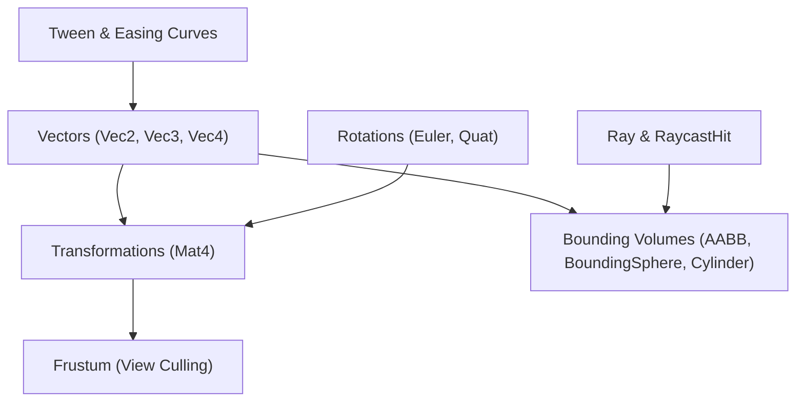

# Mathematics & Physics Primitives (`VelocityEngine.math`)

The math subsystem provides optimized C++20 GLM-backed vector, matrix, quaternion, and geometric collision primitives, along with Pythonic color management and tweening easing functions.

---

## Math System Overview



---

## Vectors & Matrices

### `Vec2`, `Vec3`, `Vec4`
Zero-overhead floating-point vector classes mapped directly to GLM SIMD types.

```python
import VelocityEngine as ve

v2 = ve.Vec2(10.0, 20.0)
v3 = ve.Vec3(1.0, 2.0, 3.0)
v4 = ve.Vec4(1.0, 0.0, 0.0, 1.0)
```

#### Operations & Methods

| Expression / Method | Return Type | Description |
|:---|:---:|:---|
| `v1 + v2`, `v1 - v2` | Vector | Component-wise addition and subtraction. |
| `v * scalar` | Vector | Scalar multiplication. |
| `v.length()` | `float` | Euclidean magnitude $\sqrt{x^2 + y^2 + z^2}$. |
| `v.normalize()` | Vector | Returns unit-length vector with magnitude $1.0$. |
| `v1.dot(v2)` | `float` | Inner dot product. |
| `v1.cross(v2)` | `ve.Vec3` | 3D cross product vector. |
| `v1.distance_to(v2)` | `float` | Euclidean distance between points. |

---

### `Quat` & `Euler`
Represent 3D spatial orientations without gimbal lock.

```python
# Euler angles (in radians: pitch, yaw, roll)
euler = ve.Euler(pitch=0.0, yaw=1.57, roll=0.0)
quat = euler.to_quat()

# Create quaternion from Axis and Angle (radians)
q_axis = ve.quat_from_axis_angle(ve.Vec3(0.0, 1.0, 0.0), angle=1.57079)

# Spherical Linear Interpolation (SLERP)
q_blend = ve.quat_slerp(q1, q2, alpha=0.5)

# Look-at orientation towards target
q_look = ve.quat_look_rotation(forward=ve.Vec3(0, 0, -1), up=ve.Vec3(0, 1, 0))
```

---

### `Mat4`
A 16-element $4 \times 4$ column-major transformation matrix.

```python
# Factory matrix builders
I = ve.Mat4.identity()
T = ve.Mat4.translation(x=2.0, y=0.0, z=-5.0)
R = ve.Mat4.rotation_y(radians=1.57)
S = ve.Mat4.scale(sx=2.0, sy=2.0, sz=2.0)

# Concatenate transforms (Scale -> Rotate -> Translate)
M = T * R * S

# Projection matrices
P = ve.Mat4.perspective(fov_radians=1.047, aspect=16/9, near=0.1, far=1000.0)
```

---

## Geometric Volumes & Raycasting

### `Ray` & `RaycastHit`
A half-line originating from `origin` and extending infinitely along normalized `direction`.

```python
ray = ve.Ray(origin=ve.Vec3(0, 2, 5), direction=ve.Vec3(0, 0, -1))
hit = scene.raycast(ray, max_distance=100.0)

if hit.hit:
    print(f"Hit entity '{hit.entity.name}' at distance {hit.distance:.2f}")
    print(f"Intersection point: ({hit.point.x}, {hit.point.y}, {hit.point.z})")
```

---

### `AABB` (Axis-Aligned Bounding Box)
Defines an orthogonal 3D box aligned with world coordinate axes.

```python
box = ve.AABB(min_point=ve.Vec3(-1, -1, -1), max_point=ve.Vec3(1, 1, 1))
```

#### Key Methods & Properties

| Method / Property | Return Type | Description |
|:---|:---:|:---|
| `center` | `ve.Vec3` | Center coordinate $(\text{min} + \text{max}) / 2$. |
| `extents` | `ve.Vec3` | Half-size dimensions $(\text{max} - \text{min}) / 2$. |
| `contains(point)` | `bool` | True if 3D coordinate lies inside volume. |
| `intersects(other)` | `bool` | True if two bounding boxes overlap. |
| `get_penetration(other)` | `ve.Vec3` | Minimum Translation Vector (MTV) to push `other` out of collision. |
| `expand(amount)` | `ve.AABB` | Expands bounds uniformly in all directions. |

---

### `BoundingSphere`
Conservative spherical bounding volume defined by `center` and `radius`.
- `sphere.from_aabb(aabb)`: Computes the tightest bounding sphere containing an AABB.
- `sphere.intersects(other)`: Fast $O(1)$ sphere-sphere overlap test.

---

### `Cylinder`
Vertical 3D cylinder primitive commonly used for character capsule collision.
- Properties: `base` (`ve.Vec3`), `radius` (`float`), `height` (`float`).
- `intersects_aabb(aabb)`: Tests intersection against an obstacle box.
- `get_penetration_aabb(aabb)`: Calculates 2D/3D collision depenetration vector.

---

### `Frustum`
A 6-plane viewing frustum extracted from the camera view-projection matrix ($\mathbf{M}_{\text{VP}}$).
- `frustum.set_from_projection_matrix(view_proj_mat)`
- `frustum.intersects_aabb(aabb)`: Discards objects outside camera view before rendering.
- `frustum.intersects_sphere(sphere)`: Fast sphere culling.

---

## Colors & Color Utility

### `Color`
RGBA linear color class supporting float clamping and hex string deserialization.

```python
# Presets
white = ve.WHITE
warm = ve.WARM_WHITE
red = ve.RED
cyan = ve.CYAN

# Hex parsing
accent = ve.Color.from_hex("#ff7700")

# Access linear channels
print(accent.r, accent.g, accent.b, accent.a)
```

---

## Animation Tweens & Easing Curves

Velocity includes an integrated tweening subsystem for smooth parametric animations.

### Easing Functions

| Function | Characteristic Curve |
|:---|:---|
| `ve.linear(t)` | Constant velocity without acceleration. |
| `ve.in_quad(t)` / `ve.out_quad(t)` / `ve.in_out_quad(t)` | Quadratic acceleration / deceleration. |
| `ve.in_cubic(t)` / `ve.out_cubic(t)` | Cubic curvature. |
| `ve.out_bounce(t)` | Bouncy decay simulating ground impacts. |
| `ve.out_elastic(t)` | Elastic spring overshoot. |

### `Tween` Usage

```python
# Smoothly animate object position over 1.5 seconds
tween = app.tweens.to(
    target=box.transform.position,
    properties={"y": 4.0, "z": -2.0},
    duration=1.5,
    easing=ve.out_bounce
)

# Attach completion callback
tween.on_complete(lambda: print("Box reached apex!"))
```

---

## Complete Working Example

```python
import VelocityEngine as ve

app = ve.App(title="Math & Collision Depenetration Sandbox", width=1280, height=720)
app.camera.set_position(0.0, 5.0, 10.0)
app.camera.look_at(ve.Vec3(0.0, 0.0, 0.0))

app.scene.set_sun(direction=(-1.0, -2.0, -1.0), color=ve.WARM_WHITE, intensity=2.0)

# 1. Obstacle Box with AABB
obstacle_mesh = ve.Mesh.create_cube(size=2.0)
obstacle_mat = ve.StandardMaterial()
obstacle_mat.base_color = ve.Vec4(0.8, 0.2, 0.2, 1.0)
obstacle = ve.Entity(mesh=obstacle_mesh, material=obstacle_mat)
obstacle.set_position(0.0, 1.0, 0.0)
app.scene.add_entity(obstacle)

obstacle_aabb = ve.AABB(min_point=ve.Vec3(-1.0, 0.0, -1.0), max_point=ve.Vec3(1.0, 2.0, 1.0))

# 2. Moving Player Cylinder
player_cyl = ve.Cylinder(base=ve.Vec3(-4.0, 0.0, 0.0), radius=0.5, height=1.8)
player_mat = ve.StandardMaterial()
player_mat.base_color = ve.Vec4(0.2, 0.8, 0.3, 1.0)
player_entity = ve.Entity(mesh=ve.Mesh.create_cylinder(radius=0.5, height=1.8), material=player_mat)
app.scene.add_entity(player_entity)

target_x = 4.0

@app.on_update
def on_frame(dt: float) -> None:
    # Move player towards target
    pos = player_entity.transform.position
    pos.x += 2.0 * dt
    if pos.x > 4.0:
        pos.x = -4.0
    player_cyl.base = pos
    
    # Check collision and calculate Minimum Translation Vector (MTV)
    if player_cyl.intersects_aabb(obstacle_aabb):
        penetration = player_cyl.get_penetration_aabb(obstacle_aabb)
        # Push player out of obstacle along MTV
        pos.x -= penetration.x
        pos.z -= penetration.z
        player_mat.base_color = ve.Vec4(1.0, 1.0, 0.0, 1.0) # Yellow collision warning
    else:
        player_mat.base_color = ve.Vec4(0.2, 0.8, 0.3, 1.0) # Normal green
        
    player_entity.set_position(pos.x, pos.y, pos.z)

if __name__ == "__main__":
    app.run()
```
