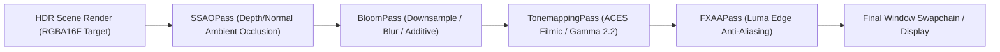

# Post-Processing Pipeline (`VelocityEngine.postprocess`)

The post-processing subsystem provides high-dynamic-range (HDR) multi-pass image processing via `EffectComposer`, including bloom glow, screen-space ambient occlusion (SSAO), fast approximate anti-aliasing (FXAA), and photographic tonemapping.

---

## Post-Processing Architecture



---

## Classes & Enums

### `TonemappingMode`
Selects the mathematical curve for mapping high dynamic range (HDR) radiance values into $[0.0, 1.0]$ display range.

| Member | Value | Description |
|:---|:---:|:---|
| `TonemappingMode.ACESFilmic` | `0` | Academy Color Encoding System standard. Rich contrast and organic highlights. |
| `TonemappingMode.Reinhard` | `1` | Classic $\frac{L}{1 + L}$ compression. Preserves color hues without clipping. |
| `TonemappingMode.Cineon` | `2` | Kodak Cineon film stock response curve. |
| `TonemappingMode.Neutral` | `3` | Khronos neutral PBR tonemapper minimizing color shifting. |
| `TonemappingMode.Linear` | `4` | Simple linear exposure scaling without knee compression. |

---

### `EffectComposer`
The master post-processing pipeline container. Owns offscreen HDR render targets, sequences chained image processing passes, and performs the final blit to the screen swapchain.

```python
composer = ve.EffectComposer(width: int = 1280, height: int = 720)
app.composer = composer
```

#### Properties

| Property | Type | Access | Description |
|:---|:---|:---:|:---|
| `enabled` | `bool` | Read/Write | Master toggle for the entire post-processing stack. |
| `passes` | `list[ve.PostProcessPass]` | Read-only | Ordered list of chained render passes. |
| `hdr_target` | `ve.RenderTarget` | Read-only | Primary RGBA16F offscreen floating-point buffer. |
| `final_target` | `ve.RenderTarget` | Read-only | Target holding the finished post-processed image. |

#### Methods

##### `add_pass(pass_obj: ve.PostProcessPass) -> None`
Appends a post-processing pass to the execution sequence.

##### `remove_pass(pass_obj: ve.PostProcessPass) -> None`
Removes a pass from the pipeline.

##### `clear_passes() -> None`
Removes all registered passes.

##### `resize(width: int, height: int) -> None`
Resizes all intermediate render target textures when the window changes dimensions.

##### `render(scene: ve.Scene, camera: ve.Camera) -> None`
Executes scene rasterization into the HDR buffer, sequentially applies all passes, and blits to the screen.

---

### `BloomPass`
Extracts pixels exceeding an HDR luminance threshold, applies a multi-tap Gaussian blur pyramid, and additively combines the glow onto the scene.

```python
bloom = ve.BloomPass(
    threshold: float = 1.0,
    strength: float = 1.5,
    radius: float = 0.5
)
```

#### Properties

| Property | Type | Default | Description |
|:---|:---|:---:|:---|
| `threshold` | `float` | `1.0` | Minimum luminance required to trigger bloom glow. |
| `strength` | `float` | `1.5` | Multiplier for the intensity of the blurred light aura. |
| `radius` | `float` | `0.5` | Spatial blur spread radius. |
| `enabled` | `bool` | `True` | Toggle for this pass. |

---

### `SSAOPass`
Screen-Space Ambient Occlusion calculates contact shadows in crevices and corners by sampling neighbor depth and normal vectors across a hemispherical kernel.

```python
ssao = ve.SSAOPass(
    radius: float = 0.5,
    bias: float = 0.025,
    power: float = 1.0
)
```

#### Properties

| Property | Type | Default | Description |
|:---|:---|:---:|:---|
| `radius` | `float` | `0.5` | World-space sampling radius around each fragment. |
| `bias` | `float` | `0.025` | Depth bias offset to avoid surface self-occlusion artifacts. |
| `power` | `float` | `1.0` | Darkening contrast exponent. |
| `enabled` | `bool` | `True` | Toggle for this pass. |

---

### `TonemappingPass`
Converts high-dynamic range floating point colors into calibrated standard dynamic range for monitor output, applying exposure adjustment and gamma correction.

```python
tonemap = ve.TonemappingPass(
    mode: ve.TonemappingMode = ve.TonemappingMode.ACESFilmic,
    exposure: float = 1.0,
    gamma: float = 2.2
)
```

#### Properties

| Property | Type | Default | Description |
|:---|:---|:---:|:---|
| `mode` | `ve.TonemappingMode`| `ACESFilmic` | Photographic compression curve algorithm. |
| `exposure` | `float` | `1.0` | Photographic virtual shutter exposure factor. |
| `gamma` | `float` | `2.2` | Display gamma exponent ($2.2$ for standard sRGB monitors). |
| `enabled` | `bool` | `True` | Toggle for this pass. |

---

### `FXAAPass`
Fast Approximate Anti-Aliasing performs an edge-directed luminance gradient analysis in screen space to smooth jagged polygon edges with near-zero performance cost.

```python
fxaa = ve.FXAAPass()
```

#### Properties

| Property | Type | Default | Description |
|:---|:---|:---:|:---|
| `enabled` | `bool` | `True` | Toggle for anti-aliasing pass. |

---

## Complete Working Example

```python
import VelocityEngine as ve

app = ve.App(title="HDR Bloom & Tonemapping Pipeline", width=1280, height=720)
app.camera.set_position(0.0, 4.0, 8.0)
app.camera.look_at(ve.Vec3(0.0, 1.0, 0.0))

# 1. Setup Lighting
sun = ve.DirectionalLight(direction=ve.Vec3(-1.0, -2.0, -1.0), intensity=1.5)
app.scene.add_light(sun)
app.scene.create_grid(size=20.0, step=1.0)

# 2. Setup Glowing Emissive Objects (HDR radiance > 1.0)
emissive_mat = ve.StandardMaterial()
emissive_mat.base_color = ve.Vec4(0.0, 0.0, 0.0, 1.0)
emissive_mat.emissive_color = ve.Vec3(0.2, 0.8, 1.0)
emissive_mat.emissive_intensity = 4.0 # High value triggers bloom threshold

crystal = ve.Entity(mesh=ve.Mesh.create_octahedron(radius=1.2), material=emissive_mat)
crystal.set_position(0.0, 2.0, 0.0)
app.scene.add_entity(crystal)

# 3. Build Post-Processing Pipeline
composer = ve.EffectComposer(1280, 720)

# Pass A: Bloom Glow
bloom = ve.BloomPass(threshold=1.0, strength=2.2, radius=0.6)
composer.add_pass(bloom)

# Pass B: ACES Filmic Tonemapping
tonemap = ve.TonemappingPass(
    mode=ve.TonemappingMode.ACESFilmic,
    exposure=1.1,
    gamma=2.2
)
composer.add_pass(tonemap)

# Pass C: Anti-Aliasing
fxaa = ve.FXAAPass()
composer.add_pass(fxaa)

# Attach to App
app.composer = composer

@app.on_update
def on_frame(dt: float) -> None:
    crystal.transform.rotation.y += 1.2 * dt
    crystal.transform.rotation.x += 0.6 * dt

if __name__ == "__main__":
    app.run()
```
