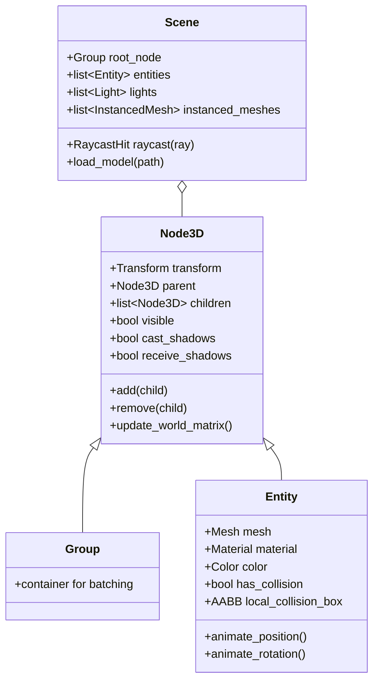

# Scene Graph & Hierarchy (`VelocityEngine.scene`)

The scene graph subsystem manages the spatial hierarchy, spatial transformations, parent-child relationships, renderable entities, and raycast collision queries in the Velocity 3D Engine.

---

## Hierarchy Overview



---

## Classes

### `Node3D`
Base spatial transform node in the 3D scene tree. Every object that exists in 3D space inherits from `Node3D`.

#### Properties

| Property | Type | Access | Description |
|:---|:---|:---:|:---|
| `name` | `str` | Read/Write | Identifier tag for node lookup. |
| `tag` | `str` | Read/Write | Custom category string for querying multiple nodes. |
| `visible` | `bool` | Read/Write | Visibility toggle (disables rendering if `False`). |
| `cast_shadows` | `bool` | Read/Write | Whether geometry casts shadows into shadow maps. |
| `receive_shadows` | `bool` | Read/Write | Whether surface receives projected shadows. |
| `transform` | `ve.Transform` | Read/Write | Local transformation containing position, rotation, and scale. |
| `parent` | `Optional[ve.Node3D]` | Read-only | Direct parent node in hierarchy. |
| `children` | `list[ve.Node3D]` | Read-only | List of immediate child nodes. |
| `world_matrix` | `ve.Mat4` | Read-only | Concatenated 4x4 model-to-world transform matrix. |
| `world_position` | `ve.Vec3` | Read-only | World-space origin coordinates. |
| `world_orientation` | `ve.Quat` | Read-only | World-space orientation quaternion. |
| `world_direction` | `ve.Vec3` | Read-only | World forward vector `(0, 0, -1)` transformed into world space. |
| `world_aabb` | `ve.AABB` | Read-only | Axis-Aligned Bounding Box in world coordinates. |

#### Methods

##### `add(child: ve.Node3D) -> None`
Attaches a child node. Updates parent reference and triggers a transform hierarchy recalculation.

##### `remove(child: ve.Node3D) -> None`
Detaches a child node from this node's children list.

##### `remove_from_parent() -> None`
Detaches this node from its parent.

##### `get_by_name(name: str) -> Optional[ve.Node3D]`
Performs a depth-first search for a child node with the matching `name`.

##### `find_all_by_tag(tag: str) -> list[ve.Node3D]`
Collects all descendant nodes that match the specified `tag`.

##### `set_position(x: float, y: float, z: float) -> None`
Sets local position vector `(x, y, z)`.

##### `set_rotation(pitch: float, yaw: float, roll: float) -> None`
Sets local rotation using Euler angles in radians.

##### `set_scale(x: float, y: float, z: float) -> None`
Sets local non-uniform scaling vector.

##### `local_to_world(point: ve.Vec3) -> ve.Vec3`
Transforms a 3D point from local coordinate space into world coordinate space.

##### `world_to_local(point: ve.Vec3) -> ve.Vec3`
Transforms a 3D point from world coordinate space into local space.

##### `on(event: str, callback: Callable) -> None` / `emit(event: str, *args) -> None`
Subscribes to or dispatches custom decoupled node lifecycle and gameplay events.

---

### `Group`
Convenience spatial container derived from `Node3D`. Used to cluster multiple objects and transform them as a single logical unit.

```python
group = ve.Group()
group.add(mesh1)
group.add(mesh2)
group.set_position(0.0, 5.0, 0.0)
app.scene.add(group)
```

---

### `Entity`
Derived from `Node3D`. Represents a renderable 3D object composed of a geometric `Mesh` and a shading `Material`.

```python
entity = ve.Entity(
    mesh: Optional[ve.Mesh] = None,
    material: Optional[ve.Material] = None,
    name: str = "Entity"
)
```

#### Additional Properties

| Property | Type | Access | Description |
|:---|:---|:---:|:---|
| `mesh` | `ve.Mesh` | Read/Write | Associated 3D vertex and index buffer geometry. |
| `material` | `ve.Material` | Read/Write | Shading model (`StandardMaterial`, `PhysicalMaterial`, `UnlitMaterial`). |
| `color` | `ve.Color` | Read/Write | Tint multiplier applied during shading. |
| `has_collision` | `bool` | Read/Write | Toggles inclusion in scene raycasting and collision queries. |
| `collision_scale` | `ve.Vec3` | Read/Write | Scale factor for collision bounding volume. |
| `collision_padding` | `ve.Vec3` | Read/Write | Extra padding added to collision AABB. |
| `local_collision_box` | `ve.AABB` | Read/Write | Local object-space collision box. |
| `world_bounding_sphere` | `ve.BoundingSphere`| Read-only | Fast bounding sphere in world coordinates. |
| `world_obb_corners` | `list[ve.Vec3]` | Read-only | 8 corners of the Oriented Bounding Box (OBB). |

#### Animation Utility Methods

##### `animate_position(target: ve.Vec3, duration: float, easing: Callable = ve.out_quad) -> ve.Tween`
Smoothly interpolates `entity.transform.position` to `target` over `duration` seconds.

##### `animate_rotation(target: ve.Vec3, duration: float, easing: Callable = ve.out_quad) -> ve.Tween`
Smoothly interpolates Euler rotation angles.

##### `animate_rotation_y(target_radians: float, duration: float, easing: Callable = ve.out_quad) -> ve.Tween`
Convenience tween for spinning objects around the vertical Y axis.

##### `animate_scale(target: ve.Vec3, duration: float, easing: Callable = ve.out_elastic) -> ve.Tween`
Smoothly animates object scale with bouncy or elastic overshoot.

---

### `Scene`
Root container and manager for the 3D world. Owned by `app.scene`.

#### Key Properties

| Property | Type | Description |
|:---|:---|:---|
| `root_node` | `ve.Group` | Root transform node of the world hierarchy. |
| `entities` | `list[ve.Entity]` | Active renderable entities list. |
| `lights` | `list[ve.Light]` | Active dynamic light sources (`Directional`, `Point`, `Spot`, etc.). |
| `instanced_meshes` | `list[ve.InstancedMesh]` | Active GPU instanced meshes. |
| `skinned_meshes` | `list[ve.SkinnedMesh]` | Active glTF rigged characters. |
| `sprites` | `list[ve.Sprite]` | Active 3D camera-facing billboard sprites. |
| `points` | `list[ve.Points]` | Active point clouds. |
| `particle_emitters`| `list[ve.ParticleEmitter]` | Active procedural particle systems. |
| `environment` | `ve.CubeTexture` | Active IBL (Image-Based Lighting) environment map. |
| `environment_intensity`| `float` | IBL reflection and ambient radiance multiplier. |

#### Key Methods

##### `add_entity(entity: ve.Entity) -> None`
Adds a renderable entity to the scene.

##### `remove_entity(entity: ve.Entity) -> None`
Removes an entity from the scene.

##### `add_light(light: ve.Light) -> None`
Registers a dynamic light for rendering.

##### `set_sun(direction: tuple / ve.Vec3, color: ve.Color, intensity: float) -> None`
Convenience setup for primary directional daylight.

##### `create_box(size: tuple = (1, 1, 1), color: ve.Color = ve.WHITE) -> ve.Entity`
Creates and immediately adds a box entity to the scene.

##### `create_sphere(radius: float = 1.0, rings: int = 32, sectors: int = 32, color: ve.Color = ve.WHITE) -> ve.Entity`
Creates and immediately adds a UV sphere entity to the scene.

##### `create_plane(size: float = 10.0, uv_tiling: float = 5.0, material: Optional[ve.Material] = None) -> ve.Entity`
Creates a textured ground plane entity.

##### `create_grid(size: float = 20.0, step: float = 1.0, color: ve.Color = ve.GRAY) -> ve.GridHelper`
Creates a 3D floor grid for orientation and spatial reference.

##### `load_model(filepath: str) -> ve.Model`
Loads a 3D model file (`.glb`, `.gltf`, `.obj`, `.stl`, `.ply`) and attaches all mesh primitives to the scene.

##### `raycast(ray: ve.Ray, max_distance: float = 1000.0) -> ve.RaycastHit`
Casts a mathematical ray into the scene against all active entities with `has_collision=True`.

##### `clear() -> None`
Removes all entities, lights, meshes, and nodes from the scene.

---

## Complete Working Example

```python
import VelocityEngine as ve

app = ve.App(title="Scene Graph Hierarchy Demo", width=1280, height=720)
app.camera.set_position(0.0, 5.0, 10.0)
app.camera.look_at(ve.Vec3(0.0, 1.0, 0.0))

# 1. Ground plane and grid
ground = app.scene.create_plane(size=30.0, uv_tiling=10.0)
grid = app.scene.create_grid(size=30.0, step=1.0, color=ve.Color.from_hex("#3a404d"))

# 2. Lighting
app.scene.set_sun(direction=(-1.0, -2.0, -1.0), color=ve.WARM_WHITE, intensity=2.0)

# 3. Create a parent hierarchical Group (Solar system pivot)
solar_system = ve.Group()
solar_system.name = "SolarSystem"
app.scene.add(solar_system)

# Central Sun
sun_mat = ve.StandardMaterial()
sun_mat.base_color = ve.Vec4(1.0, 0.8, 0.1, 1.0)
sun_mat.emissive_color = ve.Vec3(1.0, 0.7, 0.0)
sun_mat.emissive_intensity = 2.5
sun_entity = ve.Entity(mesh=ve.Mesh.create_sphere(radius=1.2), material=sun_mat)
solar_system.add(sun_entity)

# Orbiting Planet node
orbit_pivot = ve.Group()
orbit_pivot.name = "OrbitPivot"
solar_system.add(orbit_pivot)

planet_mat = ve.StandardMaterial()
planet_mat.base_color = ve.Vec4(0.2, 0.6, 1.0, 1.0)
planet_mat.roughness = 0.4
planet = ve.Entity(mesh=ve.Mesh.create_sphere(radius=0.5), material=planet_mat)
planet.set_position(4.0, 0.0, 0.0)
orbit_pivot.add(planet)

# Animate orbits in update loop
@app.on_update
def on_frame(dt: float) -> None:
    # Rotate Sun on its axis
    sun_entity.transform.rotation.y += 0.5 * dt
    # Rotate orbit pivot (causes planet to orbit around the sun)
    orbit_pivot.transform.rotation.y += 1.2 * dt
    # Rotate planet on its local axis
    planet.transform.rotation.y += 3.0 * dt

if __name__ == "__main__":
    app.run()
```
