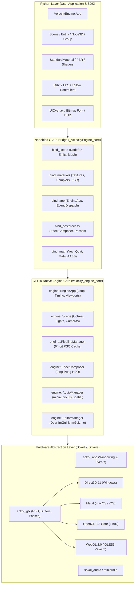

# Architecture Overview & System Design

Velocity 3D Engine is a high-performance, lightweight, multi-platform 3D game and simulation engine engineered from the ground up in modern C++20, featuring Sokol GFX as a zero-overhead hardware abstraction layer, Nanobind for seamless Python C-API interop, and an ergonomic Python SDK.

Designed for game developers, simulation researchers, and graphics engineers, Velocity combines the raw performance, cache efficiency, and deterministic memory control of modern C++ with the rapid prototyping ergonomics of Python.



---

## 1. Architectural Philosophy & Layered Stack

Velocity 3D Engine is built upon four fundamental engineering tenets:

1. **Zero Garbage Collection Stalls in Render Loops**: The inner render loop runs entirely on the native C++ side with pre-allocated uniform buffers, cached Pipeline State Objects (PSOs), and batch instancing. The Python runtime is invoked strictly once per frame via a lightweight C-API tick callback.
2. **Explicit, Immutable Pipeline State Objects (PSOs)**: Rather than relying on legacy mutable OpenGL-style state machines, all GPU pipeline state configurations (vertex layouts, blend states, depth-stencil tests, rasterizer modes) are baked into immutable PSOs managed by a centralized caching manager.
3. **Cross-Platform Graphics Portability**: Through Sokol GFX, Velocity compiles against native graphics backends across major desktop and web platforms without runtime emulation or translation layers:
   - **Windows**: Native Direct3D 11 (`SOKOL_D3D11`), DXGI, D3DCompiler.
   - **macOS**: Native Metal (`SOKOL_METAL`) with Cocoa and QuartzCore frameworks.
   - **Linux**: OpenGL 3.3 Core Profile (`SOKOL_GLCORE`) with X11 windowing.
   - **WebAssembly / Emscripten**: WebGL 2.0 / GLES3 (`SOKOL_GLES3`).
4. **Ergonomic, Type-Safe Python Bindings**: Velocity leverages Nanobind to expose high-performance native types to Python. Memory is managed via reference-counted smart pointers (`std::shared_ptr<Node3D>`), while the high-level `VelocityEngine` (`ve`) package delivers clean Pythonic interfaces with complete PEP-484 and PEP-561 type stubs.

### 1.1 The Layered Architecture

| Layer | Component | Implementation | Primary Responsibilities |
| :--- | :--- | :--- | :--- |
| **Layer 4: Python SDK** | `VelocityEngine` (`ve`) | Pure Python & Type Stubs | High-level facades (`ve.App`, `ve.SceneFactory`), camera controllers, tweening systems, color conversions, and 2D UI canvas overlays. |
| **Layer 3: C-API Bridge** | `_VelocityEngine_core` | Nanobind C++20 | Bidirectional type marshalling, GIL acquisition/release during rendering, zero-copy buffer views, and Python exception bridging. |
| **Layer 2: Engine Core** | `velocity_engine_core` | Native C++20 | Scene graph traversal, transform propagation, frustum culling, PBR shading, post-processing pipelines, spatial audio, and Dear ImGui visual tooling. |
| **Layer 1: Hardware Abstraction** | Sokol GFX & Third-Party | C99 / C++ Libraries | Window surface binding, command buffer emission, vertex/index buffer memory management, audio device mixing, and glTF asset parsing. |

---

## 2. Coordinate System & Projection Conventions

Velocity 3D Engine enforces standard right-handed Cartesian geometry throughout its mathematical primitives, cameras, scene hierarchies, and shaders.

```text
               +Y (Up)
                |
                |
                |
                + - - - - - +X (Right)
               /
              /
             /
           +Z (Backward / Towards Viewer)

   Camera Look Direction: -Z (Forward into screen)
```

### 2.1 Spatial Axes and Vectors

- **$+X$ Axis (Right / East)**: Directed towards the right side of the screen or viewport.
- **$+Y$ Axis (Up / Sky)**: Directed vertically upward. World gravity is typically defined along $-Y$ (e.g., $\vec{g} = [0, -9.81, 0]$).
- **$+Z$ Axis (Backward / Viewer)**: Directed out of the screen towards the viewer.
- **$-Z$ Axis (Forward / Heading)**: The standard forward orientation of unrotated cameras and directional nodes. A camera positioned at the origin looking down $-Z$ sees positive $X$ on its right and positive $Y$ on its top.

### 2.2 Depth Buffer & Normalized Device Coordinates (NDC)

Velocity configures its GLM mathematics with `GLM_FORCE_DEPTH_ZERO_TO_ONE`. As a result, the clip-space depth range strictly matches modern explicit graphics APIs:

$$\text{Clip Space Depth } z_{clip} \in [0.0, 1.0]$$

| Metric / Feature | Velocity 3D Engine Standard | Legacy OpenGL Standard |
| :--- | :--- | :--- |
| **Clip Depth Range ($Z_{ndc}$)** | $[0.0, 1.0]$ | $[-1.0, 1.0]$ |
| **Near Plane Depth Value** | $0.0$ | $-1.0$ |
| **Far Plane Depth Value** | $1.0$ | $+1.0$ |
| **Hardware Compatibility** | Direct3D 11, Metal, Vulkan, WebGPU | Legacy Desktop GL |
| **Depth Comparison Operator** | `SG_COMPAREFUNC_LESS_EQUAL` | `GL_LESS` |
| **Depth Clear Value** | `1.0f` | `1.0f` |
| **Z-Precision Distribution** | High precision throughout near-to-mid range | Compressed near plane precision |

Enforcing $[0.0, 1.0]$ clip depth eliminates the unnecessary $[-1.0, 1.0]$ remapping step required by older OpenGL drivers and doubles floating-point precision when distributing depth bits across the view frustum.

### 2.3 Rotation Conventions & Euler Orders

Rotations in the native engine core are internally stored and calculated using normalized unit quaternions (`glm::quat`, with identity defined as $w=1.0, x=0.0, y=0.0, z=0.0$).

When interacting with Euler angles in degrees via the Python SDK or editor inspectors, rotations follow the **$YXZ$ Tait-Bryan (Yaw-Pitch-Roll)** convention:
1. **Yaw (Rotation around $Y$)**: Primary heading/steering direction.
2. **Pitch (Rotation around $X$)**: Elevation/tilt angle.
3. **Roll (Rotation around $Z$)**: Banking or tilting sideways.

This convention prevents premature gimbal lock during typical first-person and third-person camera movements.

---

## 3. Memory Management & Ownership Model

Bridging high-performance C++20 with a garbage-collected language like Python requires clear ownership semantics to prevent memory leaks, dangling pointers, and double-free crashes.

```mermaid
classDiagram
    class PythonScope {
        +app: ve.App
        +entity: ve.Entity
        +material: ve.StandardMaterial
    }

    class NanobindWrapper {
        +nb::class_<Entity>
        +std::shared_ptr<Entity>
    }

    class NativeSceneGraph {
        +std::vector<std::shared_ptr<Node3D>> children_
        +Node3D* parent_
    }

    class NativeGPUResources {
        +uint32_t vbuf_id
        +uint32_t ibuf_id
        +uint32_t view_id
    }

    PythonScope --> NanobindWrapper : Holds Python PyObject ref
    NanobindWrapper --> NativeSceneGraph : std::shared_ptr ref count (+1)
    NativeSceneGraph --> NativeSceneGraph : Parent holds child (+1 ref count)
    NativeSceneGraph ..> NativeSceneGraph : Child holds raw Node3D* (0 ref count)
    NativeSceneGraph --> NativeGPUResources : Manages GPU Buffer IDs
```

### 3.1 C++ Handles vs Python GC

1. **Shared Ownership (`std::shared_ptr<Node3D>`)**:
   All scene nodes (`Node3D`, `Entity`, `Group`, `SkinnedMesh`) derive from `std::enable_shared_from_this<Node3D>`. When Python instantiates an entity:
   ```python
box = ve.Entity("MyBox")
   ```
   Nanobind allocates a C++ `std::shared_ptr<engine::Entity>` inside the Python object wrapper. The reference count is initially $1$.
2. **Scene Hierarchy Retention**:
   When the child node is added to a parent or the scene:
   ```python
scene.add(box)
   ```
   The parent's internal container `children_` (`std::vector<std::shared_ptr<Node3D>>`) stores a copy of the `shared_ptr`, incrementing the native reference count to $2$.
   Even if the Python local variable `box` falls out of scope and is collected by the CPython garbage collector, the native C++ entity remains fully alive in memory because the parent retains a reference.
3. **Circular Reference Prevention**:
   Child nodes maintain a non-owning raw pointer (`Node3D* parent_`) back to their parent. Exposing `.parent` to Python uses Nanobind's reference return policy (`nb::rv_policy::reference`). This guarantees that parent-child relationships never form circular `shared_ptr` ownership loops that would bypass destructor cascades.
4. **Weakref Protection in Frame Callbacks**:
   The high-level `ve.App` registers an internal update callback with the native engine core. To prevent the native `EngineApp` from indefinitely keeping the high-level Python `App` alive, the callback uses `weakref.ref(self)` to invoke frame updates cleanly without cyclic retention.

---

## 4. Pipeline State Object (PSO) Architecture & PipelineManager

Modern graphics APIs (Direct3D 11, Metal, Vulkan) disallow fine-grained runtime state alterations (such as changing blending modes or depth masks midway through draw commands) due to driver validation overhead. Instead, all GPU pipeline configurations must be baked into immutable Pipeline State Objects (`sg_pipeline`).

Velocity implements a high-throughput, zero-allocation pipeline cache through `engine::PipelineManager`.

### 4.1 The 64-Bit Packed PSO Key

Each unique combination of shader ID, rasterizer cull mode, depth test, depth write mask, alpha blend mode, primitive topology, MSAA sample count, and render target pixel format is encoded into a single 64-bit unsigned integer key (`uint64_t`).

```text
 63                                37 36        29 28    25 24 23 22    20 19 18 17 16 15            0
┌────────────────────────────────────┬────────────┬────────┬──┬──┬────────┬──┬──┬─────┬──────────────┐
│              Reserved              │ Pixel Fmt  │ Samples│In│WF│ Blend  │DT│DW│Side │  Shader ID   │
│              (27 bits)             │  (8 bits)  │(4 bits)│  │  │(3 bits)│  │  │(2b) │  (16 bits)   │
└────────────────────────────────────┴────────────┴────────┴──┴──┴────────┴──┴──┴─────┴──────────────┘
```

The bit layout is defined as follows:

| Field | Bit Offset | Width (Bits) | Description / Valid Values |
| :--- | :--- | :--- | :--- |
| `shader_id` | 0 | 16 | Sokol shader handle index (`shd.id & 0xFFFF`). |
| `side` | 16 | 2 | Polygon face culling: `Front` (0), `Back` (1), `Double` (2). |
| `depth_write` | 18 | 1 | Depth write mask: `false` (0), `true` (1). |
| `depth_test` | 19 | 1 | Depth comparison enable: `false` (0), `true` (1). |
| `blend_mode` | 20 | 3 | Alpha blending: `Opaque` (0), `Alpha` (1), `Additive` (2), `Multiply` (3). |
| `wireframe` | 23 | 1 | Primitive mode: Triangles (0), Line strips/wireframe (1). |
| `is_instanced` | 24 | 1 | Instance step rate: standard vertex buffer (0), dual-stream instancing (1). |
| `sample_count` | 25 | 4 | Multisampling anti-aliasing sample count ($1$, $2$, $4$, $8$). |
| `pixel_format` | 29 | 8 | Target framebuffer format (`SG_PIXELFORMAT_DEFAULT`, `RGBA8`, `RGBA16F`). |

### 4.2 Bitwise Key Generation Implementation

```cpp
uint64_t PipelineManager::make_key(
    uint32_t shader_id,
    SideMode side,
    bool depth_write,
    bool depth_test,
    BlendMode blend_mode,
    bool wireframe,
    bool is_instanced,
    int sample_count,
    uint32_t pixel_format
) {
    uint64_t key = 0;
    key |= (static_cast<uint64_t>(shader_id) & 0xFFFF);
    key |= (static_cast<uint64_t>(side) & 0x3) << 16;
    key |= (static_cast<uint64_t>(depth_write ? 1 : 0) & 0x1) << 18;
    key |= (static_cast<uint64_t>(depth_test ? 1 : 0) & 0x1) << 19;
    key |= (static_cast<uint64_t>(blend_mode) & 0x7) << 20;
    key |= (static_cast<uint64_t>(wireframe ? 1 : 0) & 0x1) << 23;
    key |= (static_cast<uint64_t>(is_instanced ? 1 : 0) & 0x1) << 24;
    key |= (static_cast<uint64_t>(sample_count) & 0xF) << 25;
    key |= (static_cast<uint64_t>(pixel_format) & 0xFF) << 29;
    return key;
}
```

### 4.3 Caching & Retrieval Flow

When iterating through entities during a render pass:
1. The renderer computes the 64-bit key from the active material and pass parameters.
2. If the key matches the currently bound pipeline key, state binding is completely skipped (zero GPU driver commands).
3. If the key changes, `PipelineManager::instance().get_or_create(key, desc)` performs an $O(1)$ amortized lookup in an internal `std::unordered_map<uint64_t, sg_pipeline>`.
4. If absent from cache, a new `sg_pipeline` is baked instantly via `sg_make_pipeline()` and cached for the remainder of the application lifecycle.
5. All cached pipelines are safely destroyed during application teardown via `PipelineManager::instance().release_all()`.

---

## 5. Architectural Directory Layout

The engine repository adheres to strict modular separation between native C++ engine core, hardware abstraction headers, language bindings, Python wrappers, and user applications:

```text
velocity-3d-engine/
├── core/                               # Native C++20 engine core library
│   ├── include/engine/                 # Public C++ engine header interfaces
│   │   ├── app.hpp                     # Main EngineApp application harness
│   │   ├── scene.hpp                   # Scene container & spatial registration
│   │   ├── node3d.hpp                  # Hierarchical transform node
│   │   ├── entity.hpp                  # Concrete renderable entity
│   │   ├── skinned_mesh.hpp            # Skeletal mesh & bone transforms
│   │   ├── material.hpp                # PBR materials & PipelineManager PSO cache
│   │   ├── camera.hpp                  # Perspective and Orthographic camera models
│   │   ├── light.hpp                   # Directional, Point, Spot, Ambient lights
│   │   ├── post_process.hpp            # EffectComposer & Ping-Pong HDR passes
│   │   ├── render_target.hpp           # Offscreen framebuffers & depth attachments
│   │   ├── physics.hpp                 # AABB, BoundingSphere, Cylinder & MTV math
│   │   └── audio.hpp                   # miniaudio spatial 3D audio engine
│   └── src/                            # Implementation files (.cpp)
│       ├── app.cpp                     # Frame pacing, pass orchestration, HUD blitter
│       ├── material.cpp                # PipelineManager singleton & PSO hashing
│       ├── post_process.cpp            # Ping-pong passes, ACES tonemap, bloom
│       └── ...
├── bindings/                           # Nanobind C-API Python bridge
│   ├── bindings.cpp                    # Native module initialization (_VelocityEngine_core)
│   ├── bind_app.cpp                    # Application loop & window bindings
│   ├── bind_scene.cpp                  # Node3D, Entity, Scene, Light bindings
│   ├── bind_geometry.cpp               # Mesh, InstancedMesh, SkinnedMesh bindings
│   ├── bind_materials.cpp              # Material, Texture, CubeTexture bindings
│   └── bind_math.cpp                   # Vectors, Quaternions, Matrices, Physics math
├── python/                             # High-level Python SDK
│   ├── VelocityEngine/                 # Primary public Python package
│   │   ├── __init__.py                 # Facade exports, Euler class, PEP-484 stubs
│   │   ├── app.py                      # ve.App high-level engine facade
│   │   ├── scene_factory.py            # Procedural primitives (Box, Sphere, Plane)
│   │   ├── orbit_controller.py         # Smooth arcball camera navigation
│   │   ├── controller.py               # First-person WASD + Mouse look controller
│   │   ├── tween.py                    # Easing and procedural animation system
│   │   └── ui.py                       # High-level 2D UIOverlay canvas
│   └── velocity/                       # Convenience alias package
├── third_party/                        # Bundled single-header & static dependencies
│   ├── sokol/                          # sokol_gfx, sokol_app, sokol_audio, sokol_time
│   ├── glm/                            # OpenGL Mathematics (C++20 vector/matrix math)
│   ├── imgui/                          # Dear ImGui immediate-mode UI
│   ├── imguizmo/                       # 3D interactive manipulation gizmos
│   ├── miniaudio/                      # Low-latency cross-platform audio engine
│   ├── cgltf/                          # High-speed glTF 2.0 parser
│   └── stb/                            # stb_image & stb_image_write
└── docs/                               # Comprehensive engine documentation
    └── architecture/                   # Deep technical specifications
        ├── overview.md                 # System overview (this document)
        ├── render-pipeline.md          # Multi-pass forward pipeline & HDR
        └── scene-graph.md              # Transform hierarchy & physics MTV
```

---

## 6. Self-Contained Python Quickstart Example

The following executable Python script demonstrates initializing the engine, configuring the coordinate space, building a hierarchical scene graph, applying PBR materials, and launching the interactive render loop.

```python
"""Velocity 3D Engine: Architecture Verification & Bootstrap Example."""

import VelocityEngine as ve


def main() -> None:
    # 1. Initialize the engine application facade
    app = ve.App(
        title="Velocity 3D Engine — Architecture Bootstrap",
        width=1280,
        height=720,
        clear_color=[0.05, 0.07, 0.10, 1.0],  # Dark slate background
        vsync=True,
        target_fps=60,
    )

    # 2. Configure the primary perspective camera
    # Following Right-Handed convention (+Y Up, -Z Forward)
    camera = app.camera
    camera.position = ve.Vec3(0.0, 3.0, 6.0)
    camera.look_at(ve.Vec3(0.0, 1.0, 0.0))
    camera.fov = 60.0
    camera.near_z = 0.1
    camera.far_z = 100.0

    # 3. Setup Scene Lighting
    scene = app.scene

    # Sunlight (DirectionalLight)
    sun = ve.DirectionalLight(
        color=ve.Vec3(1.0, 0.95, 0.85),
        intensity=2.5,
        direction=ve.Vec3(-0.5, -1.0, -0.6),
    )
    sun.cast_shadow = True
    scene.add_light(sun)

    # Ambient Fill (HemisphereLight)
    hemi = ve.HemisphereLight(
        sky_color=ve.Vec3(0.3, 0.4, 0.5),
        ground_color=ve.Vec3(0.1, 0.1, 0.1),
        intensity=0.8,
    )
    scene.add_light(hemi)

    # 4. Construct a Hierarchical Scene Graph
    # Root group node for animated orbit
    root_group = ve.Group("PivotGroup")
    root_group.set_position(0.0, 1.0, 0.0)
    scene.add(root_group)

    # Central metallic cube
    cube_mesh = ve.Mesh.create_cube(1.2)
    cube_mat = ve.StandardMaterial(
        color=ve.Vec4(0.9, 0.2, 0.3, 1.0),
        roughness=0.25,
        metallic=0.85,
    )
    center_cube = ve.Entity("CenterCube")
    center_cube.mesh = cube_mesh
    center_cube.material = cube_mat
    root_group.add(center_cube)

    # Orbiting child sphere
    sphere_mesh = ve.Mesh.create_sphere(0.4, 32, 16)
    sphere_mat = ve.StandardMaterial(
        color=ve.Vec4(0.2, 0.8, 0.9, 1.0),
        roughness=0.1,
        metallic=0.1,
    )
    orbiting_sphere = ve.Entity("OrbitingChild")
    orbiting_sphere.mesh = sphere_mesh
    orbiting_sphere.material = sphere_mat
    orbiting_sphere.set_position(2.2, 0.0, 0.0)
    root_group.add(orbiting_sphere)

    # Static ground plane
    ground_mesh = ve.Mesh.create_plane(20.0, 20.0, 10, 10)
    ground_mat = ve.StandardMaterial(
        color=ve.Vec4(0.15, 0.18, 0.22, 1.0),
        roughness=0.8,
        metallic=0.1,
    )
    ground = ve.Entity("GroundPlane")
    ground.mesh = ground_mesh
    ground.material = ground_mat
    ground.set_position(0.0, 0.0, 0.0)
    ground.set_rotation(-90.0, 0.0, 0.0)  # Lay horizontal along XZ plane
    scene.add(ground)

    # 5. Register Frame Update Callback
    elapsed_time = 0.0

    def on_update(dt: float) -> None:
        nonlocal elapsed_time
        elapsed_time += dt

        # Rotate parent group — child sphere automatically follows in world space
        root_group.transform.rotate_y(45.0 * dt)

        # Spin center cube locally along X and Z
        center_cube.transform.rotate_x(30.0 * dt)

        # Update HUD text with live frame statistics
        stats = app.stats
        app.hud_title = "Velocity 3D Engine v0.2.0"
        app.hud_hint = (
            f"FPS: {app.fps:.1f} | Draw Calls: {stats.draw_calls} | "
            f"Triangles: {stats.total_triangles:,}"
        )

    app.set_update_callback(on_update)

    # 6. Run the Native Event Loop
    print("[Velocity] Starting main application loop...")
    app.run()


if __name__ == "__main__":
    main()
```
