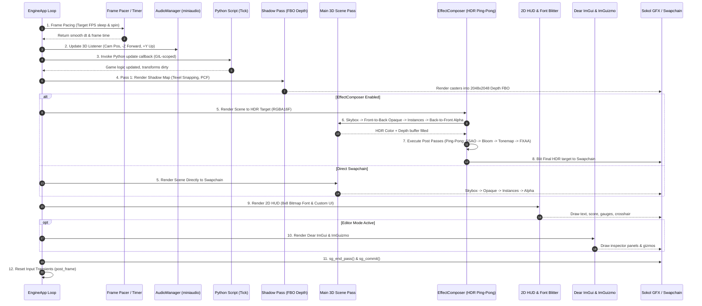
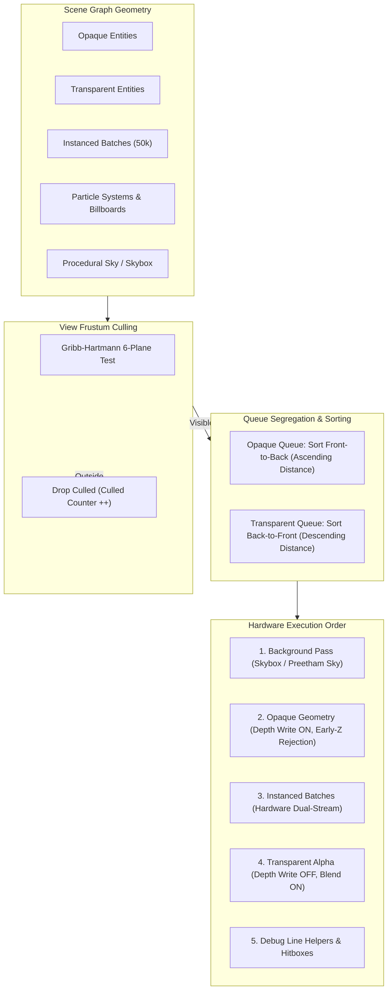
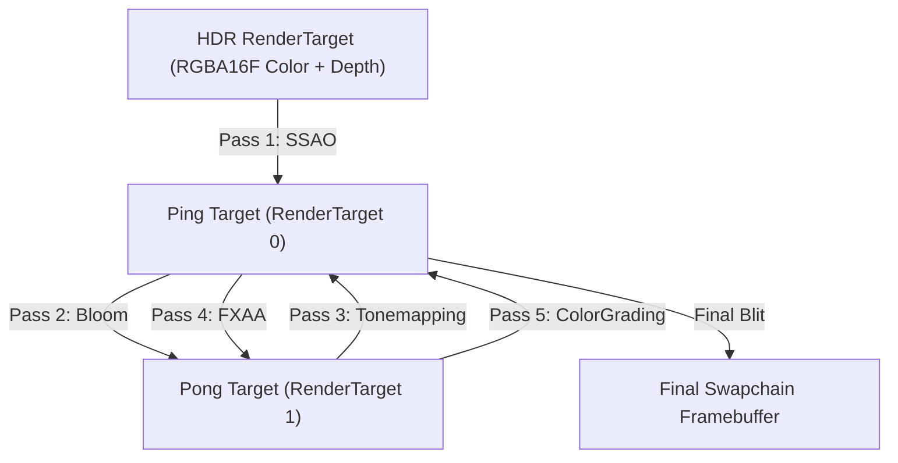

# Render Pipeline Architecture

Velocity 3D Engine employs a high-throughput, multi-pass Forward+ rendering pipeline engineered specifically for deterministic performance, sub-millisecond draw overhead, and modern physically based shading (PBR).

The pipeline supports dynamic PCF shadows with sub-texel snapping, hardware instancing for massive entity counts, dual-queue depth sorting (front-to-back opaque, back-to-front alpha), an HDR Ping-Pong post-processing compositor, an immediate-mode 2D HUD glyph engine, and Dear ImGui editor integration.



---

## 1. Frame Lifecycle & The 10-Stage Pipeline

Each frame executed by `engine::EngineApp::on_frame()` progresses through ten strict, sequential stages. This deterministic flow guarantees that transforms, camera matrices, light parameters, and audio listeners remain 100% synchronized with zero single-frame latency.

### Stage 0: Microsecond-Precision Frame Pacing

To prevent CPU spin-waste while ensuring rock-solid frame timing, Velocity implements a hybrid pacing algorithm:

```cpp
// Target FPS limiter (e.g., 60 FPS = 16.666 ms per frame)
if (target_fps_ > 0 && has_last_frame_) {
    double min_dt = 1.0 / static_cast<double>(target_fps_);
    auto target_time = last_frame_time_ + std::chrono::duration<double>(min_dt);
    auto now = std::chrono::steady_clock::now();
    if (now < target_time) {
        auto sleep_dur = target_time - now;
        // 1. Coarse sleep for long durations (> 3ms) to release OS thread quanta
        if (sleep_dur > std::chrono::milliseconds(3)) {
            std::this_thread::sleep_for(sleep_dur - std::chrono::milliseconds(2));
        }
        // 2. High-precision busy yield for the final fraction of a millisecond
        while (std::chrono::steady_clock::now() < target_time) {
            std::this_thread::yield();
        }
    }
}
```

This hybrid approach eliminates frame hitching and jitter commonly caused by Windows OS timer granularities ($15.6\text{ ms}$ default sleep quantum).

### Stage 1: Delta Time & EMA Framerate Smoothing

The engine measures elapsed wall-clock time using `std::chrono::steady_clock`. To prevent large simulation explosions during window dragging or debugging pauses, delta time is clamped to a maximum of $0.1\text{ s}$ ($10\text{ FPS}$).

The displayed framerate is smoothed using an Exponential Moving Average (EMA) filter:

$$\text{FPS}_{smoothed} = \text{FPS}_{smoothed} \cdot 0.92 + \text{FPS}_{instant} \cdot 0.08$$

### Stage 2: 3D Spatial Audio Listener Update

The `AudioManager` (backed by miniaudio) is updated immediately before any game logic executes. The listener's position, forward orientation vector (calculated along the camera's local $-Z$ axis), and upward vector ($+Y$) are synchronized:

```cpp
audio_.update_listener(camera_.position, camera_.forward(), camera_.up);
```

All 3D spatialized sound sources positioned throughout the scene graph calculate distance attenuation and stereo Doppler panning relative to this listener frame.

### Stage 3: Python Frame Update Callback

If a Python callback is registered via `app.set_update_callback(fn)`, the native engine acquires the Python Global Interpreter Lock (GIL) and invokes the user's tick function:

```cpp
if (update_callback_) {
    try {
        update_callback_(dt);
    } catch (const std::exception& e) {
        std::cerr << "[Engine] Exception in Python update callback: " << e.what() << "\n";
    }
}
```

During this callback, user gameplay code, character physics controllers, pathfinding routines, and tweens mutate entity positions, orientations, and scales.

### Stage 4: Dynamic Camera Matrix & Aspect Adaptation

Immediately after the Python callback returns, the camera recalculates its projection and view matrices. If the window has been resized or viewport dimensions have changed, the camera aspect ratio is automatically updated:

$$\text{Aspect Ratio } A = \frac{W_{\text{viewport}}}{H_{\text{viewport}}}$$

$$\mathbf{M}_{\text{VP}} = \mathbf{P}_{\text{camera}} \cdot \mathbf{V}_{\text{camera}}$$

---

## 2. Pass 1: Dynamic Shadow Mapping with Sub-Texel Snapping

Velocity supports high-resolution directional sunlight shadows and spot light shadow cones rendered into an offscreen depth buffer attachment (up to $4096 \times 4096$ resolution).

```mermaid
flowchart LR
    subgraph SunSetup["Directional Sun Orientation"]
        SunDir["Sun Light Direction (-0.5, -1.0, -0.6)"]
        CamCenter["Camera Target Center (World Space)"]
        LightView["glm::lookAt(light_pos, center, up)"]
    end

    subgraph TexelSnapping["Sub-Texel Quantization"]
        TransformLS["Center -> Light View Space"]
        Quantize["Round to nearest TexelSize"]
        TransformWS["Quantized Center -> World Space"]
    end

    subgraph ShadowRaster["GPU Shadow Rasterization"]
        Ortho["glm::ortho(-ortho_size, +ortho_size)"]
        DrawOpaque["Render Opaque Entities"]
        DrawInstances["Render Instanced Batches"]
        DepthFBO["Write to 2048x2048 Depth Map"]
    end

    SunSetup --> TexelSnapping
    TexelSnapping --> ShadowRaster
```



### 2.1 The Sub-Texel Snapping Algorithm

A common artifact in cascaded and directional shadow maps is **shadow edge shimmering (crawling)**: as the camera moves through the world, the shadow projection volume shifts continuously, causing shadow texels to map to different world positions from frame to frame.

To achieve razor-sharp, completely stable shadow borders, Velocity snaps the light-space projection center to discrete shadow map texel intervals:

```cpp
if (shadow_settings_.texel_snapping && shadow_settings_.resolution > 0) {
    // 1. Transform camera center into light view space
    glm::vec4 center_ls = light_view * glm::vec4(center, 1.0f);

    // 2. Compute world-space dimension of a single shadow texel
    float texel_size = (2.0f * shadow_settings_.ortho_size) / static_cast<float>(shadow_settings_.resolution);

    // 3. Quantize coordinates to exact integer multiples of texel_size
    center_ls.x = std::floor(center_ls.x / texel_size) * texel_size;
    center_ls.y = std::floor(center_ls.y / texel_size) * texel_size;

    // 4. Transform quantized center back into world space
    glm::vec4 snapped_center_ws = glm::inverse(light_view) * center_ls;
    glm::vec3 snapped_center = glm::vec3(snapped_center_ws);

    // 5. Reconstruct stable light view matrix
    light_pos = snapped_center - sun_dir * dist;
    light_view = glm::lookAt(light_pos, snapped_center, light_up);
}
```

### 2.2 Percentage-Closer Filtering (PCF 16-Tap)

During the main forward shading pass, shadow depth comparisons are filtered across a 16-tap Poisson disc kernel. This softens the penumbra and hides discrete shadow map pixels:

```hlsl
// HLSL / GLSL Shadow Sampling in Fragment Shader
float shadow = 0.0;
float2 texel_size = 1.0 / shadow_res.xx;

// 16-tap Poisson Disk Offsets
static const float2 poisson_disk[16] = {
    float2(-0.94201624, -0.39906216), float2( 0.94558609, -0.76890725),
    float2(-0.09418410, -0.92938870), float2( 0.34495938,  0.29387760),
    float2(-0.91588581,  0.45771432), float2(-0.81544232, -0.87912464),
    float2(-0.38277543,  0.27676845), float2( 0.97484398,  0.75648379),
    float2( 0.44323325, -0.97511554), float2( 0.53742981, -0.47373420),
    float2(-0.26496911, -0.41893023), float2( 0.79197514,  0.19090188),
    float2(-0.24188840,  0.99706507), float2(-0.81409955,  0.91437590),
    float2(-0.58754108,  0.68083912), float2( 0.20798138,  0.97860852)
};

for (int i = 0; i < 16; ++i) {
    float sample_depth = shadow_map.Sample(shadow_smp, proj_uv + poisson_disk[i] * texel_size * 1.5).r;
    shadow += (current_depth - bias > sample_depth) ? 0.0 : 1.0;
}
shadow /= 16.0;
```

---

## 3. Pass 2: Main 3D Forward Scene Pass

The scene pass is where all visible 3D geometry is rasterized. Velocity enforces strict queue sorting to maximize GPU hardware efficiency.



### 3.1 Frustum Culling & Queue Segregation

Every node possessing a valid Axis-Aligned Bounding Box (`AABB`) is tested against the six planes of the camera frustum:

```cpp
if (aabb.is_valid()) {
    if (!camera_frustum.intersects_aabb(aabb.min_point, aabb.max_point)) {
        stats_.culled_objects++;
        return; // Early discard: zero draw calls
    }
}
```

Entities passing frustum culling are categorized into two dedicated queues:
1. **Opaque Queue**: Materials where `transparent == false`, `opacity >= 0.999f`, and `blend_mode == BlendMode::Opaque`.
2. **Transparent Queue**: Materials configured with `transparent == true`, `opacity < 1.0`, or alpha blending (`BlendMode::Alpha`, `Additive`, `Multiply`).

### 3.2 Dual-Direction Depth Sorting

1. **Front-to-Back Sorting for Opaque Meshes**:
   $$\text{Queue sorted by } d^2 = \|\vec{p}_{\text{entity}} - \vec{p}_{\text{camera}}\|^2 \quad (\text{Ascending order})$$
   Drawing the closest opaque geometry first fills the hardware depth buffer early. Subsequent fragments belonging to distant occluded objects fail the depth test (`SG_COMPAREFUNC_LESS_EQUAL`) before executing expensive PBR fragment shaders (**Early-Z Depth Rejection**).
2. **Back-to-Front Sorting for Transparent Meshes**:
   $$\text{Queue sorted by } d^2 = \|\vec{p}_{\text{entity}} - \vec{p}_{\text{camera}}\|^2 \quad (\text{Descending order})$$
   Alpha blending requires painter's algorithm order: distant transparent surfaces must be written to the framebuffer before foreground transparent surfaces can blend over them. Depth writing is disabled (`depth_write = false`) to prevent translucent surfaces from occluding objects behind them.

### 3.3 Hardware Instanced Batches

When rendering repetitive objects (e.g., thousands of forest trees, grass blades, asteroid fields, or bullet streams), `ve.InstancedMesh` uploads per-instance 64-byte model matrices and 16-byte color tints directly into a dynamic second vertex buffer (`inst_vbuf_id`).

In the vertex layout:
- **Buffer Stream 0**: Per-vertex attributes (Position, Normal, UV, Color, Tangent) with `step_func = SG_VERTEXSTEP_PER_VERTEX`.
- **Buffer Stream 1**: Per-instance transform rows with `step_func = SG_VERTEXSTEP_PER_INSTANCE`.

This allows drawing up to **50,000 unique objects in a single draw call** (`sg_draw(0, num_indices, instance_count)`), reducing CPU-to-GPU overhead from hundreds of thousands of state mutations to zero.

---

## 4. Pass 3: EffectComposer & Ping-Pong HDR Post-Processing

When post-processing is enabled, the 3D scene is rendered into an offscreen High Dynamic Range framebuffer (`hdr_target_`) formatted as 16-bit floating-point (`SG_PIXELFORMAT_RGBA16F`).



### 4.1 Ping-Pong Buffer Execution

Rather than allocating distinct textures for every post-processing effect, `EffectComposer` manages two reusable work buffers: `ping_pong_[0]` and `ping_pong_[1]`.

The execution alternates read and write attachments at zero memory allocation cost:

```cpp
RenderTarget* current_read = hdr_target_.get();
int write_idx = 0;

for (size_t i = 0; i < active_passes.size(); ++i) {
    RenderTarget* current_write = ping_pong_[write_idx].get();
    
    // Pass takes input from current_read, samples depth from hdr_target_, and writes to current_write
    active_passes[i]->render(*current_read, *hdr_target_, *current_write, quad_vbuf_id_, quad_ibuf_id_);
    
    // Swap pointers
    current_read = current_write;
    write_idx = 1 - write_idx;
}

final_target_ = current_read;
```

### 4.2 Available Post-Processing Passes

| Pass | Class | Key Parameters | Algorithm / Implementation |
| :--- | :--- | :--- | :--- |
| **SSAO** | `SSAOPass` | `radius=0.5`, `bias=0.025`, `power=1.0` | 8-sample screen-space ambient occlusion sampling native depth texture. |
| **Bloom** | `BloomPass` | `threshold=1.0`, `strength=1.5`, `radius=0.5` | HDR luminance threshold extraction followed by 9-tap separable Gaussian blur. |
| **Tonemapping** | `TonemappingPass` | `mode=ACESFilmic`, `exposure=1.0`, `gamma=2.2` | ACES Filmic, Reinhard, Cineon, or Neutral curve remapping HDR $[0, \infty)$ to SDR $[0, 1]$. |
| **FXAA** | `FXAAPass` | Automatic sub-pixel contrast threshold | Fast Approximate Anti-Aliasing detecting luminance gradients. |
| **Color Grading** | `ColorGradingPass` | `contrast=1.0`, `saturation=1.0`, `brightness=1.0` | Global color manipulation in linear RGB space. |
| **Vignette & Grain** | `VignetteChromaticPass` | `vignette=0.3`, `chromatic=0.005`, `grain=0.02` | Radial lens darkening, chromatic fringing, and animated procedural film grain. |

---

## 5. Pass 4 & 5: 2D HUD Canvas, Dear ImGui & Swapchain Commit

### 5.1 Immediate-Mode 2D HUD & Built-in 8x8 Font Blitter

After 3D geometry and post-processing passes complete, the engine renders an immediate-mode 2D HUD overlay. An orthographic projection matrix maps screen pixel coordinates $(0, 0)$ to the top-left and $(W, H)$ to the bottom-right.

The engine bundles a lightweight ASCII bitmap font covering ASCII 32 (`' '`) to 126 (`'~'`) defined in `FONT_8X8[95][8]`. This font requires zero external TTF file dependencies and guarantees debug information, scores, crosshairs, and gauges can always render on screen.

### 5.2 Dear ImGui & ImGuizmo Pass

When `app.set_mode(ve.Mode.EDITOR)` is enabled (or toggled via `F2`), the engine renders the Dear ImGui docking interface:
- **Hierarchy Inspector**: Tree-view of all nodes in the scene graph.
- **Transform Inspector**: Real-time position, Euler rotation, and scale edit boxes.
- **PBR Material Editor**: Live sliders for metallic, roughness, and color pickers.
- **ImGuizmo 3D Transform Gizmos**: Interactive translate, rotate, and scale gizmo handles drawn directly over selected 3D geometry in world space.

### 5.3 Swapchain Commit

The frame terminates with Sokol GFX swapchain finalization:
```cpp
sg_end_pass();
sg_commit();
input_.post_frame(); // Resets mouse deltas and single-frame key-down triggers
```

---

## 6. Depth Buffer Math & Viewport Handling

### 6.1 Derivation of the Depth Projection $[0.0, 1.0]$

With `GLM_FORCE_DEPTH_ZERO_TO_ONE` defined, GLM produces perspective projection matrices tailored specifically for Direct3D 11, Metal, and modern Sokol GFX backends:

$$\mathbf{P} = \begin{bmatrix}
\frac{1}{\tan(\text{fov}/2) \cdot \text{aspect}} & 0 & 0 & 0 \\
0 & \frac{1}{\tan(\text{fov}/2)} & 0 & 0 \\
0 & 0 & \frac{z_{far}}{z_{near} - z_{far}} & \frac{z_{near} \cdot z_{far}}{z_{near} - z_{far}} \\
0 & 0 & -1 & 0
\end{bmatrix}$$

Transforming a view-space point $\vec{v} = [x, y, z, 1]^T$ produces clip-space coordinates:

$$z_{clip} = z \cdot \left( \frac{z_{far}}{z_{near} - z_{far}} \right) + \frac{z_{near} \cdot z_{far}}{z_{near} - z_{far}}$$

$$w_{clip} = -z$$

Dividing by perspective $w_{clip}$ yields Normalized Device Coordinates:

$$z_{ndc} = \frac{z_{clip}}{w_{clip}} = \frac{z_{far}}{z_{far} - z_{near}} \cdot \left( 1 - \frac{z_{near}}{-z} \right)$$

Evaluating at the boundary planes:
- At the Near Plane ($-z = z_{near}$):
  $$z_{ndc} = \frac{z_{far}}{z_{far} - z_{near}} \cdot (1 - 1) = \mathbf{0.0}$$
- At the Far Plane ($-z = z_{far}$):
  $$z_{ndc} = \frac{z_{far}}{z_{far} - z_{near}} \cdot \left( 1 - \frac{z_{near}}{z_{far}} \right) = \frac{z_{far} - z_{near}}{z_{far} - z_{near}} = \mathbf{1.0}$$

### 6.2 Viewport and Scissor Clipping Mechanics

Velocity supports sub-viewports and localized scissor clipping for split-screen multiplayer, UI viewports, and picture-in-picture displays:

```cpp
static void apply_camera_viewport_and_scissor(const Camera& cam, int target_w, int target_h) {
    // 1. Calculate Viewport (normalized 0.0-1.0 or absolute pixels)
    int vp_x = (cam.viewport.z <= 1.0f) ? static_cast<int>(cam.viewport.x * target_w) : static_cast<int>(cam.viewport.x);
    int vp_y = (cam.viewport.w <= 1.0f) ? static_cast<int>(cam.viewport.y * target_h) : static_cast<int>(cam.viewport.y);
    int vp_w = (cam.viewport.z <= 1.0f) ? static_cast<int>(cam.viewport.z * target_w) : static_cast<int>(cam.viewport.z);
    int vp_h = (cam.viewport.w <= 1.0f) ? static_cast<int>(cam.viewport.w * target_h) : static_cast<int>(cam.viewport.w);

    sg_apply_viewport(vp_x, vp_y, vp_w, vp_h, true);

    // 2. Calculate Scissor Rectangle
    if (cam.has_scissor) {
        int sc_x = (cam.scissor.z <= 1.0f) ? static_cast<int>(cam.scissor.x * target_w) : static_cast<int>(cam.scissor.x);
        int sc_y = (cam.scissor.w <= 1.0f) ? static_cast<int>(cam.scissor.y * target_h) : static_cast<int>(cam.scissor.y);
        int sc_w = (cam.scissor.z <= 1.0f) ? static_cast<int>(cam.scissor.z * target_w) : static_cast<int>(cam.scissor.z);
        int sc_h = (cam.scissor.w <= 1.0f) ? static_cast<int>(cam.scissor.w * target_h) : static_cast<int>(cam.scissor.w);

        sg_apply_scissor_rect(sc_x, sc_y, sc_w, sc_h, true);
    }
}
```

---

## 7. Self-Contained Python Pipeline Showcase

The following complete script configures dynamic shadows, initializes the HDR `EffectComposer` with Bloom and ACES Filmic tonemapping, adds custom 2D HUD commands, and displays live render statistics.

```python
"""Velocity 3D Engine: Multi-Pass Pipeline & EffectComposer Showcase."""

import math
import VelocityEngine as ve


def main() -> None:
    # 1. Initialize engine facade
    app = ve.App(
        title="Velocity 3D Engine — Render Pipeline & HDR Compositor",
        width=1280,
        height=720,
        clear_color=[0.02, 0.03, 0.05, 1.0],
        vsync=True,
    )

    # 2. Camera setup
    camera = app.camera
    camera.position = ve.Vec3(0.0, 4.0, 8.0)
    camera.look_at(ve.Vec3(0.0, 1.0, 0.0))
    camera.fov = 60.0

    # 3. Configure Shadow Mapping (Pass 1)
    # Enable PCF 16-tap filtering and texel snapping
    app.set_shadow_resolution(2048)
    app.set_shadow_ortho_size(12.0)
    app.set_shadow_pcf_16_tap(True)
    app.set_shadow_texel_snapping(True)
    app.set_shadow_bias(0.002)
    app.set_shadow_normal_bias(0.005)

    scene = app.scene

    # Directional sun light
    sun = ve.DirectionalLight(
        color=ve.Vec3(1.0, 0.95, 0.9),
        intensity=3.0,
        direction=ve.Vec3(-0.6, -1.0, -0.4),
    )
    sun.cast_shadow = True
    scene.add_light(sun)

    # Glowing point light inside scene
    orb_light = ve.PointLight(
        color=ve.Vec3(0.2, 0.9, 1.0),
        intensity=5.0,
        range=10.0,
    )
    orb_light.set_position(0.0, 2.0, 0.0)
    scene.add_light(orb_light)

    # 4. Construct Scene Geometry (Pass 2)
    # Floor receiving shadows
    floor_mesh = ve.Mesh.create_cube(1.0)
    floor_mat = ve.StandardMaterial(
        color=ve.Vec4(0.2, 0.25, 0.3, 1.0),
        roughness=0.6,
        metallic=0.2,
    )
    floor = ve.Entity("Floor")
    floor.mesh = floor_mesh
    floor.material = floor_mat
    floor.set_position(0.0, -0.5, 0.0)
    floor.set_scale(20.0, 1.0, 20.0)
    scene.add(floor)

    # Glowing Emissive Center Sphere (Triggers HDR Bloom)
    sphere_mesh = ve.Mesh.create_sphere(0.8, 32, 16)
    sphere_mat = ve.StandardMaterial(
        color=ve.Vec4(0.1, 0.1, 0.1, 1.0),
        emissive_color=ve.Vec3(0.2, 0.9, 1.0),
        emissive_intensity=4.0,  # Luminance > 1.0 triggers bloom threshold
        roughness=0.1,
        metallic=0.9,
    )
    center_sphere = ve.Entity("CenterSphere")
    center_sphere.mesh = sphere_mesh
    center_sphere.material = sphere_mat
    center_sphere.set_position(0.0, 1.5, 0.0)
    scene.add(center_sphere)

    # Semi-transparent outer glass cylinder
    glass_mesh = ve.Mesh.create_cylinder(1.6, 2.2, 32)
    glass_mat = ve.StandardMaterial(
        color=ve.Vec4(0.8, 0.9, 1.0, 0.4),
        roughness=0.05,
        metallic=0.1,
    )
    glass_mat.transparent = True
    glass_mat.blend_mode = ve.BlendMode.Alpha
    glass_mat.depth_write = False

    glass = ve.Entity("GlassDome")
    glass.mesh = glass_mesh
    glass.material = glass_mat
    glass.set_position(0.0, 1.5, 0.0)
    scene.add(glass)

    # 5. Configure HDR EffectComposer (Pass 3)
    composer = ve.EffectComposer(app)

    # Bloom Pass: extracts luminance > 1.0 and applies 9-tap blur
    bloom = ve.BloomPass(threshold=1.0, strength=1.8, radius=0.6)
    composer.add_pass(bloom)

    # ACES Filmic Tonemapping: compresses HDR intensities to SDR
    tonemap = ve.TonemappingPass(
        mode=ve.TonemappingMode.ACESFilmic,
        exposure=1.1,
        gamma=2.2,
    )
    composer.add_pass(tonemap)

    # FXAA Pass: anti-aliasing edge artifacts
    fxaa = ve.FXAAPass()
    composer.add_pass(fxaa)

    app.set_composer(composer)

    # 6. Interactive Frame Update & HUD (Pass 4)
    time = 0.0

    def on_frame(dt: float) -> None:
        nonlocal time
        time += dt

        # Animate glowing sphere
        center_sphere.set_position(
            math.sin(time * 1.5) * 2.0,
            1.5 + math.sin(time * 3.0) * 0.4,
            math.cos(time * 1.5) * 2.0,
        )
        orb_light.set_position(
            center_sphere.transform.position.x,
            center_sphere.transform.position.y,
            center_sphere.transform.position.z,
        )

        # Orbit camera
        cam_x = math.sin(time * 0.4) * 8.0
        cam_z = math.cos(time * 0.4) * 8.0
        camera.position = ve.Vec3(cam_x, 4.0, cam_z)
        camera.look_at(ve.Vec3(0.0, 1.0, 0.0))

        # Update Live Pipeline Telemetry
        stats = app.stats
        app.hud_title = "Velocity 3D Engine — Multi-Pass Pipeline"
        app.hud_hint = (
            f"FPS: {app.fps:.1f} | Frame Time: {app.frame_time_ms:.2f} ms | "
            f"Draw Calls: {stats.draw_calls} | Triangles: {stats.total_triangles:,} | "
            f"Culled: {stats.culled_objects}"
        )

    app.set_update_callback(on_frame)
    app.run()


if __name__ == "__main__":
    main()
```
