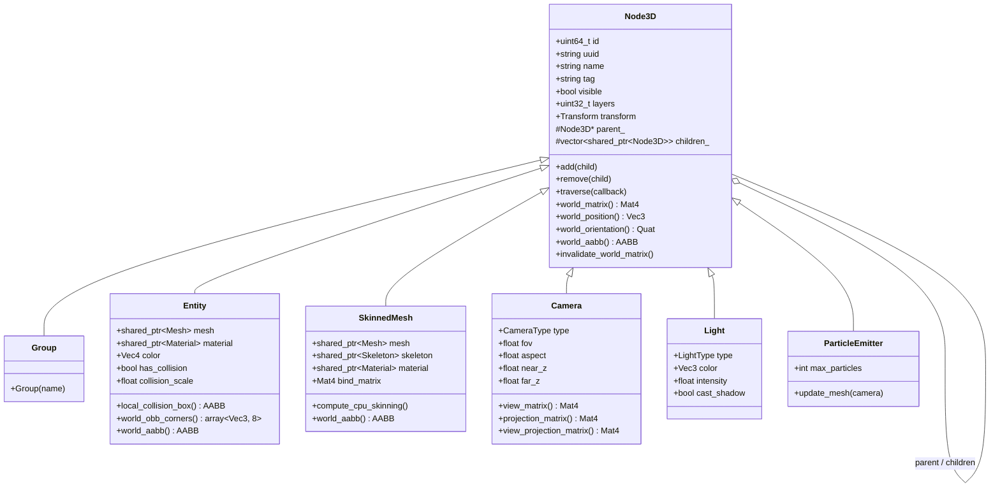
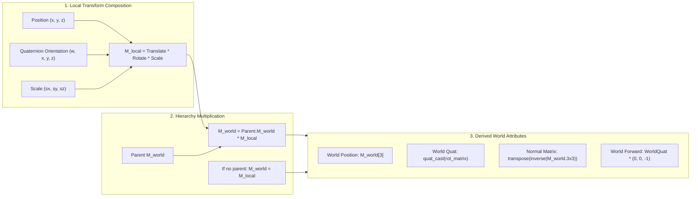
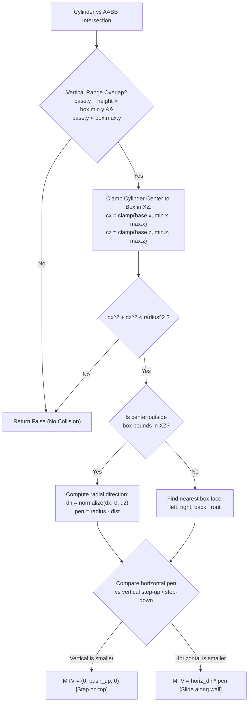

# Scene Graph Architecture & Spatial Mathematics

Velocity 3D Engine organizes all 3D objects, lights, cameras, and audio emitters into a high-performance hierarchical directed acyclic graph (Scene Graph).

The scene graph system is engineered around cache-conscious matrix operations, lazy dirty-flag transform propagation, automatic cycle prevention, and exact collision depenetration algorithms (Minimum Translation Vector, or MTV).



---

## 1. Scene Graph Hierarchy & Class Specialization

All spatial elements in Velocity derive from the polymorphic base class `engine::Node3D` (`std::enable_shared_from_this<Node3D>`).

### 1.1 Base Class: `Node3D`

`Node3D` provides the foundational identity, spatial transform, and tree mechanics:
- **Global Identification**: Each node is assigned a monotonic 64-bit integer `id` (via atomic increment) and an RFC 4122 v4 hexadecimal `uuid` for deterministic serialization.
- **Hierarchical Linking**: Nodes maintain an non-owning raw pointer to their `parent_` (`Node3D*`) and an array of owning shared pointers to their `children_` (`std::vector<std::shared_ptr<Node3D>>`).
- **Bitmask Layers**: A 32-bit `layers` bitfield allows selective camera rendering and raycast filtering (e.g., Layer 0 = Default, Layer 1 = Characters, Layer 2 = 2D UI).
- **Cycle Prevention**: To prevent cyclic parent-child links that would result in infinite loops during matrix recalculation, `add()` validates that the candidate child is not an ancestor of `this`:
  ```cpp
  Node3D* curr = this;
  while (curr) {
      if (curr == child.get()) {
          return; // Cyclic dependency prevented!
      }
      curr = curr->parent_;
  }
  ```

### 1.2 Structural Specializations

| Class | Purpose | Key Attributes | Render Behavior |
| :--- | :--- | :--- | :--- |
| **`Group`** | Logical grouping node & transform pivot. | No geometry or materials. | Invisible; passes down composite world transform to child nodes. |
| **`Entity`** | Concrete renderable 3D game object. | `mesh`, `material`, `color`, collision padding. | Enqueued into Opaque or Transparent rendering passes; supports OBB generation. |
| **`SkinnedMesh`** | Rigged character mesh driven by skeleton. | `mesh`, `skeleton`, `bind_matrix`, `base_vertices`. | Evaluates skinning matrices per vertex; dynamic vertex buffer update. |
| **`Camera`** | Perspective or Orthographic view camera. | `fov`, `aspect`, `near_z`, `far_z`, `viewport`, `scissor`. | Calculates `view_matrix()` and `projection_matrix()`. |
| **`Light`** | Illuminator (Directional, Point, Spot, Hemi). | `color`, `intensity`, `range`, `outer_cone_angle`. | Packed into `LightParamsUBO` for forward PBR shading. |
| **`ParticleEmitter`**| GPU billboard particle system. | `max_particles`, `spawn_rate`, `lifetime`. | Generates dynamic camera-facing quad strips. |

---

## 2. Transform Propagation & Spatial Mathematics

Every `Node3D` contains an `engine::Transform` instance representing its spatial configuration relative to its immediate parent.



### 2.1 Local Matrix Composition

The local transformation matrix $\mathbf{M}_{local} \in \mathbb{R}^{4 \times 4}$ is assembled in Translation-Rotation-Scale ($T \cdot R \cdot S$) order:

$$\mathbf{M}_{local} = \mathbf{T}(\vec{p}) \cdot \mathbf{R}(\mathbf{q}) \cdot \mathbf{S}(\vec{s})$$

Where:
- $\mathbf{T}(\vec{p})$ translates by position $\vec{p} = [x, y, z]^T$:
  $$\mathbf{T}(\vec{p}) = \begin{bmatrix} 1 & 0 & 0 & x \\ 0 & 1 & 0 & y \\ 0 & 0 & 1 & z \\ 0 & 0 & 0 & 1 \end{bmatrix}$$
- $\mathbf{R}(\mathbf{q})$ is the rotation matrix derived from normalized unit quaternion $\mathbf{q} = [w, x, y, z]$:
  $$\mathbf{R}(\mathbf{q}) = \begin{bmatrix}
  1 - 2(y^2 + z^2) & 2(xy - wz) & 2(xz + wy) & 0 \\
  2(xy + wz) & 1 - 2(x^2 + z^2) & 2(yz - wx) & 0 \\
  2(xz - wy) & 2(yz + wx) & 1 - 2(x^2 + y^2) & 0 \\
  0 & 0 & 0 & 1
  \end{bmatrix}$$
- $\mathbf{S}(\vec{s})$ applies scaling along principal axes $\vec{s} = [s_x, s_y, s_z]^T$:
  $$\mathbf{S}(\vec{s}) = \begin{bmatrix} s_x & 0 & 0 & 0 \\ 0 & s_y & 0 & 0 \\ 0 & 0 & s_z & 0 \\ 0 & 0 & 0 & 1 \end{bmatrix}$$

### 2.2 Euler-Quaternion Synchronization ($YXZ$ Order)

To eliminate conversion overhead and prevent numerical drift, `Transform` synchronizes Euler angles with quaternions lazily using a cache variable `last_synced_euler_`.

When Euler rotations are modified in degrees:
1. `Transform::set_rotation(rx, ry, rz)` evaluates:
   $$\mathbf{q} = \mathbf{q}_Y(\text{ry}) \cdot \mathbf{q}_X(\text{rx}) \cdot \mathbf{q}_Z(\text{rz})$$
2. In reverse, when querying `.rotation`, the quaternion is decomposed into $YXZ$ Euler angles:
   $$\text{Pitch } (X) = \arcsin\left(\text{clamp}(-2(yz - wx), -1.0, 1.0)\right)$$
   $$\text{Yaw } (Y) = \operatorname{atan2}\left(2(xz + wy), 1 - 2(x^2 + y^2)\right)$$
   $$\text{Roll } (Z) = \operatorname{atan2}\left(2(xy + wz), 1 - 2(x^2 + z^2)\right)$$

### 2.3 World Matrix Propagation & Lazy Dirty Flags

Calculating world matrices for thousands of nodes every frame is computationally expensive. Velocity employs a **hierarchical dirty flag invalidation pattern**:

```cpp
void Node3D::invalidate_world_matrix() {
    world_matrix_dirty_ = true;
    for (auto& child : children_) {
        if (child) {
            child->invalidate_world_matrix();
        }
    }
}
```

When a node's position, rotation, or scale changes:
1. It calls `invalidate_world_matrix()`, setting `world_matrix_dirty_ = true` on itself and recursively flagging all its descendants ($O(k)$ pointer traverse, zero matrix math).
2. The world matrix is evaluated **lazily** only when read by the renderer, physics engine, or user script:
   ```cpp
   const glm::mat4& Node3D::world_matrix() const {
       if (world_matrix_dirty_) {
           glm::mat4 local = transform.model_matrix();
           if (parent_) {
               world_matrix_ = parent_->world_matrix() * local;
           } else {
               world_matrix_ = local;
           }
           world_matrix_dirty_ = false;
       }
       return world_matrix_;
   }
   ```

### 2.4 World Matrix Decomposition

Velocity provides $O(1)$ accessors to extract true global spatial parameters from the composite $4 \times 4$ world matrix:

1. **World Position**:
   $$\vec{p}_{world} = \begin{bmatrix} \mathbf{M}_{world}[3][0] \\ \mathbf{M}_{world}[3][1] \\ \mathbf{M}_{world}[3][2] \end{bmatrix}$$
2. **World Scale Extraction**:
   $$s_x = \|\mathbf{M}_{world}[0]\|, \quad s_y = \|\mathbf{M}_{world}[1]\|, \quad s_z = \|\mathbf{M}_{world}[2]\|$$
3. **World Orientation Quaternion**:
   Normalized $3 \times 3$ rotational basis vectors:
   $$\mathbf{R}_{pure} = \begin{bmatrix} \frac{\mathbf{M}_{world}[0]}{s_x} & \frac{\mathbf{M}_{world}[1]}{s_y} & \frac{\mathbf{M}_{world}[2]}{s_z} \end{bmatrix}$$
   $$\mathbf{q}_{world} = \text{quat\_cast}(\mathbf{R}_{pure})$$
4. **World Forward Direction**:
   Following the right-handed convention, the unrotated heading is along $-Z$:
   $$\vec{d}_{forward} = \mathbf{q}_{world} \cdot \begin{bmatrix} 0 \\ 0 \\ -1 \end{bmatrix}$$

### 2.5 The World Normal Matrix (Inverse-Transpose)

Transforming surface normal vectors directly by $\mathbf{M}_{world}$ distorts angles if the node experiences non-uniform scaling ($s_x \neq s_y \neq s_z$).

To guarantee that surface normals remain strictly perpendicular to geometry surfaces, Velocity computes the inverse-transpose of the upper-left $3 \times 3$ world matrix:

$$\mathbf{M}_{normal} = \left( (\mathbf{M}_{world}^{3 \times 3})^{-1} \right)^T$$

---

## 3. Bounding Volumes & Spatial Bounds

Velocity provides three primary spatial bounding volume representations for culling, broad-phase collision detection, and raycasting.

```text
       AABB                     BoundingSphere                  Cylinder
  +---------------+                  .---.                       .---.
  |               |                /       \                    /     \
  |               |               |    o    |                  |   o   |  Radius r
  |               |                \       /                   |       |
  |               |                  '---'                     |       |  Height h
  +---------------+                 Radius r                   |       |
  min_p       max_p                                             '---'
                                                                 base
```

### 3.1 Axis-Aligned Bounding Box (`AABB`)

Defined by two 3D vectors: `min_point` and `max_point`.
- **Validity Condition**: $\min.x \le \max.x \land \min.y \le \max.y \land \min.z \le \max.z$.
- **Extents & Center**:
  $$\text{Center } \vec{c} = \frac{\min + \max}{2}, \quad \text{Extents } \vec{e} = \frac{\max - \min}{2}$$

#### 8-Corner Matrix Transformation

When an entity with a local AABB undergoes rotation, the resulting world bounds are no longer axis-aligned. To derive the tightest containing world AABB, Velocity transforms all 8 local corners by $\mathbf{M}_{world}$ and calculates the bounding envelope:

```cpp
AABB AABB::transformed(const glm::mat4& matrix) const {
    if (!is_valid()) return *this;

    glm::vec3 corners[8] = {
        { min_point.x, min_point.y, min_point.z }, { max_point.x, min_point.y, min_point.z },
        { min_point.x, max_point.y, min_point.z }, { max_point.x, max_point.y, min_point.z },
        { min_point.x, min_point.y, max_point.z }, { max_point.x, min_point.y, max_point.z },
        { min_point.x, max_point.y, max_point.z }, { max_point.x, max_point.y, max_point.z },
    };

    AABB result;
    for (int i = 0; i < 8; ++i) {
        glm::vec4 t = matrix * glm::vec4(corners[i], 1.0f);
        float w = t.w != 0.0f ? t.w : 1.0f;
        result.expand(glm::vec3(t) / w);
    }
    return result;
}
```

### 3.2 Oriented Bounding Box (`OBB`)

An `Entity` can generate an exact Oriented Bounding Box by transforming its local collision box corners directly into world space:

```cpp
auto corners = entity.world_obb_corners()  # Returns std::array<glm::vec3, 8>
```

These 8 world-space vertices retain the entity's exact orientation and are connected across 12 line edges to render real-time green debug hitboxes in Editor and Debug modes.

### 3.3 Bounding Sphere (`BoundingSphere`)

Defined by center point $\vec{c}$ and scalar radius $r$.
Constructed automatically from an AABB:
$$r = \|\vec{e}\| = \sqrt{e_x^2 + e_y^2 + e_z^2}$$

Optimal for rapid coarse frustum intersection tests ($O(1)$ dot-product distance against 6 frustum planes) and omnidirectional trigger volumes.

### 3.4 Character Collision Cylinder (`Cylinder`)

Specifically engineered for character controllers (e.g., Mario, humanoids, racing cars), the `Cylinder` represents an upright vertical volume defined by:
- `base`: 3D position of bottom center.
- `radius`: Horizontal cross-section radius in $XZ$.
- `height`: Vertical extent along $+Y$.

---

## 4. Minimum Translation Vector (MTV) Depenetration Algorithms

The **Minimum Translation Vector (MTV)** is the shortest spatial vector required to displace a penetrating bounding volume so that it rests completely outside the colliding surface.

### 4.1 AABB vs AABB MTV Algorithm

When two axis-aligned bounding boxes $A$ and $B$ intersect, penetration occurs across all three coordinate axes simultaneously:

$$\text{Overlap along } X: \quad \delta x_1 = A_{\max}.x - B_{\min}.x, \quad \delta x_2 = B_{\max}.x - A_{\min}.x$$
$$\text{Push}_x = (\delta x_1 < \delta x_2) \,?\, -\delta x_1 : \delta x_2$$

$$\text{Overlap along } Y: \quad \delta y_1 = A_{\max}.y - B_{\min}.y, \quad \delta y_2 = B_{\max}.y - A_{\min}.y$$
$$\text{Push}_y = (\delta y_1 < \delta y_2) \,?\, -\delta y_1 : \delta y_2$$

$$\text{Overlap along } Z: \quad \delta z_1 = A_{\max}.z - B_{\min}.z, \quad \delta z_2 = B_{\max}.z - A_{\min}.z$$
$$\text{Push}_z = (\delta z_1 < \delta z_2) \,?\, -\delta z_1 : \delta z_2$$

The algorithm selects the axis exhibiting the **minimum absolute penetration**:

$$\text{axis} = \operatorname{argmin}\left( |\text{Push}_x|, |\text{Push}_y|, |\text{Push}_z| \right)$$

$$\vec{v}_{MTV} = \begin{cases}
[\text{Push}_x, 0, 0]^T & \text{if } |\text{Push}_x| \le |\text{Push}_y| \land |\text{Push}_x| \le |\text{Push}_z| \\
[0, \text{Push}_y, 0]^T & \text{if } |\text{Push}_y| \le |\text{Push}_x| \land |\text{Push}_y| \le |\text{Push}_z| \\
[0, 0, \text{Push}_z]^T & \text{otherwise}
\end{cases}$$

Displacing box $A$ by $\vec{v}_{MTV}$ guarantees exact tangential contact with $B$.

---

### 4.2 Cylinder vs AABB Depenetration Algorithm

For humanoid characters, testing an upright cylinder against an AABB box provides smooth wall-sliding and realistic step climbing.



The algorithm executes in four steps:

1. **Vertical Overlap Check**:
   $$\text{overlap}_y = (base.y + height > box.min.y) \land (base.y < box.max.y)$$
   If false, the character is completely above or below the box. Return false immediately.
2. **Horizontal Clamping to Box Bounds**:
   Find the closest point $(c_x, c_z)$ on the 2D box footprint to the cylinder axis:
   $$c_x = \operatorname{clamp}(base.x, box.min.x, box.max.x)$$
   $$c_z = \operatorname{clamp}(base.z, box.min.z, box.max.z)$$
   $$dx = base.x - c_x, \quad dz = base.z - c_z, \quad d^2 = dx^2 + dz^2$$
3. **Radial Depenetration (Center Outside Box)**:
   If $d^2 > 10^{-8}$:
   $$\text{dist} = \sqrt{d^2}$$
   If $\text{dist} \ge \text{radius}$, no collision exists.
   Otherwise:
   $$\text{Horizontal Penetration } p_h = \text{radius} - \text{dist}$$
   $$\vec{d}_{horiz} = \left[ \frac{dx}{\text{dist}}, 0, \frac{dz}{\text{dist}} \right]^T$$
4. **Step-Up vs Wall-Slide Decision**:
   $$\text{Push Up } = box.max.y - base.y, \quad \text{Push Down } = box.min.y - (base.y + height)$$
   If horizontal penetration $p_h$ is smaller than vertical pushes, the character slides horizontally along the wall:
   $$\vec{v}_{MTV} = \vec{d}_{horiz} \cdot p_h$$
   If vertical step-up is smaller (e.g., character's feet clipped into a low curb or platform edge $\le 0.3\text{ m}$), the character is popped vertically onto the platform surface:
   $$\vec{v}_{MTV} = [0, \text{Push Up}, 0]^T$$

---

## 5. Self-Contained Python Scene Graph & Physics Example

The following script constructs a hierarchical articulated vehicle with child wheel pivots, implements a character with an upright `Cylinder`, and runs a real-time MTV depenetration physics loop.

```python
"""Velocity 3D Engine: Scene Graph Hierarchy & MTV Collision Example."""

import VelocityEngine as ve


def main() -> None:
    # 1. Initialize engine
    app = ve.App(
        title="Velocity 3D Engine — Scene Graph & MTV Physics",
        width=1280,
        height=720,
        clear_color=[0.08, 0.10, 0.14, 1.0],
        vsync=True,
    )

    camera = app.camera
    camera.position = ve.Vec3(0.0, 5.0, 10.0)
    camera.look_at(ve.Vec3(0.0, 1.0, 0.0))

    scene = app.scene

    # Lighting
    sun = ve.DirectionalLight(
        color=ve.Vec3(1.0, 0.95, 0.85),
        intensity=2.5,
        direction=ve.Vec3(-0.5, -1.0, -0.5),
    )
    sun.cast_shadow = True
    scene.add_light(sun)

    # 2. Construct Articulated Vehicle Hierarchy
    # Root Vehicle Pivot
    vehicle_root = ve.Group("VehicleRoot")
    vehicle_root.set_position(0.0, 0.5, 0.0)
    scene.add(vehicle_root)

    # Chassis Entity (Child of Root)
    chassis_mesh = ve.Mesh.create_cube(1.0)
    chassis_mat = ve.StandardMaterial(
        color=ve.Vec4(0.85, 0.15, 0.2, 1.0),
        roughness=0.3,
        metallic=0.7,
    )
    chassis = ve.Entity("Chassis")
    chassis.mesh = chassis_mesh
    chassis.material = chassis_mat
    chassis.set_scale(2.0, 0.6, 4.0)
    vehicle_root.add(chassis)

    # 4 Wheel Entities (Children of Root)
    wheel_mesh = ve.Mesh.create_cylinder(0.4, 0.3, 16)
    wheel_mat = ve.StandardMaterial(
        color=ve.Vec4(0.1, 0.1, 0.1, 1.0),
        roughness=0.9,
        metallic=0.0,
    )
    wheel_offsets = [
        (-1.1, -0.2,  1.3),  # Front-Left
        ( 1.1, -0.2,  1.3),  # Front-Right
        (-1.1, -0.2, -1.3),  # Rear-Left
        ( 1.1, -0.2, -1.3),  # Rear-Right
    ]
    wheels: list[ve.Entity] = []
    for i, offset in enumerate(wheel_offsets):
        w = ve.Entity(f"Wheel_{i}")
        w.mesh = wheel_mesh
        w.material = wheel_mat
        w.set_position(*offset)
        w.set_rotation(0.0, 0.0, 90.0)  # Align cylinder axis horizontally
        vehicle_root.add(w)
        wheels.append(w)

    # 3. Environment Obstacles (AABBs)
    obstacles: list[ve.Entity] = []
    wall_mesh = ve.Mesh.create_cube(1.0)
    wall_mat = ve.StandardMaterial(
        color=ve.Vec4(0.3, 0.5, 0.7, 1.0),
        roughness=0.5,
        metallic=0.1,
    )

    pillar = ve.Entity("StonePillar")
    pillar.mesh = wall_mesh
    pillar.material = wall_mat
    pillar.set_position(3.0, 1.5, 0.0)
    pillar.set_scale(1.5, 3.0, 1.5)
    scene.add(pillar)
    obstacles.append(pillar)

    step_block = ve.Entity("LowStep")
    step_block.mesh = wall_mesh
    step_block.material = wall_mat
    step_block.set_position(-3.0, 0.25, 0.0)
    step_block.set_scale(2.0, 0.5, 2.0)
    scene.add(step_block)
    obstacles.append(step_block)

    # 4. Player Character Representation (Cylinder)
    player_cylinder = ve.Cylinder(
        base=ve.Vec3(0.0, 0.0, 3.5),
        radius=0.4,
        height=1.8,
    )

    player_mesh = ve.Mesh.create_cylinder(0.4, 1.8, 16)
    player_mat = ve.StandardMaterial(
        color=ve.Vec4(0.2, 0.8, 0.3, 1.0),
        roughness=0.4,
        metallic=0.2,
    )
    player_entity = ve.Entity("PlayerAvatar")
    player_entity.mesh = player_mesh
    player_entity.material = player_mat
    scene.add(player_entity)

    # 5. Physics & Animation Tick
    time = 0.0

    def on_tick(dt: float) -> None:
        nonlocal time
        time += dt

        # Articulated Hierarchy Animation:
        # Move vehicle in a circle
        vehicle_root.transform.rotate_y(30.0 * dt)
        vehicle_root.transform.translate(ve.Vec3(0.0, 0.0, -2.0 * dt))

        # Spin child wheels around their local axle
        for w in wheels:
            w.transform.rotate_x(180.0 * dt)

        # Character Navigation with MTV Depenetration
        # Move player horizontally towards obstacles
        move_dir = ve.Vec3(0.0, 0.0, 0.0)
        input_mgr = app.input
        if input_mgr.is_key_down(ve.Key.W):
            move_dir.z -= 4.0 * dt
        if input_mgr.is_key_down(ve.Key.S):
            move_dir.z += 4.0 * dt
        if input_mgr.is_key_down(ve.Key.A):
            move_dir.x -= 4.0 * dt
        if input_mgr.is_key_down(ve.Key.D):
            move_dir.x += 4.0 * dt

        # Apply proposed motion
        player_cylinder.base = ve.Vec3(
            player_cylinder.base.x + move_dir.x,
            player_cylinder.base.y + move_dir.y,
            player_cylinder.base.z + move_dir.z,
        )

        # Test MTV Depenetration against all environment AABBs
        for obs in obstacles:
            obs_box = obs.world_aabb()
            mtv = ve.Vec3(0.0, 0.0, 0.0)

            # Solve exact Cylinder vs AABB depenetration
            if player_cylinder.get_penetration_aabb(obs_box, mtv):
                # Displace cylinder position by the Minimum Translation Vector
                player_cylinder.base = ve.Vec3(
                    player_cylinder.base.x + mtv.x,
                    player_cylinder.base.y + mtv.y,
                    player_cylinder.base.z + mtv.z,
                )

        # Synchronize visual entity with physical cylinder
        player_entity.set_position(
            player_cylinder.base.x,
            player_cylinder.base.y + 0.9,  # Center is base + half-height
            player_cylinder.base.z,
        )

        # Telemetry
        app.hud_title = "Velocity 3D Engine — Scene Graph & MTV Collision"
        app.hud_hint = (
            f"Player Pos: ({player_cylinder.base.x:.2f}, {player_cylinder.base.y:.2f}, {player_cylinder.base.z:.2f}) | "
            f"Use W/A/S/D to test wall slide & curb climb"
        )

    app.set_update_callback(on_tick)
    app.run()


if __name__ == "__main__":
    main()
```
