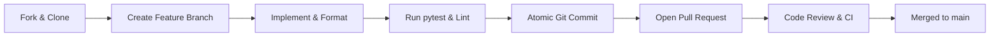

# Contributing to Velocity 3D Engine

Thank you for your interest in contributing to **Velocity 3D Engine**! This document provides an overview of our project mission, development environment setup, workflow, and pull request guidelines.

---

## Project Mission & Philosophy

Velocity 3D Engine is engineered around three foundational pillars:
1. **Raw C++20 Performance**: Zero-overhead abstractions, data-oriented memory layouts, GLM SIMD vector mathematics, and Sokol GFX (Direct3D 11, Metal, OpenGL, WebGPU).
2. **Pythonic Ergonomics**: First-class Python bindings via `nanobind` with complete PEP-484 / PEP-561 type stub annotations for seamless IDE auto-completion.
3. **100% Automated Test Coverage**: A rigorous, regression-resistant test suite verifying mathematical correctness, memory lifecycle safety, and rendering pipelines.

---

## Development Environment Setup

### Prerequisites

| Tool | Minimum Version | Recommended Version | Notes |
|:---|:---:|:---:|:---|
| **CMake** | `3.24+` | `3.28+` | Build system generator |
| **C++ Compiler** | C++20 compliant | MSVC 2022 (v143) / GCC 13+ / Clang 16+ | C++20 standard required |
| **Python** | `3.10+` | `3.12+` | Python runtime |
| **Ninja** | `1.10+` | `1.12+` | High-speed build tool |
| **Git** | `2.30+` | Latest | Version control |

---

### Step-by-Step Installation

#### 1. Clone Repository with Submodules
```bash
git clone https://github.com/fortestaccountQ/velocity-3d-engine.git
cd velocity-3d-engine
```

#### 2. Create and Activate a Python Virtual Environment
```bash
# Windows
python -m venv .venv
.venv\Scripts\activate

# Linux / macOS
python3 -m venv .venv
source .venv/bin/activate
```

#### 3. Install Development & Build Dependencies
```bash
pip install --upgrade pip
pip install scikit-build-core nanobind ninja pytest numpy flake8 black
```

#### 4. Compile the Engine in Editable Mode
```bash
# Compiles the C++ core and installs the Python bindings directly into the virtual environment
pip install -e . --no-build-isolation
```

#### 5. Verify Build by Running the Test Suite
```bash
pytest tests -q
```
All tests should pass.

---

## Alternative: Standalone C++ Build via CMake

If you are developing purely on the C++ core engine or profiling native code:

```bash
# Configure with Ninja
cmake -B build -G "Ninja" -DCMAKE_BUILD_TYPE=Release

# Build
cmake --build build --config Release
```

---

## Development Workflow & Git Best Practices



### 1. Branch Naming
- Features: `feature/pbr-clearcoat-roughness`
- Bug Fixes: `fix/cylinder-mtv-penetration`
- Performance: `perf/instanced-buffer-upload`
- Documentation: `docs/api-postprocess-reference`

### 2. Commit Message Convention
We adhere to Conventional Commits:
- `feat(materials): add transmission and IOR to PhysicalMaterial`
- `fix(controller): resolve stair step-up jitter on low FPS`
- `docs(api): document AnimationMixer and crossfade_to`
- `test(physics): add unit tests for Ray-Cylinder intersection`

---

## Pull Request Checklist

Before submitting a Pull Request, ensure that:
- [ ] Code builds cleanly without warnings on MSVC/GCC/Clang.
- [ ] Automated tests pass: `pytest tests -q`.
- [ ] New functionality includes corresponding unit or integration tests in `tests/`.
- [ ] C++ code adheres to LLVM/Google style guidelines (see [`code-style.md`](code-style.md)).
- [ ] Python code passes PEP 8 linting and type annotations are updated in `.pyi` stubs.
- [ ] Public API additions are documented in `docs/api-reference/`.
