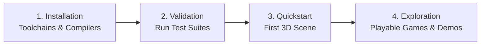

# Getting Started

Welcome to the **Velocity 3D Engine** Getting Started section. Whether you are an experienced 3D graphics engineer or a Python developer building your very first real-time simulation, this guide will walk you through the entire process of setting up your environment, compiling the C++20 core, running automated diagnostics, and writing your first illuminated 3D application.

---

## 🗺️ Learning Path

Follow this structured roadmap to get up and running smoothly:

-   :material-download:{ .lg .middle } **[1. Installation Guide](installation.md)**

    ---

    Detailed instructions for compiling the engine across Windows (MSVC 2022), Linux (GCC/Clang), and macOS (Apple Clang/Metal) using Python editable mode (`pip install -e .`) or standalone `CMake` with `Ninja`.

    [:octicons-arrow-right-24: Read Installation Guide](installation.md)

-   :material-play-circle:{ .lg .middle } **[2. 5-Minute Quickstart](quickstart.md)**

    ---

    A step-by-step tutorial that builds an interactive 3D scene from the ground up: creating an `App` window, placing a `Camera`, configuring sunlight, spawning a metallic PBR cube, and adding real-time rotation.

    [:octicons-arrow-right-24: Jump to Quickstart](quickstart.md)

-   :material-wrench:{ .lg .middle } **[3. Troubleshooting & FAQs](troubleshooting.md)**

    ---

    Solutions to common build warnings, missing MSVC compilers, GPU backend selection, vertex index buffer limits (`uint16_t`), and dynamic vertex buffer usage.

    [:octicons-arrow-right-24: View Troubleshooting](troubleshooting.md)

---

## 💻 System Requirements & Compatibility

Velocity 3D Engine relies on **Sokol GFX** for native graphics hardware abstraction and **nanobind** for low-overhead Python binding. Check the compatibility matrix below to verify your hardware and operating system support:

### Operating System Support

| Operating System | Architecture | Graphics API Backend | Status |
| :--- | :--- | :--- | :--- |
| **Windows 10 / 11** | `x86_64` | **Direct3D 11** (`SOKOL_D3D11`) | :white_check_mark: Tier 1 (Fully Supported) |
| **Linux (Ubuntu, Debian, Fedora, Arch)** | `x86_64`, `aarch64` | **OpenGL 3.3+ Core** (`SOKOL_GLCORE`) | :white_check_mark: Tier 1 (Fully Supported) |
| **macOS (12+ Monterey, Ventura, Sonoma)** | Apple Silicon (`M1/M2/M3`), `x86_64` | **Metal** (`SOKOL_METAL`) | :white_check_mark: Tier 1 (Fully Supported) |
| **Web / Browser** | WebAssembly (`wasm32`) | **WebGL 2.0 / GLES3** (`SOKOL_GLES3`) | :construction: Experimental Alpha |

### Hardware Prerequisites

| Component | Minimum Specification | Recommended Specification |
| :--- | :--- | :--- |
| **Processor** | 64-bit dual-core CPU with SSE4.2 support | 64-bit quad-core CPU or Apple Silicon |
| **System Memory (RAM)** | 4 GB RAM | 8 GB+ RAM (especially when compiling C++20 core) |
| **Graphics Card (GPU)** | GPU with Direct3D 11 (Feature Level 11_0), Metal 2, or OpenGL 3.3 Core | Dedicated NVIDIA / AMD / Apple Silicon GPU |
| **Disk Space** | 500 MB free space for toolchains and build artifacts | 2 GB free space |

### Software Prerequisites

* **Python**: `3.10`, `3.11`, `3.12`, or `3.13` (64-bit).
* **CMake**: Version `3.24` or newer.
* **C++20 Compiler**:
    * **Windows**: Microsoft Visual C++ 2022 (MSVC v143, Visual Studio 17.0+).
    * **Linux**: GCC `>= 12.0` or Clang `>= 15.0`.
    * **macOS**: Apple Clang `>= 14.0` (included with Xcode Command Line Tools).
* **Build Generator**: `Ninja` version `1.10` or newer (strongly recommended for fast parallel compilation).

---

## 🎯 Recommended Development Setup

To maximize productivity and benefit from strict PEP-484 static typing, we recommend the following IDE configuration:

1. **Visual Studio Code / Cursor**:
    * Install the **Python** and **Pylance** extensions.
    * In `.vscode/settings.json`, set `"python.analysis.typeCheckingMode": "basic"` (or `"strict"`).
    * Pylance will automatically discover the native type stubs located at `python/VelocityEngine/_VelocityEngine_core.pyi` to provide full autocomplete, parameter hints, and signature verification.
2. **Dedicated Virtual Environment**:
    * Always isolate project dependencies using a clean Python virtual environment (`python -m venv .venv`).
3. **Interactive Debugging**:
    * Enable the built-in Dear ImGui visual editor at any time in your applications by pressing ++f2++. It displays live entity counts, frame timing, transform hierarchies, and interactive manipulation gizmos.

---

## 🚀 Next Steps

Ready to set up your environment? Proceed to the **[Installation Guide](installation.md)** to configure your compiler and install Velocity 3D Engine.
