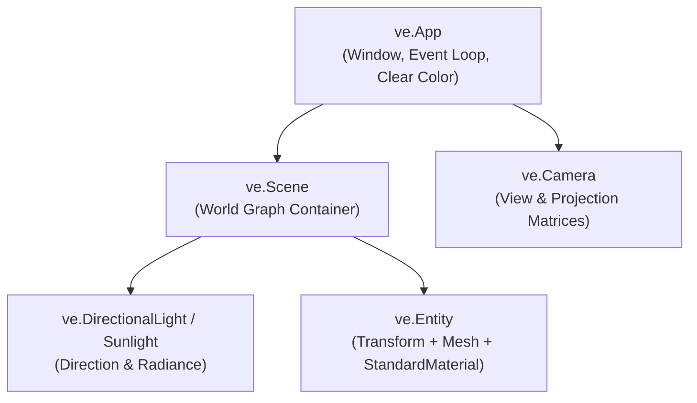

# 5-Minute Quickstart: Your First 3D Scene

In this tutorial, you will build an interactive 3D application from scratch in **under 5 minutes**. By the end of this guide, you will have created a native window, configured a perspective camera, illuminated the world with directional sunlight, constructed a metallic Physically Based Rendering (PBR) cube, and animated it smoothly at 60+ FPS.

---

## 🎯 Architecture of a Velocity Application

Every 3D experience in Velocity is structured around five core building blocks:



1. **`ve.App`**: Manages the native OS window, Sokol GFX graphics context, and frame loop.
2. **`ve.Scene`**: The hierarchical 3D container holding all entities, lights, environment probes, and collision geometry.
3. **`ve.Camera`**: Defines how the 3D world is projected onto your 2D screen (position, target, field of view, clipping planes).
4. **`ve.DirectionalLight` / `ve.AmbientLight`**: Simulates infinite distant illumination (e.g. the sun) and ambient environment radiance.
5. **`ve.Entity`**: A tangible 3D object combining a `Transform` (position, rotation, scale), a `Mesh` (vertex buffers), and a `StandardMaterial` (PBR shaders).

---

## 🛠️ Step-by-Step Walkthrough

### Step 1: Initializing the Application Window

Start by creating an instance of `ve.App`. You can specify the window title, resolution, and clear color:

```python
from __future__ import annotations
import VelocityEngine as ve

# Initialize a 1280x720 window with a modern dark slate background (#12151f)
app = ve.App(
    title="Velocity 3D Engine - Quickstart",
    width=1280,
    height=720,
    clear_color="#12151f",
    vsync=True,
)
```

### Step 2: Configuring the Camera

Velocity automatically provides an active perspective camera on `app.camera`. Position the camera 2 units up and 4.5 units back, aimed directly at the origin `(0, 0, 0)`:

```python
# Position the camera in world space
app.camera.set_position(0.0, 2.0, 4.5)

# Orient the camera toward the origin
app.camera.set_target(0.0, 0.0, 0.0)
```

### Step 3: Illuminating the World

Realistic PBR rendering requires light. We add ambient fill lighting to illuminate shadow crevices alongside a strong directional sunlight:

```python
# 1. Subtle ambient fill lighting
ambient = ve.AmbientLight(color=ve.Vec3(0.08, 0.09, 0.12), intensity=0.5)
app.scene.add_light(ambient)

# 2. Main directional sunlight angled downwards
app.scene.set_sun(
    direction=(-1.0, -2.0, -1.0),
    color=ve.WARM_WHITE,
    intensity=2.0,
)
```

### Step 4: Creating a Physically Based Material & Mesh

Materials in Velocity utilize the industry-standard **Cook-Torrance GGX microfacet PBR** model. We configure a polished, metallic copper material:

```python
# Create a copper-tinted metallic material
copper_material = ve.StandardMaterial()
copper_material.base_color = ve.Vec4(0.95, 0.55, 0.35, 1.0)
copper_material.metallic = 0.85     # High metallicity for sharp specular reflections
copper_material.roughness = 0.20    # Low roughness for a smooth, glossy surface

# Generate a unit box mesh
cube_mesh = ve.Mesh.create_cube()
```

### Step 5: Assembling the Entity in the Scene

Instantiate a `ve.Entity`, attach the mesh and material, configure the scale, and register it with the active scene:

```python
# Construct the entity and add it to the scene graph
cube_entity = ve.Entity()
cube_entity.mesh = cube_mesh
cube_entity.material = copper_material
cube_entity.set_scale(1.5, 1.5, 1.5)
app.scene.add_entity(cube_entity)
```

### Step 6: Animating the Cube with `on_update(dt)`

To bring the scene to life, decorate a Python function with `@app.on_update`. This callback executes on every frame before rendering, passing the elapsed delta time `dt` (in seconds):

```python
@app.on_update
def on_frame(dt: float) -> None:
    # Rotate the cube smoothly around the Y and X axes (degrees per second)
    cube_entity.transform.rotate_y(45.0 * dt)
    cube_entity.transform.rotate_x(25.0 * dt)

    # Allow closing the application with the ESC key
    if app.input.is_key_pressed(ve.Key.ESCAPE):
        app.close()
```

### Step 7: Launching the Engine Loop

Finally, call `app.run()` to start the native Sokol GFX event and rendering loop:

```python
# Start the rendering loop (blocks until the window is closed)
app.run()
```

---

## 📄 Complete, Runnable Script

Save the following complete code into a file named `quickstart.py`:

```python
"""Velocity 3D Engine - 5-Minute Quickstart Tutorial.

Creates a native window, configures camera and sunlight,
and renders a smoothly rotating metallic PBR copper cube.
"""

from __future__ import annotations
import VelocityEngine as ve


def main() -> None:
    # 1. Initialize application window
    app = ve.App(
        title="Velocity 3D Engine - 5-Minute Quickstart",
        width=1280,
        height=720,
        clear_color="#12151f",
        vsync=True,
    )

    # 2. Position camera and set target
    app.camera.set_position(0.0, 2.0, 4.5)
    app.camera.set_target(0.0, 0.0, 0.0)

    # 3. Setup lighting (Ambient fill + Directional Sunlight)
    ambient = ve.AmbientLight(color=ve.Vec3(0.08, 0.09, 0.12), intensity=0.5)
    app.scene.add_light(ambient)

    app.scene.set_sun(
        direction=(-1.0, -2.0, -1.0),
        color=ve.WARM_WHITE,
        intensity=2.0,
    )

    # Optional: Add ground reference grid
    app.scene.create_grid(size=20.0, step=1.0, color=ve.Color.from_hex("#252836"))

    # 4. Construct PBR Material & Mesh
    material = ve.StandardMaterial()
    material.base_color = ve.Vec4(0.95, 0.55, 0.35, 1.0)  # Copper tint
    material.metallic = 0.85
    material.roughness = 0.20

    cube_mesh = ve.Mesh.create_cube()
    cube_entity = ve.Entity()
    cube_entity.mesh = cube_mesh
    cube_entity.material = material
    cube_entity.set_scale(1.5, 1.5, 1.5)
    app.scene.add_entity(cube_entity)

    # 5. Frame animation callback
    @app.on_update
    def update(dt: float) -> None:
        # Rotate cube continuously based on delta time
        cube_entity.transform.rotate_y(45.0 * dt)
        cube_entity.transform.rotate_x(25.0 * dt)

        # Exit on ESC key
        if app.input.is_key_pressed(ve.Key.ESCAPE):
            app.close()

    # 6. Run native loop
    print("Launching Velocity 3D Engine Quickstart. Press ESC to exit.")
    app.run()


if __name__ == "__main__":
    main()
```

Run the script from your terminal:

```bash
python quickstart.py
```

---

## 🎮 Interactive Camera: Adding Orbit Controls

Want to rotate, pan, and zoom around the cube with your mouse? Swap the static camera with an **`OrbitController`** in just **two lines of code**:

```python
# Replace static camera with interactive mouse orbit controls
orbit_controller = ve.OrbitController(
    target=(0.0, 0.0, 0.0),
    distance=4.5,
    min_distance=1.5,
    max_distance=20.0,
)
app.camera = orbit_controller
```

Now you can:
* **Left Click + Drag**: Orbit around the cube.
* **Right Click + Drag**: Pan the camera target.
* **Mouse Scroll Wheel**: Zoom in and out.
* **Press F2**: Toggle the Dear ImGui in-engine visual editor and inspect the cube's transforms live!

---

## 🧭 What to Explore Next

Now that you have a running 3D scene, dive into the core features of the engine:

* **[Materials and Shaders Guide](../guides/materials-and-shaders.md)**: Add normal maps, roughness textures, and HDR reflections.
* **[Skeletal Animation Guide](../guides/skeletal-animation.md)**: Load rigged glTF character models with bone hierarchies and blendable animations.
* **[Post-Processing Pipeline](../guides/post-processing.md)**: Add cinematic bloom, vignette, and HDR tonemapping passes.
* **[Showcase Games](../examples/index.md)**: Inspect full source code for complete playable 3D games.
