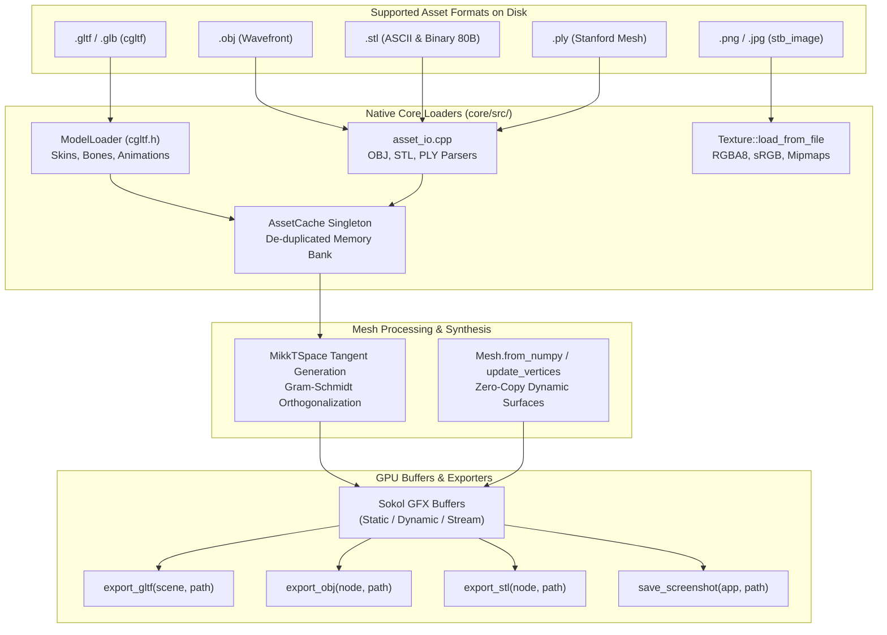

# Asset Pipeline, Formats & Procedural Meshes

Velocity 3D Engine features a multi-format asset pipeline engineered for loading, processing, procedurally synthesizing, and exporting 3D content. 

The pipeline supports glTF 2.0 / GLB files (with PBR materials, skeletons, and animation tracks), Wavefront OBJ, STL (binary & ASCII), and Stanford PLY models. It includes analytical **MikkTSpace-compliant tangent generation**, zero-copy **NumPy procedural mesh construction**, and scene export facilities.



---

## 1. glTF 2.0 & GLB Loading Architecture

### 1.1 The cgltf Integration

glTF 2.0 is the transmission format of the modern 3D web and game industry. Velocity integrates the lightweight, high-performance C99 [cgltf](https://github.com/jkuhlmann/cgltf) library into `core/src/model_loader.cpp`.

The parser handles:
- **Binary glTF (`.glb`)**: Self-contained packages where JSON headers, binary vertex buffers, indices, and embedded textures reside in contiguous binary chunks.
- **Separate glTF (`.gltf`)**: JSON descriptor referencing external `.bin` binary files and individual image files.
- **Embedded Base64 (`data:application/octet-stream;base64,...`)**: Inlined binary buffers decoded entirely in memory.

### 1.2 Hierarchy, Skins, and Animations Parsing

The `ModelLoader::load_model(scene, filepath)` pipeline executes in five sequential phases:

1. **Parse Skeleton & Joints**:
   - Parses `cgltf_skin` joint lists into `Bone` hierarchies.
   - Extracts inverse bind matrices from the `inverse_bind_matrices` accessor into `glm::mat4` arrays.
2. **De-duplicated Texture Caching**:
   - Compares image buffer pointers; duplicate references to the same embedded image view share a single `Texture` instance.
3. **PBR Material Extraction**:
   - Extracts `baseColorFactor`, `metallicFactor`, and `roughnessFactor`.
   - Binds `baseColorTexture`, `metallicRoughnessTexture`, `normalTexture`, `emissiveTexture`, and `occlusionTexture`.
4. **Mesh Geometry & Tangent Generation**:
   - Streams interleaved attribute accessors (`POSITION`, `NORMAL`, `TEXCOORD_0`, `COLOR_0`, `TANGENT`).
   - If tangents are missing from the asset, the engine automatically synthesizes MikkTSpace-compliant tangent vectors.
5. **Animation Tracks**:
   - Parses translation, rotation (quaternion), and scale channels into `KeyframeTrack` objects.
   - Supports `Step`, `Linear`, and `CubicSpline` interpolations into an `AnimationClip`.

---

## 2. Wavefront OBJ, STL & Stanford PLY Loaders

For CAD files, 3D printing models, and legacy asset libraries, Velocity delivers high-speed parsers in `core/src/asset_io.cpp`:

### 2.1 Wavefront OBJ Loader (`load_obj`, `load_obj_mesh`)
- Efficient line-based tokenizer parsing `v` (positions), `vn` (normals), `vt` (UVs), and `f` (faces).
- Automatic quad-to-triangle fan triangulation ($[v_1, v_2, v_3, v_4] \to [v_1, v_2, v_3] + [v_1, v_3, v_4]$).
- De-duplicates composite index triples (`pos_idx/uv_idx/norm_idx`) into unified `Vertex` buffers.

### 2.2 STL Loader (`load_stl`, `load_stl_mesh`)
- **Binary STL**: Detects and skips the 80-byte header, reads the 32-bit unsigned triangle count, and parses 50-byte facet records (12-byte normal + 36-byte vertices + 2-byte attribute byte count) in high-speed binary streams.
- **ASCII STL**: Tokenizes `solid...endsolid` blocks and parses `facet normal` and `vertex x y z` lines.
- Computes unified vertex normals and generates planar UV mappings.

### 2.3 Stanford PLY Loader (`load_ply`, `load_ply_mesh`)
- Reads ASCII and little-endian binary header properties (`element vertex`, `property float x`, `property float y`, `element face`).
- Automatically extracts positions, vertex normals, texture coordinates, and per-vertex RGBA tint colors.

---

## 3. MikkTSpace Tangent Basis Derivation

When rendering Cook-Torrance GGX normal maps, accurate surface tangents $\mathbf{T}$ and bitangents $\mathbf{B}$ are required to transform tangent-space normal vectors into world-space vectors.

If a 3D model lacks tangent attributes, Velocity computes **MikkTSpace-compliant tangents** analytically:

Given a triangle with vertices $\mathbf{p}_1, \mathbf{p}_2, \mathbf{p}_3$ and texture coordinates $(u_1, v_1), (u_2, v_2), (u_3, v_3)$:

$$\Delta \mathbf{p}_1 = \mathbf{p}_2 - \mathbf{p}_1, \quad \Delta \mathbf{p}_2 = \mathbf{p}_3 - \mathbf{p}_1$$

$$\Delta u_1 = u_2 - u_1, \quad \Delta v_1 = v_2 - v_1$$

$$\Delta u_2 = u_3 - u_1, \quad \Delta v_2 = v_3 - v_1$$

The spatial position delta relates to the UV delta through the tangent and bitangent vectors:

$$\begin{bmatrix} \Delta \mathbf{p}_1 \\ \Delta \mathbf{p}_2 \end{bmatrix} = \begin{bmatrix} \Delta u_1 & \Delta v_1 \\ \Delta u_2 & \Delta v_2 \end{bmatrix} \begin{bmatrix} \mathbf{T} \\ \mathbf{B} \end{bmatrix}$$

Inverting the UV coordinate matrix yields:

$$\begin{bmatrix} \mathbf{T} \\ \mathbf{B} \end{bmatrix} = \frac{1}{\Delta u_1 \Delta v_2 - \Delta u_2 \Delta v_1} \begin{bmatrix} \Delta v_2 & -\Delta v_1 \\ -\Delta u_2 & \Delta u_1 \end{bmatrix} \begin{bmatrix} \Delta \mathbf{p}_1 \\ \Delta \mathbf{p}_2 \end{bmatrix}$$

### 3.1 Gram-Schmidt Orthogonalization & Handedness

Because mesh deformation and non-uniform UV stretching can cause $\mathbf{T}$ to lose perpendicularity with the vertex normal $\mathbf{N}$, the tangent is re-orthogonalized using **Gram-Schmidt**:

$$\mathbf{T}_{\text{ortho}} = \text{normalize}\left(\mathbf{T} - \mathbf{N} (\mathbf{N} \cdot \mathbf{T})\right)$$

The bitangent handedness ($w = \pm 1.0$) is calculated via scalar triple product to preserve correct normal map orientation across mirrored UV seams:

$$w = \mathrm{sign}\left((\mathbf{N} \times \mathbf{T}) \cdot \mathbf{B}\right)$$

The complete 4-component tangent $(\mathbf{T}_{\text{ortho}}.x, \mathbf{T}_{\text{ortho}}.y, \mathbf{T}_{\text{ortho}}.z, w)$ is packed into the vertex attribute stream.

---

## 4. Procedural Mesh Generation with NumPy

Velocity provides direct zero-copy bindings for NumPy arrays, enabling procedural generation of dynamic terrains, water surfaces, cloth simulations, and mathematical manifolds.

### 4.1 Supported NumPy Array Layouts

`ve.Mesh.from_numpy(...)` accepts three flexible memory layouts:

1. **Separated Arrays**:
   - `positions`: `(N, 3)` `float32` array.
   - `normals`: Optional `(N, 3)` `float32` array.
   - `uvs`: Optional `(N, 2)` `float32` array.
   - `colors`: Optional `(N, 4)` `float32` array.
   - `indices`: Optional `(M,)` `uint16` / `uint32` array.
2. **Interleaved Array**:
   - A single `(N, 12)` `float32` array where each row contains:
     `[px, py, pz,  nx, ny, nz,  u, v,  r, g, b, a]`
3. **Flat 1D Buffer**:
   - A 1D contiguous array of length $N \times 12$.

### 4.2 Dynamic Vertex Buffer Updates

For animated surfaces (e.g. oscillating water waves), reallocating the GPU mesh every frame is inefficient. Instead, use:

```python
mesh.mark_dynamic() # Marks GPU buffer as SG_USAGE_STREAM
mesh.update_vertices_from_numpy(positions_array, recalculate_bounds=True)
```

This streams new vertex data into the existing GPU buffer without pipeline destruction or memory allocation.

---

## 5. Scene Exporters & Screen Capture

Velocity enables saving scenes and generated 3D geometry back to disk:

| Function | Signature | Output Format | Description |
| :--- | :--- | :--- | :--- |
| `export_gltf` | `(scene: Scene, filepath: str) -> bool` | `.gltf` (JSON + buffers) | Exports all meshes, transforms, and materials in the scene to standard glTF 2.0. |
| `export_obj` | `(node: Node3D, filepath: str) -> bool` | `.obj` (Wavefront) | Exports a specific node or entity hierarchy to Wavefront OBJ format. |
| `export_stl` | `(node: Node3D, filepath: str, binary: bool = True) -> bool` | `.stl` (Stereolithography) | Exports geometry to binary (default) or ASCII STL for 3D printing/CAD. |
| `save_screenshot`| `(app: App, filepath: str) -> bool` | `.png` / `.bmp` | Captures the current backbuffer render and saves it losslessly to disk. |

---

## 6. Core Engine Classes & Methods

| Class / Method | Signature | Description |
| :--- | :--- | :--- |
| `ModelLoader.load_model` | `(scene: Scene, path: str) -> Model` | Loads a glTF/GLB model into the scene graph, returning a `Model` handle. |
| `load_mesh_file` | `(path: str) -> Mesh` | Dispatches to OBJ, STL, or PLY loader based on file extension. |
| `load_obj` / `load_obj_mesh` | `(scene, path) / (path)` | Loads an OBJ into a full `Model` or standalone `Mesh`. |
| `load_stl` / `load_stl_mesh` | `(scene, path) / (path)` | Loads binary or ASCII STL into a `Model` or `Mesh`. |
| `load_ply` / `load_ply_mesh` | `(scene, path) / (path)` | Loads Stanford PLY into a `Model` or `Mesh`. |
| `Mesh.from_numpy` | `(*args, **kwargs) -> Mesh` | Creates a GPU-ready `Mesh` from NumPy coordinate and attribute arrays. |
| `mesh.update_vertices_from_numpy` | `(array, recalculate_bounds=True) -> None` | Fast in-place vertex position update for dynamic meshes. |
| `AssetCache.instance()` | `-> AssetCache` | Accesses the engine's central asset caching singleton. |

---

## 7. Runnable Code Examples

### 7.1 Loading glTF Models, OBJ & STL Assets

```python
"""Velocity 3D Engine: Multi-Format Asset Loading."""

from pathlib import Path
import VelocityEngine as ve


def main():
    app = ve.App(
        title="Velocity - Multi-Format Asset Loader",
        width=1280,
        height=720,
    )

    camera = app.camera
    camera.set_position(0.0, 3.0, -10.0)
    camera.set_yaw_pitch(90.0, -12.0)

    scene = app.scene
    scene.set_sun(direction=(0.5, -1.2, 0.4), color=ve.WARM_WHITE, intensity=1.5)

    # Ground plane
    ground = scene.create_plane(size=30.0)
    ground.material = ve.Material.plastic(roughness=0.8, color=(0.15, 0.18, 0.22))

    # 1. Load glTF / GLB Model via ModelLoader
    gltf_path = Path("assets/duck.glb")
    if gltf_path.exists():
        duck_model = ve.ModelLoader.load_model(scene, str(gltf_path))
        duck_model.set_position(-3.0, 0.0, 0.0)
        duck_model.set_scale(0.015, 0.015, 0.015)
        duck_model.set_cast_shadows(True)

    # 2. Load Wavefront OBJ Mesh
    obj_path = Path("assets/model.obj")
    if obj_path.exists():
        obj_mesh = ve.load_obj_mesh(str(obj_path))
        obj_entity = scene.create_entity("OBJ_Model")
        obj_entity.mesh = obj_mesh
        obj_entity.material = ve.Material.metal(roughness=0.2, color=(0.8, 0.8, 0.85))
        obj_entity.transform.position = (0.0, 1.0, 0.0)

    # 3. Load STL Mesh (CAD / 3D Print)
    stl_path = Path("assets/part.stl")
    if stl_path.exists():
        stl_mesh = ve.load_stl_mesh(str(stl_path))
        stl_entity = scene.create_entity("STL_Model")
        stl_entity.mesh = stl_mesh
        stl_entity.material = ve.Material.gold(roughness=0.25)
        stl_entity.transform.position = (3.0, 1.0, 0.0)

    app.ui.draw_text("Velocity 3D Engine - Asset Pipeline Demo", (20, 20), size=18, color=ve.WHITE)
    app.ui.draw_text("Supports glTF 2.0 / GLB, Wavefront OBJ, Binary STL & Stanford PLY", (20, 48), size=14, color=ve.CYAN)
    app.ui.show_stats(True)

    app.run()


if __name__ == "__main__":
    main()
```

### 7.2 Procedural NumPy Sine Wave Surface with Dynamic Streaming

```python
"""Velocity 3D Engine: Dynamic Procedural Mesh with NumPy."""

import math
import numpy as np
import VelocityEngine as ve


def main():
    app = ve.App(
        title="Velocity - Dynamic NumPy Wave Surface",
        width=1280,
        height=720,
        clear_color=(0.05, 0.08, 0.12, 1.0),
    )

    app.camera.set_position(0.0, 14.0, -22.0)
    app.camera.set_yaw_pitch(90.0, -32.0)

    scene = app.scene
    scene.set_sun(direction=(0.4, -1.0, 0.6), color=ve.WHITE, intensity=1.6)

    # 1. Generate 120x120 Grid Vertices in NumPy
    grid_res = 120
    x = np.linspace(-15.0, 15.0, grid_res, dtype=np.float32)
    z = np.linspace(-15.0, 15.0, grid_res, dtype=np.float32)
    xx, zz = np.meshgrid(x, z)
    yy = np.zeros_like(xx)

    # Flatten coordinates into (N, 3) positions array
    positions = np.stack([xx.ravel(), yy.ravel(), zz.ravel()], axis=-1)

    # Generate UVs
    u = np.linspace(0.0, 1.0, grid_res, dtype=np.float32)
    v = np.linspace(0.0, 1.0, grid_res, dtype=np.float32)
    uu, vv = np.meshgrid(u, v)
    uvs = np.stack([uu.ravel(), vv.ravel()], axis=-1)

    # Triangulate quad grid into 16-bit indices
    indices = []
    for r in range(grid_res - 1):
        for c in range(grid_res - 1):
            i0 = r * grid_res + c
            i1 = i0 + 1
            i2 = (r + 1) * grid_res + c
            i3 = i2 + 1
            indices.extend([i0, i2, i1, i1, i2, i3])
    indices_arr = np.array(indices, dtype=np.uint16)

    # 2. Create GPU Mesh via from_numpy
    mesh = ve.Mesh.from_numpy(positions, uvs=uvs, indices=indices_arr)
    mesh.mark_dynamic() # Prepare for fast per-frame streaming

    wave_entity = scene.create_entity("ProceduralWave")
    wave_entity.mesh = mesh
    wave_mat = ve.Material.plastic(roughness=0.15, color=(0.1, 0.55, 0.95))
    wave_entity.material = wave_mat

    time_elapsed = 0.0

    def update(dt: float):
        nonlocal time_elapsed
        time_elapsed += dt * 2.5

        # Compute dynamic ripple wave in NumPy
        r = np.sqrt(xx**2 + zz**2)
        animated_y = np.sin(r * 0.8 - time_elapsed) * 1.2 * np.exp(-r * 0.05)

        # Update position coordinates
        updated_positions = np.stack([xx.ravel(), animated_y.ravel(), zz.ravel()], axis=-1)
        mesh.update_vertices_from_numpy(updated_positions, recalculate_bounds=False)

    app.ui.draw_text("Velocity 3D Engine - 120x120 Dynamic NumPy Wave Surface", (20, 20), size=16, color=ve.WHITE)
    app.ui.draw_text("Zero-Copy Dynamic Buffer Streaming at 60+ FPS", (20, 48), size=13, color=ve.CYAN)
    app.ui.show_stats(True)

    app.set_update_callback(update)
    app.run()


if __name__ == "__main__":
    main()
```

---

## 8. Common Pitfalls & Best Practices

### 8.1 16-Bit Index Limits (65,535 Vertices)

> [!CAUTION]
> The Sokol index buffer format is `uint16_t`. Any single procedural mesh generated via NumPy must have **65,535 vertices or fewer** (e.g. an indexed grid up to $180 \times 180 = 32,400$ vertices fits safely). Exceeding 65,535 vertices will trigger an index overflow error.

### 8.2 Mark Dynamic Before GPU Allocation

> [!IMPORTANT]
> If a mesh will be mutated at runtime (via `update_vertices_from_numpy` or skeletal deformation), you **must call `mesh.mark_dynamic()`** before calling `ensure_gpu_buffers()` or rendering the first frame. This ensures Sokol allocates the vertex buffer with `SG_USAGE_STREAM` or `SG_USAGE_DYNAMIC`.

### 8.3 glTF Asset Relative Paths

When loading assets with external `.bin` buffers or texture images, always pass absolute paths or paths relative to your main script using Python's `pathlib.Path`:

```python
asset_path = Path(__file__).resolve().parent / "assets" / "model.glb"
model = ve.ModelLoader.load_model(scene, str(asset_path))
```
