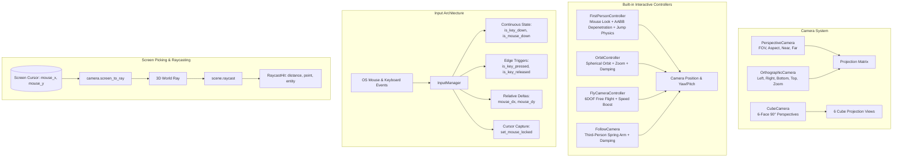
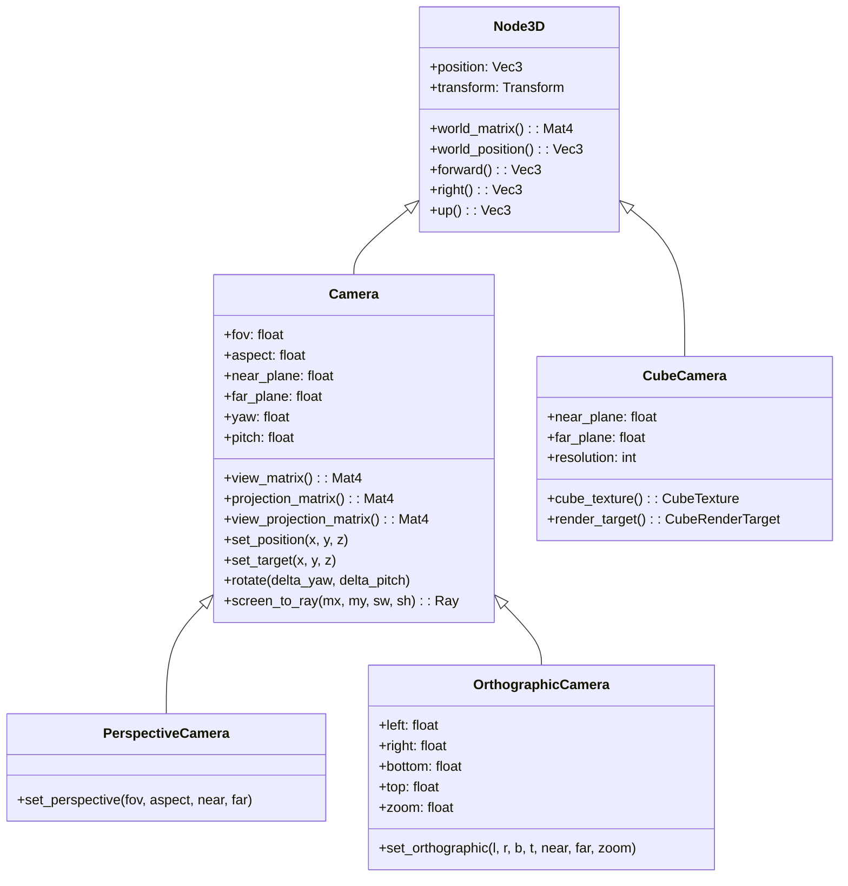
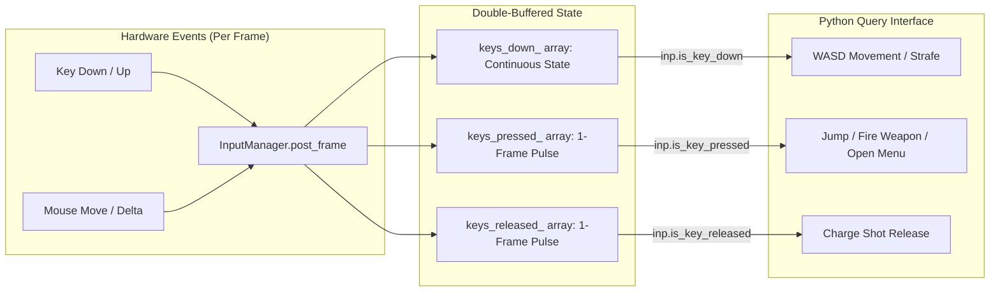
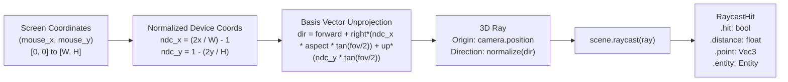

# Cameras, Controllers & Input Architecture Guide

This technical guide covers the camera models, interactive camera controllers, hardware input polling, edge-trigger detection, 3D screen picking, and raycasting systems in the **Velocity 3D Engine**.

---

## 1. Architectural Overview & Camera Models

Velocity 3D Engine features a unified camera architecture where cameras are first-class nodes in the scene graph (`Node3D`). This enables cameras to be parented to characters, spring-arms, vehicles, or orbital rigs with automatic world matrix propagation.



---

## 2. Core Camera Classes & Projection Math



### 2.1 PerspectiveCamera

Calculates a perspective projection matrix where objects appear smaller with distance, imitating the human eye:

$$M_{\text{proj}} = \begin{bmatrix}
\frac{1}{\text{aspect} \cdot \tan(\frac{\text{fov}}{2})} & 0 & 0 & 0 \\
0 & \frac{1}{\tan(\frac{\text{fov}}{2})} & 0 & 0 \\
0 & 0 & -\frac{\text{far} + \text{near}}{\text{far} - \text{near}} & -\frac{2 \cdot \text{far} \cdot \text{near}}{\text{far} - \text{near}} \\
0 & 0 & -1 & 0
\end{bmatrix}$$

```python
import VelocityEngine as ve

cam = ve.PerspectiveCamera(fov=60.0, aspect_ratio=16.0 / 9.0, near_z=0.1, far_z=1000.0)
cam.set_position(0.0, 5.0, 10.0)
cam.set_target(0.0, 0.0, 0.0)
```

### 2.2 OrthographicCamera

Calculates a parallel orthographic projection matrix without perspective foreshortening. Essential for 2D overlays, isometric strategy games, and CAD tools:

$$M_{\text{proj}} = \begin{bmatrix}
\frac{2 \cdot \text{zoom}}{\text{right} - \text{left}} & 0 & 0 & -\frac{\text{right} + \text{left}}{\text{right} - \text{left}} \\
0 & \frac{2 \cdot \text{zoom}}{\text{top} - \text{bottom}} & 0 & -\frac{\text{top} + \text{bottom}}{\text{top} - \text{bottom}} \\
0 & 0 & -\frac{2}{\text{far} - \text{near}} & -\frac{\text{far} + \text{near}}{\text{far} - \text{near}} \\
0 & 0 & 0 & 1
\end{bmatrix}$$

```python
ortho = ve.OrthographicCamera(left=-10.0, right=10.0, bottom=-10.0, top=10.0, near_z=0.1, far_z=100.0, zoom_val=1.0)
```

### 2.3 CubeCamera

Encapsulates 6 internal 90° perspective renders facing $\pm X, \pm Y, \pm Z$. Used for real-time dynamic environment maps (water reflections, metallic orbs, and chrome surfaces):

```python
cube_cam = ve.CubeCamera(near_p=0.1, far_p=50.0, resolution=256)
app.scene.add(cube_cam)

# Obtain the resulting CubeTexture for mirror materials
mirror_mat = ve.StandardMaterial()
mirror_mat.metallic = 1.0
mirror_mat.roughness = 0.05
# Update cube camera reflection pass
cube_mat = cube_cam.cube_texture()
```

---

## 3. Built-in Camera Controllers

Velocity 3D Engine ships with 4 specialized, production-ready camera controllers:

### 3.1 `FirstPersonController`

Designed for FPS games and architectural walk-throughs:
- **Mouse Look**: Gathers relative mouse deltas (`mouse_dx`, `mouse_dy`) and modifies yaw/pitch with hard vertical angle clamping ($-89^\circ$ to $+89^\circ$).
- **Kinematic Physics**: Gravity acceleration, jumping, ground detection, and terminal fall velocities.
- **Cylinder & Step-Height Collision**: Uses a vertical player collision `Cylinder`. Elevates the base by `step_height = 0.20` to allow climbing over stairs and curbs without getting stuck.
- **Depenetration Sliding**: Projects against scene `AABB` colliders using Minimum Translation Vectors (MTV).

```python
fpc = ve.FirstPersonController(
    camera=app.camera,
    input_manager=app.input,
    scene=app.scene,
    move_speed=6.0,
    mouse_sensitivity=0.12,
    gravity=18.0,
    jump_speed=6.5,
    player_height=1.8,
    player_radius=0.4,
    step_height=0.25
)
app.camera = fpc
```

### 3.2 `OrbitController`

Designed for model viewers, CAD inspection, and strategy games:
- **Spherical Orbit**: Controls position via azimuth ($\theta$), polar inclination ($\phi$), and distance ($r$) relative to a focal target.
- **Damping (Inertia)**: Smooth spherical interpolation creates a weighted, tactile feel.
- **Pinch / Wheel Zooming**: Clamped between `min_distance` and `max_distance`.
- **Auto-Rotation**: Optional constant rotation turntable display (`auto_rotate = True`).

```python
orb = ve.OrbitController(
    target=(0.0, 1.5, 0.0),
    distance=10.0,
    min_distance=2.0,
    max_distance=50.0,
    rotate_speed=1.0,
    zoom_speed=1.2,
    damping_factor=0.08
)
app.camera = orb
```

### 3.3 `FlyCameraController`

Provides full 6-Degrees-of-Freedom (6DOF) flight for world editors and space games:
- **Controls**: W/S (forward/back), A/D (strafe), Space/Ctrl or E/Q (up/down).
- **Speed Boost**: Holding `LeftShift` multiplies velocity by `boost_factor = 3.0`.

```python
fly = ve.FlyCameraController(
    camera=app.camera,
    input_manager=app.input,
    move_speed=10.0,
    look_speed=0.15,
    boost_multiplier=3.0
)
app.camera = fly
```

### 3.4 `FollowCamera` (Third-Person Spring Arm)

Smoothly trails behind an animated character or moving vehicle:
- **Lag Compensation**: Uses an exponential smoothing filter to absorb sudden movement spikes:
  $$\vec{p}_{\text{cam}} = \text{lerp}\left(\vec{p}_{\text{current}}, \; \vec{p}_{\text{target}} + \vec{o}, \; 1.0 - e^{-\text{stiffness} \cdot dt}\right)$$
- **Decoupled Look-At**: Independently tracks a focal look-at offset above the character's feet.

```python
follow = ve.FollowCamera(
    camera=app.camera,
    target_entity=hero_entity,
    offset=(0.0, 2.8, 5.5),        # Position relative to target
    look_at_offset=(0.0, 1.3, 0.0), # Look at chest/head
    stiffness=14.0,                 # Spring stiffness
    damping=0.85                    # Velocity dampening
)
app.camera = follow
```

---

## 4. Hardware Input Architecture (`InputManager`)

Velocity 3D Engine captures operating system keyboard and mouse events through Sokol APP (`sokol_app.h`), presenting a clean, non-blocking polling interface.



### 4.1 Continuous State vs. Edge-Trigger Detection

A frequent bug in game development is testing single-event actions (like jumping or toggling a menu) with continuous key down checks, which causes the action to trigger on every frame (60 times per second).

| Method | Behavior | Usage Scenarios |
|:---|:---|:---|
| **`is_key_down(Key)`** | Returns `True` as long as the physical key remains depressed. | Player movement (WASD), holding sprint (`LeftShift`), continuous beam firing. |
| **`is_key_pressed(Key)`** | Returns `True` **only on the initial frame** the key transitioned from Up to Down. Cleared automatically on `post_frame()`. | Jumping (`Space`), triggering attack slashes, toggling inventory (`Tab`), pausing (`Escape`). |
| **`is_key_released(Key)`** | Returns `True` **only on the single frame** the key was released. | Releasing an archery bow string, releasing a charged jump. |
| **`is_mouse_down(button)`** | Returns `True` while mouse button is held (`0`=Left, `1`=Right, `2`=Middle). | Dragging cameras, holding automatic fire. |
| **`mouse_dx()` / `mouse_dy()`** | Frame-to-frame relative cursor displacement. | FPS mouse look calculations. |
| **`set_mouse_locked(bool)`** | Hides the OS cursor and locks it to the window center. | First-person and third-person camera control. |

---

## 5. 3D Screen Picking & Raycasting

Screen picking translates a 2D screen coordinate (such as the OS mouse cursor position $(x, y)$ in pixels) into a 3D ray originating at the camera lens and projecting into the virtual scene.



### 5.1 Mathematical Derivation of `screen_to_ray`

Let $W, H$ be the viewport width and height in pixels, and $(x_m, y_m)$ be mouse coordinates with $(0, 0)$ at the top-left corner.

1. **Normalized Device Coordinates (NDC)** in range $[-1.0, 1.0]$:
   $$x_{\text{ndc}} = \frac{2 \cdot x_m}{W} - 1.0$$
   $$y_{\text{ndc}} = 1.0 - \frac{2 \cdot y_m}{H}$$

2. **Unprojected Direction Vector**:
   Given camera forward vector $\vec{f}$, right vector $\vec{r}$, reconstructed up vector $\vec{u} = \vec{r} \times \vec{f}$, and aspect ratio $A = W / H$:
   $$\tan_{\text{half}} = \tan\left(\frac{\text{fov}}{2}\right)$$
   $$\vec{d}_{\text{world}} = \vec{f} + \vec{r} \cdot \left(x_{\text{ndc}} \cdot A \cdot \tan_{\text{half}}\right) + \vec{u} \cdot \left(y_{\text{ndc}} \cdot \tan_{\text{half}}\right)$$
   $$\vec{d}_{\text{ray}} = \frac{\vec{d}_{\text{world}}}{\|\vec{d}_{\text{world}}\|}$$

The Ray is constructed as:
$$\text{Ray}(P_0, \vec{d}_{\text{ray}}), \quad P_0 = \text{camera.position}$$

---

## 6. Complete Executable Code Examples

### Example 1: 3D Object Click-To-Select & Screen Picking

This self-contained example spawns a cluster of interactive cubes that turn bright yellow when clicked by the user:

```python
"""3D Screen Picking & Object Selection Demo."""

import VelocityEngine as ve

def main():
    app = ve.App("3D Object Screen Picking Demo", width=1280, height=720)
    scene = app.scene

    scene.set_sun(direction=(-0.8, -1.2, -0.6), color=(1.0, 0.98, 0.9), intensity=1.8)

    # Ground plane
    floor = scene.create_plane(width=30.0, height=30.0)
    floor_mat = ve.StandardMaterial()
    floor_mat.base_color = (0.15, 0.16, 0.2, 1.0)
    floor.material = floor_mat

    # Spawn interactive clickable target cubes
    cube_mesh = ve.Mesh.create_box(1.2, 1.2, 1.2)
    cubes = []

    for x in range(-3, 4, 2):
        for z in range(-3, 4, 2):
            box = scene.create_entity(f"SelectableBox_{x}_{z}")
            box.mesh = cube_mesh
            mat = ve.StandardMaterial()
            mat.base_color = (0.2, 0.6, 0.9, 1.0)
            mat.roughness = 0.4
            box.material = mat
            box.transform.position = (float(x) * 2.0, 0.6, float(z) * 2.0)
            cubes.append(box)

    app.camera = ve.OrbitController(target=(0.0, 1.0, 0.0), distance=18.0)

    selected_entity = None

    def update(dt: float):
        nonlocal selected_entity
        inp = app.input

        # Check edge-triggered left mouse click
        if inp.is_mouse_down(ve.MouseButton.LEFT):
            mx = inp.mouse_x()
            my = inp.mouse_y()

            # Cast ray from camera through cursor position
            ray = app.camera.screen_to_ray(mx, my, app.width, app.height)
            hit = scene.raycast(ray, max_distance=100.0)

            if hit.hit and hit.entity and "SelectableBox" in hit.entity.name:
                # Revert previous selection
                if selected_entity and selected_entity.material:
                    selected_entity.material.base_color = (0.2, 0.6, 0.9, 1.0)

                # Highlight new selection
                selected_entity = hit.entity
                selected_entity.material.base_color = (1.0, 0.85, 0.1, 1.0)
                app.ui.clear()
                app.ui.draw_text(f"Selected: {hit.entity.name} at distance {hit.distance:.2f}m", (24, 24), size=18, color=(1.0, 1.0, 0.2, 1.0))

    app.on_update(update)
    app.run()

if __name__ == "__main__":
    main()
```

### Example 2: First-Person Controller with Jumping & Obstacle Collision

```python
"""First-Person Controller with Physical Obstacle Depenetration."""

import VelocityEngine as ve

def main():
    app = ve.App("First-Person Walkthrough", width=1280, height=720)
    scene = app.scene

    scene.set_sun(direction=(-0.6, -1.2, -0.8), color=(1.0, 1.0, 0.95), intensity=1.6)
    scene.create_grid(size=40.0, step=1.0, color=(0.2, 0.25, 0.32, 1.0))

    # Room Floor
    floor = scene.create_plane(width=40.0, height=40.0)
    floor_mat = ve.StandardMaterial()
    floor_mat.base_color = (0.1, 0.12, 0.15, 1.0)
    floor.material = floor_mat

    # Obstacle pillars to navigate around
    obs_mesh = ve.Mesh.create_box(2.0, 4.0, 2.0)
    obs_mat = ve.StandardMaterial()
    obs_mat.base_color = (0.7, 0.35, 0.2, 1.0)

    for px, pz in [(-5, -5), (5, -5), (-5, 5), (5, 5), (0, 7)]:
        pillar = scene.create_entity(f"Obstacle_{px}_{pz}")
        pillar.mesh = obs_mesh
        pillar.material = obs_mat
        pillar.transform.position = (float(px), 2.0, float(pz))

    # Setup FPS Camera & Controller
    cam = ve.PerspectiveCamera(fov=65.0, aspect_ratio=app.width / app.height, near_z=0.1, far_z=200.0)
    cam.set_position(0.0, 1.8, 0.0)

    fpc = ve.FirstPersonController(
        camera=cam,
        input_manager=app.input,
        scene=scene,
        move_speed=6.0,
        mouse_sensitivity=0.14,
        gravity=18.0,
        jump_speed=6.5,
        player_height=1.8,
        player_radius=0.4,
        step_height=0.25
    )
    app.camera = fpc

    # Lock cursor for immersion
    app.input.set_mouse_locked(True)

    app.ui.clear()
    app.ui.draw_text("Velocity 3D Engine | FirstPersonController", (24, 24), size=20, color=(1.0, 1.0, 1.0, 1.0))
    app.ui.draw_text("WASD: Move | Space: Jump | Mouse: Look | Esc: Exit", (24, 52), size=14, color=(0.4, 0.8, 1.0, 1.0))
    app.ui.draw_crosshair(size=10, color=(1.0, 1.0, 1.0, 0.8))

    def update(dt: float):
        if app.input.is_key_pressed(ve.Key.Escape):
            app.input.set_mouse_locked(False)

    app.on_update(update)
    app.run()

if __name__ == "__main__":
    main()
```

---

## 7. Common Pitfalls & Best Practices

> [!WARNING]
> **Edge Triggers vs. Continuous State**
> Always use `input.is_key_pressed()` for jump actions and weapon firing. Using `input.is_key_down()` will execute the jump logic continuously on every tick during the key press, compounding velocity upwards and catapulting the player into the skybox.

> [!IMPORTANT]
> **Mouse Deltas with Locked vs. Unlocked Cursor**
> When implementing mouselook, always call `app.input.set_mouse_locked(True)`. In an unlocked cursor state, OS mouse coordinates stop generating deltas once the physical cursor hits the display monitor edge.

> [!TIP]
> **Viewport Scaling for High-DPI Displays**
> When calling `camera.screen_to_ray(mouse_x, mouse_y, screen_w, screen_h)`, always supply `app.width` and `app.height`. If running on macOS Retina or Windows high-DPI displays with UI scaling ($125\%$ or $150\%$), passing incorrect framebuffer dimensions will skew raycast unprojection angles.
