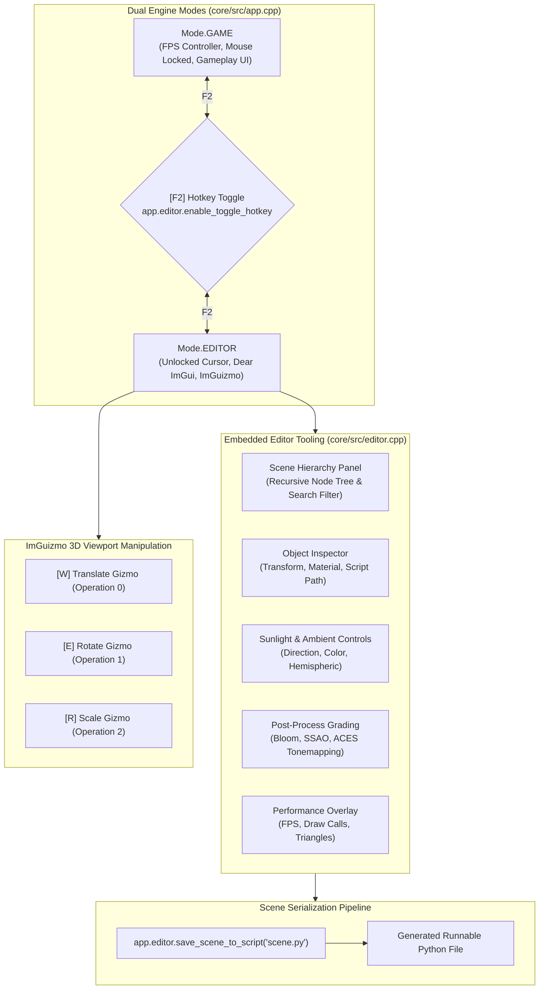

# Visual Editor, Dear ImGui & Tooling

Velocity 3D Engine includes an embedded visual editor built directly into the C++ runtime using [Dear ImGui](https://github.com/ocornut/imgui) and [ImGuizmo](https://github.com/CedricGuillemet/ImGuizmo). 

The editor provides real-time scene inspection, 3D viewport translation/rotation/scale gizmos, live PBR material tweaking, lighting controls, post-processing grading, and a Python scene exporter (`save_scene_to_script`) that writes modified scenes directly back to executable Python code.



---

## 1. Conceptual Overview: The Dual-Mode Paradigm

Game engine development typically suffers from friction between the game runtime and separate editor executables. Velocity eliminates this disconnect by embedding the editor directly inside the core application through a **Dual-Mode Architecture**:

1. **`Mode.GAME`**:
   - Focus is given to game logic, player input controllers (e.g. `FirstPersonController`), and 2D gameplay HUDs.
   - Mouse cursor can be locked and hidden (`app.input.set_mouse_locked(True)`).
   - Dear ImGui windows are hidden, releasing CPU/GPU cycles for gameplay.

2. **`Mode.EDITOR`**:
   - Mouse cursor is unlocked and rendered as the desktop pointer.
   - Player input controllers are suspended.
   - Dear ImGui panels (Hierarchy, Inspector, Post-Process, Performance) and the ImGuizmo 3D manipulators render directly on top of the active 3D viewport.
   - Any modifications made to transforms, materials, or lights take effect immediately in the live scene.

Pressing **`F2`** seamlessly toggles between Game Mode and Editor Mode in real time without reloading the application, resetting state, or dropping GPU textures.

---

## 2. 3D Viewport Gizmos (ImGuizmo)

When an entity or node is selected in Editor Mode, Velocity projects an interactive 3D manipulator gizmo into the viewport using the camera's View and Projection matrices.

```text
       +Y (Green)
        ^
        |     / +Z (Blue)
        |   /
        | /
        +--------> +X (Red)
     Center Handle
```

### 2.1 Gizmo Operations & Keyboard Shortcuts

| Shortcut | Gizmo Operation | Integer ID | Functionality |
| :--- | :--- | :--- | :--- |
| **`W`** | **Translate** | `0` | Displays 3-axis arrows and planar quads for spatial position manipulation along X, Y, and Z. |
| **`E`** | **Rotate** | `1` | Displays 3-axis gimbal circles for yaw, pitch, and roll angular rotation. |
| **`R`** | **Scale** | `2` | Displays 3-axis scale boxes and uniform central scale cube. |

The active gizmo mode can also be changed programmatically:

```python
app.editor.gizmo_operation = 0  # 0: Translate, 1: Rotate, 2: Scale
```

---

## 3. Editor Panels & Live Inspector

### 3.1 Scene Hierarchy Panel
- Displays a hierarchical tree view of all `Node3D`, `Entity`, `Model`, `Light`, and `Group` objects in the scene.
- Includes a live search text filter to quickly isolate specific entities in complex scenes.
- Clicking any node selects it as the active object in both the viewport and Inspector panel.

### 3.2 Object Inspector Panel
When an `Entity` is selected, the Inspector exposes:
- **Transform**: Real-time sliders for Position $(X, Y, Z)$, Euler Rotation $(R_x, R_y, R_z)$, and Scale $(S_x, S_y, S_z)$.
- **Mesh Information**: Vertex count, triangle count, and bounding box dimensions.
- **PBR Material Properties**:
  - `Base Color` (RGBA color picker).
  - `Roughness` slider ($0.0 \to 1.0$).
  - `Metallic` slider ($0.0 \to 1.0$).
  - One-click PBR Presets: **Gold**, **Chrome / Metal**, **Plastic**, and **Rubber**.
- **Shadow Casting**: Checkbox toggling directional shadow map generation.
- **VS Code Integration**: If `entity.script_path` is assigned, a button allows opening the defining Python source script directly in VS Code at the exact file location.

### 3.3 Post-Process & Lighting Panel
- **Sunlight**: Sliders for light direction vector, warm sunlight tint, and intensity ($0.0 \to 10.0$).
- **Hemispheric Ambient**: Sky ambient color, ground bounce color, and intensity.
- **Bloom**: Threshold, filter radius, and intensity.
- **SSAO (Screen Space Ambient Occlusion)**: Sample radius and power exponent.
- **HDR Tonemapping**: Exposure slider, Gamma correction slider, and Tonemapping algorithm dropdown (`ACESFilmic`, `Reinhard`, `Cineon`, `Linear`, `Neutral`).

---

## 4. Scene Serialization to Python (`save_scene_to_script`)

One of Velocity's most powerful tooling features is the ability to export the current live scene back into a clean, standalone, executable Python script.

When `app.editor.save_scene_to_script("exported_scene.py")` is invoked:
1. The engine crawls the active scene graph.
2. Extracts sun direction, ambient colors, camera position, and FOV.
3. Serializes all entities, their 3D transforms, attached meshes, and PBR material settings.
4. Generates a fully formatted, PEP-8 compliant Python script that runs independently via `python exported_scene.py`.

```python
# Save the modified level design back to code
app.editor.save_scene_to_script("levels/level_01_final.py")
```

---

## 5. Core Engine Classes & Methods

### 5.1 EditorManager API (`VelocityEngine.EditorManager`)

| Property / Method | Signature | Description |
| :--- | :--- | :--- |
| `app.editor` | `-> EditorManager` | Accesses the engine's editor manager attached to `App`. |
| `enable_toggle_hotkey(enable, key)` | `(enable: bool, key: Key = Key.F2) -> None` | Enables or disables the global hotkey that toggles between Game and Editor modes. |
| `is_toggle_hotkey_enabled()` | `-> bool` | Returns `True` if hotkey toggling is active. |
| `gizmo_operation` | `int` (Read/Write) | Gets or sets active gizmo tool (`0` = Translate, `1` = Rotate, `2` = Scale). |
| `select_entity(entity)` | `(entity: Optional[Entity]) -> None` | Sets the designated entity as the active selection. |
| `selected_entity` | `-> Optional[Entity]` | Returns the currently selected entity, or `None`. |
| `select_node(node)` | `(node: Optional[Node3D]) -> None` | Sets the designated scene graph node as the active selection. |
| `selected_node` | `-> Optional[Node3D]` | Returns the currently selected node. |
| `show_hierarchy` | `bool` (Read/Write) | Toggles visibility of the Scene Hierarchy tree panel. |
| `show_inspector` | `bool` (Read/Write) | Toggles visibility of the Object Inspector panel. |
| `show_postprocess` | `bool` (Read/Write) | Toggles visibility of the Lighting & Post-Processing panel. |
| `show_perf_overlay` | `bool` (Read/Write) | Toggles visibility of the Performance & FPS overlay. |
| `save_scene_to_script(filepath)` | `(filepath: str = "exported_scene.py") -> bool` | Serializes the entire scene graph into a runnable Python script. |

### 5.2 Application Mode API (`VelocityEngine.App`)

| Property / Method | Signature | Description |
| :--- | :--- | :--- |
| `app.mode` | `Mode` (Read/Write) | Gets or sets active mode: `ve.Mode.GAME` or `ve.Mode.EDITOR`. |
| `app.toggle_mode()` | `() -> None` | Toggles between `Mode.GAME` and `Mode.EDITOR`. |

---

## 6. Runnable Code Examples

### 6.1 Launching Directly in Visual Editor Mode

This script launches the engine directly in `Mode.EDITOR` with pre-populated PBR objects and lights ready for visual manipulation.

```python
"""Velocity 3D Engine: Interactive Visual Editor Showcase."""

from pathlib import Path
import VelocityEngine as ve


def main():
    # 1. Initialize Engine in EDITOR Mode
    app = ve.App(
        title="Velocity 3D Engine - Visual Editor Mode",
        width=1280,
        height=720,
        mode=ve.Mode.EDITOR, # Start directly in Editor Mode
        clear_color=(0.12, 0.16, 0.22, 1.0),
    )

    # Configure Editor Panels
    app.editor.enable_toggle_hotkey(True, key=ve.Key.F2)
    app.editor.show_hierarchy = True
    app.editor.show_inspector = True
    app.editor.show_postprocess = True

    # 2. Camera Setup
    camera = app.camera
    camera.set_position(0.0, 3.5, -8.0)
    camera.set_yaw_pitch(90.0, -18.0)

    # 3. Daylight Lighting Setup
    scene = app.scene
    scene.set_sun(direction=(0.55, -0.85, 0.40), color=ve.WARM_WHITE, intensity=1.4)
    scene.light.set_ambient(0.35, 0.40, 0.48)
    scene.light.set_hemispheric_ambient(0.40, 0.48, 0.60, 0.25, 0.22, 0.18)

    # 4. Floor Grid
    ground = scene.create_plane(size=36.0)
    ground.name = "Ground_Plane"
    ground.material = ve.Material.plastic(roughness=0.85, color=(0.20, 0.22, 0.26))

    # 5. Showcase Entities with Material Presets
    # Gold Cube
    gold_cube = scene.create_cube()
    gold_cube.name = "PBR_Gold_Cube"
    gold_cube.transform.position = (-2.5, 1.0, 0.0)
    gold_cube.material = ve.Material.gold(roughness=0.18)

    # Chrome / Metal Cylinder
    metal_cyl = scene.create_cylinder(radius=0.8, height=2.0)
    metal_cyl.name = "PBR_Chrome_Cylinder"
    metal_cyl.transform.position = (0.0, 1.0, 0.0)
    metal_cyl.material = ve.Material.metal(roughness=0.08, color=(0.85, 0.90, 1.0))

    # Red Plastic Sphere
    plastic_sphere = scene.create_sphere(radius=1.0)
    plastic_sphere.name = "PBR_Plastic_Sphere"
    plastic_sphere.transform.position = (2.5, 1.0, 0.0)
    plastic_sphere.material = ve.Material.plastic(roughness=0.25, color=(0.95, 0.15, 0.15))

    # Pre-select Gold Cube to activate the ImGuizmo manipulator immediately
    app.editor.select_entity(gold_cube)

    print("=" * 70)
    print(" Velocity Visual Editor Active")
    print(" Controls:")
    print("   [F2]        : Toggle between EDITOR Mode and GAME Mode")
    print("   [W / E / R] : Switch Gizmo (Translate / Rotate / Scale)")
    print("   Mouse       : Select nodes in Hierarchy, tweak Inspector sliders")
    print("=" * 70)

    app.run()


if __name__ == "__main__":
    main()
```

### 6.2 Seamless In-Game Hotkey Toggle & Scene Export

This example demonstrates starting in Game Mode with a playable character controller, switching to Editor Mode via `F2` to modify the scene, and saving changes out to `exported_level.py`.

```python
"""Velocity 3D Engine: In-Game F2 Editor Toggle and Script Export."""

from pathlib import Path
import VelocityEngine as ve


def main():
    app = ve.App(
        title="Velocity - In-Game F2 Editor Toggle Demo",
        width=1280,
        height=720,
        mode=ve.Mode.GAME, # Start in Game Mode
    )

    # Ensure F2 hotkey is bound
    app.editor.enable_toggle_hotkey(True, key=ve.Key.F2)

    scene = app.scene
    scene.set_sun(direction=(0.5, -1.0, 0.5), color=ve.WHITE, intensity=1.3)

    ground = scene.create_plane(size=40.0)
    ground.name = "Arena_Floor"
    ground.material = ve.Material.plastic(roughness=0.8, color=(0.18, 0.22, 0.28))

    box = scene.create_cube()
    box.name = "Interactive_Crate"
    box.transform.position = (0.0, 1.0, 3.0)
    box.material = ve.Material.gold(roughness=0.2)

    # FPS Controller (Active during Game Mode)
    controller = ve.FirstPersonController(
        camera=app.camera,
        input_manager=app.input,
        scene=scene,
        audio=app.audio,
        move_speed=5.0,
    )

    def on_update(dt: float):
        # Update character only while in GAME mode
        if app.mode == ve.Mode.GAME:
            controller.update(dt)

            app.ui.clear()
            app.ui.draw_text("GAME MODE ACTIVE", (20, 20), size=16, color=ve.GREEN)
            app.ui.draw_text("Press [F2] to open Visual Scene Editor", (20, 48), size=14, color=ve.WHITE)
            app.ui.draw_text("Press [K] to export scene to 'exported_level.py'", (20, 72), size=13, color=ve.YELLOW)

            # Export trigger shortcut
            if app.input.is_key_just_pressed(ve.Key.K):
                success = app.editor.save_scene_to_script("exported_level.py")
                if success:
                    print("[Editor] Successfully exported scene to 'exported_level.py'!")

    app.set_update_callback(on_update)
    app.run()


if __name__ == "__main__":
    main()
```

---

## 7. Common Pitfalls & Best Practices

### 7.1 Mouse Cursor Lock in Editor Mode

> [!WARNING]
> In `Mode.GAME`, FPS controllers commonly lock the mouse cursor via `app.input.set_mouse_locked(True)`. When toggling to `Mode.EDITOR` via `F2`, Velocity automatically unhides and unlocks the system cursor so the user can interact with Dear ImGui panels. If you manually lock the mouse in your update loop, make sure to guard it with `if app.mode == ve.Mode.GAME:` to avoid locking the cursor during editor inspection.

### 7.2 ImGui Keyboard Capture

When typing into Inspector input boxes (such as renaming an entity or setting transform values), Dear ImGui sets `ImGui::GetIO().WantCaptureKeyboard = true`.
- Velocity's input manager respects this state to prevent game controls (like `WASD` movement) from triggering while typing.

### 7.3 Preserving Python Script Paths

> [!TIP]
> When creating procedural entities or loading models, assign `entity.script_path = str(Path(__file__).resolve())`. This enables the Inspector's **"Open Script in VS Code"** button, allowing developers to jump straight from visual inspection to code modification in their IDE.
