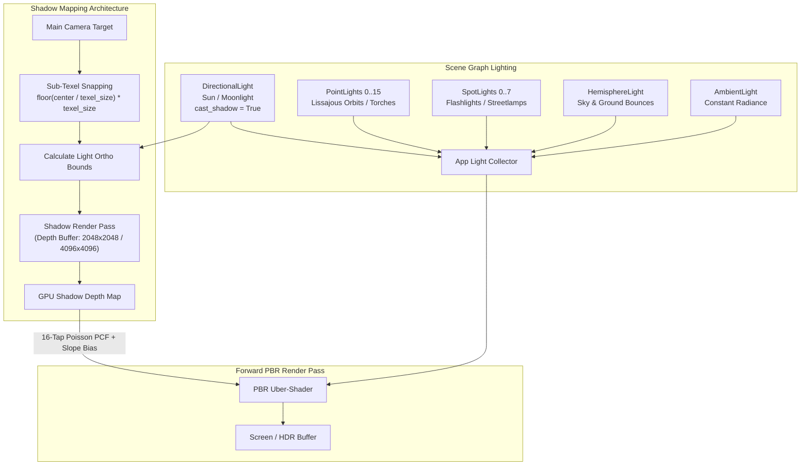
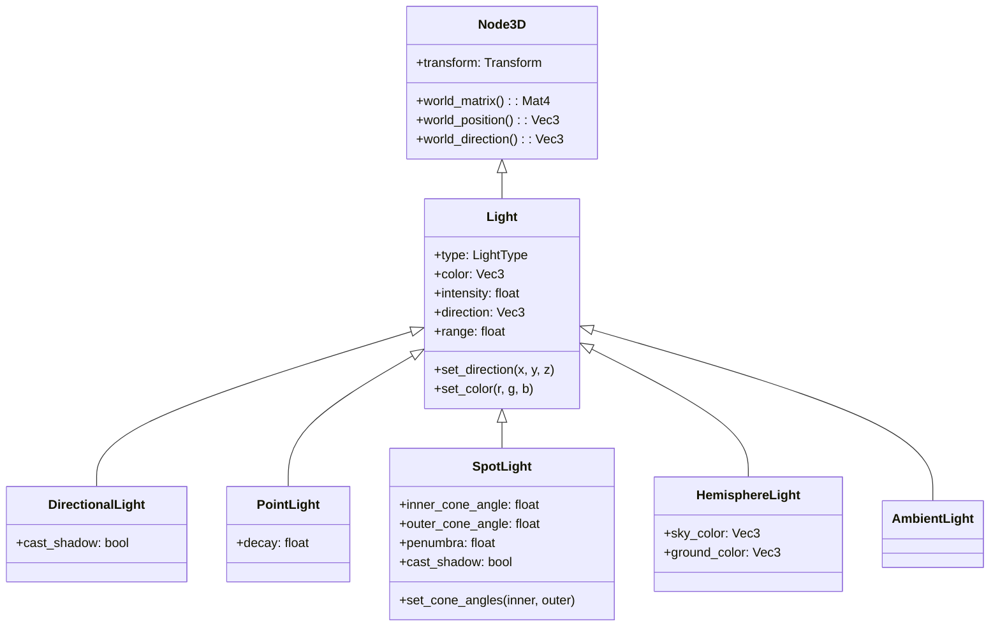
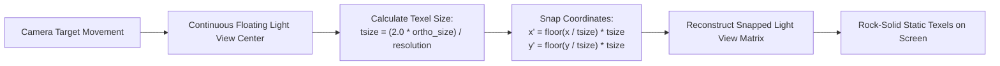

# Lighting & Shadows Architecture Guide

This technical guide covers the lighting models, light types, shadow mapping pipeline, sub-texel snapping, slope-scale depth biasing, and 16-tap Poisson disk Percentage-Closer Filtering (PCF) implemented in the **Velocity 3D Engine**.

---

## 1. Architectural Overview

Velocity 3D Engine utilizes a forward PBR lighting architecture capable of evaluating multiple light types in a unified pass:



### Supported Light Caps per Forward Pass

| Light Category | Max Active Lights per Pass | Attenuation Model | Shadow Casting |
|:---|:---:|:---|:---:|
| **`DirectionalLight`** | 4 | None (infinite parallel rays) | Yes (Cascaded / Snapped Orthographic) |
| **`PointLight`** | 16 | Physically based inverse-square decay ($1 / d^{\text{decay}}$) | No (Direct Forward) |
| **`SpotLight`** | 8 | Inverse-square distance decay + Cosine angular falloff | Optional |
| **`HemisphereLight`** | 1 | Trilinear vertical normal interpolation ($\text{lerp}(C_{\text{ground}}, C_{\text{sky}}, N_y \cdot 0.5 + 0.5)$) | No (Ambient Fill) |
| **`AmbientLight`** | 1 | Constant isotropic radiance | No (Base Floor) |

---

## 2. Core Light Types & Classes



### 2.1 API Reference Table

| Class | Key Attributes | Default Values | Physical Meaning |
|:---|:---|:---|:---|
| **`DirectionalLight`** | `direction`<br>`color`<br>`intensity`<br>`cast_shadow` | `(-0.4, -0.8, -0.4)`<br>`(1.1, 1.05, 0.95)`<br>`1.25`<br>`True` | Simulates distant collimated celestial sources (Sun, Moon) whose light rays are parallel. |
| **`PointLight`** | `position`<br>`color`<br>`intensity`<br>`range`<br>`decay` | `(0, 0, 0)`<br>`(1, 1, 1)`<br>`1.0`<br>`10.0`<br>`2.0` | Omni-directional radiator emitting light in all spherical directions with inverse-square drop-off. |
| **`SpotLight`** | `direction`<br>`inner_cone_angle`<br>`outer_cone_angle`<br>`range` | `(0, -1, 0)`<br>`0.35 rad (20°)`<br>`0.52 rad (30°)`<br>`15.0` | Conical beam projector with smooth angular cosine falloff between inner hot spot and outer penumbra. |
| **`HemisphereLight`** | `sky_color`<br>`ground_color`<br>`intensity` | `(0.6, 0.7, 0.9)`<br>`(0.3, 0.25, 0.2)`<br>`1.0` | Dual-color ambient light modeling atmospheric skylight from above and warm indirect terrain bounce from below. |
| **`AmbientLight`** | `color`<br>`intensity` | `(1, 1, 1)`<br>`0.2` | Uniform omni-directional baseline light ensuring zero surfaces remain pitch black. |

---

## 3. Shadow Mapping Architecture

Shadow mapping in Velocity 3D Engine executes in two phases:
1. **Depth Pass (`shadow-pass`)**: The scene geometry is rendered from the light's point of view into an off-screen depth texture.
2. **Lighting Pass**: Fragments are projected into the light's clip space to compare fragment depth against the depth map.

### 3.1 Sub-Texel Snapping (Eliminating Shimmering / "Shadow Swimming")

When the camera moves across the terrain, the light's orthographic bounding volume shifts continuously by sub-pixel fractions. This sub-pixel translation causes texel grid coordinates to jitter across geometry edges, causing high-frequency shimmering (the "crawling ant" effect).



#### Mathematical Formulation

Let $V_{\text{light}}$ be the light's view matrix and $O$ be the camera target center in world space.
The center in light-space is:

$$\begin{bmatrix} x_{\text{ls}} \\ y_{\text{ls}} \\ z_{\text{ls}} \\ 1 \end{bmatrix} = V_{\text{light}} \cdot \begin{bmatrix} O_x \\ O_y \\ O_z \\ 1 \end{bmatrix}$$

The world-space size of a single shadow map texel is:

$$\Delta_{\text{texel}} = \frac{2 \cdot \text{ortho\_size}}{\text{resolution}}$$

The snapped light-space coordinates are calculated via floor quantization:

$$x'_{\text{ls}} = \lfloor \frac{x_{\text{ls}}}{\Delta_{\text{texel}}} \rfloor \cdot \Delta_{\text{texel}}, \quad y'_{\text{ls}} = \lfloor \frac{y_{\text{ls}}}{\Delta_{\text{texel}}} \rfloor \cdot \Delta_{\text{texel}}$$

The light view matrix is then reconstructed using the inverse-transformed snapped center:

$$O'_{\text{ws}} = V_{\text{light}}^{-1} \cdot \begin{bmatrix} x'_{\text{ls}} \\ y'_{\text{ls}} \\ z_{\text{ls}} \\ 1 \end{bmatrix}$$

In `core/src/app.cpp`:
```cpp
if (shadow_settings_.texel_snapping && shadow_settings_.resolution > 0) {
    glm::vec4 center_ls = light_view * glm::vec4(center, 1.0f);
    float texel_size = (2.0f * shadow_settings_.ortho_size) / static_cast<float>(shadow_settings_.resolution);
    center_ls.x = std::floor(center_ls.x / texel_size) * texel_size;
    center_ls.y = std::floor(center_ls.y / texel_size) * texel_size;
    glm::vec4 snapped_center_ws = glm::inverse(light_view) * center_ls;
    glm::vec3 snapped_center = glm::vec3(snapped_center_ws);
    light_pos = snapped_center - sun_dir * dist;
    light_view = glm::lookAt(light_pos, snapped_center, light_up);
}
```

### 3.2 Slope-Scale Depth Biasing (Eliminating Shadow Acne)

Direct depth comparison creates moiré zebra stripes ("shadow acne") due to floating-point quantization on angled surfaces. Adding a constant bias eliminates acne on flat surfaces but causes "Peter-Panning" (shadows visibly detaching from feet/bases).

Velocity 3D Engine dynamically scales bias based on surface slope angle ($N \cdot L$):

$$\text{bias} = \max\left( \text{bias}_{\text{slope}} \cdot (1.0 - N \cdot L), \; \text{bias}_{\text{min}} \right)$$

- At normal incidence ($N \cdot L \approx 1.0$), bias drops to $\text{bias}_{\text{min}} = 0.0004$, preventing shadow detachment.
- At glancing angles ($N \cdot L \approx 0.0$), bias climbs to $0.0015$, suppressing acne on steep slopes.

### 3.3 16-Tap Poisson Disk PCF Filtering

To achieve realistic soft shadow penumbras without expensive stochastic ray tracing, VelocityEngine samples a 16-tap Poisson disk distribution:

```
                          * (0.35, 0.74)
             * (-0.61, 0.58)
                                    * (0.79, 0.31)
                 * (-0.13, 0.22)
     * (-0.94, -0.05)         * (0.24, -0.08)
                                              * (0.92, -0.38)
            * (-0.48, -0.52)      * (0.38, -0.55)
                     * (-0.05, -0.89)
```

In `core/src/app.cpp`:
```hlsl
float sample_shadow(float4 lpos, float3 N, float3 L) {
    float NdotL = dot(N, L);
    if (NdotL <= 0.0) return 0.0;
    
    float3 proj = lpos.xyz / lpos.w;
    float2 uv = float2(proj.x * 0.5 + 0.5, -proj.y * 0.5 + 0.5);
    if (uv.x < 0.0 || uv.x > 1.0 || uv.y < 0.0 || uv.y > 1.0 || proj.z < 0.0 || proj.z > 1.0) {
        return 1.0;
    }
    
    float depth_bias = max(0.0015 * (1.0 - NdotL), 0.0004);
    float current_depth = proj.z - depth_bias;
    float shadow_res = max(light_counts.z, 512.0);
    float texel = 1.0 / shadow_res;
    float shadow = 0.0;
    
    if (light_counts.w > 0.5) { // 16-tap Poisson PCF mode
        float filter_radius = 2.5 * texel;
        [unroll]
        for (int tap = 0; tap < 16; ++tap) {
            float2 offset = POISSON_DISK_16[tap] * filter_radius;
            float d = tex_shadow.Sample(smp_shadow, uv + offset).r;
            shadow += (current_depth <= d) ? 1.0 : 0.0;
        }
        shadow *= 0.0625; // Divide by 16.0
    } else { // Fast 4-tap bilinear PCF mode
        float s0 = (current_depth <= tex_shadow.Sample(smp_shadow, uv + float2(-0.5, -0.5) * texel).r) ? 1.0 : 0.0;
        float s1 = (current_depth <= tex_shadow.Sample(smp_shadow, uv + float2( 0.5, -0.5) * texel).r) ? 1.0 : 0.0;
        float s2 = (current_depth <= tex_shadow.Sample(smp_shadow, uv + float2(-0.5,  0.5) * texel).r) ? 1.0 : 0.0;
        float s3 = (current_depth <= tex_shadow.Sample(smp_shadow, uv + float2( 0.5,  0.5) * texel).r) ? 1.0 : 0.0;
        shadow = (s0 + s1 + s2 + s3) * 0.25;
    }
    
    // Smooth fade near shadow projection boundary
    float2 border = min(uv, 1.0 - uv);
    float edge_fade = saturate(min(border.x, border.y) * 15.0);
    return lerp(1.0, shadow, edge_fade);
}
```

---

## 4. Configuring Shadow Settings via Python

The `ve.ShadowSettings` object controls shadow map resolution and quality options:

```python
import VelocityEngine as ve

app = ve.App("Shadow Configuration Demo", width=1280, height=720)

# Configure high-quality shadows
app.set_shadow_resolution(4096)        # 4096 x 4096 depth buffer
app.set_shadow_ortho_size(45.0)        # Coverage box radius in world units
app.set_shadow_bias(0.0012)            # Slope bias multiplier
app.set_shadow_normal_bias(0.02)       # Geometry normal offset
app.set_shadow_pcf_16_tap(True)        # Enable 16-tap Poisson PCF filtering

# Ensure sub-texel snapping is enabled to eliminate shimmering
app.shadow_settings.texel_snapping = True
```

---

## 5. Complete Executable Code Examples

### Example 1: Sunny Courtyard with Directional Shadows & Moving Obstacles

```python
"""Complete Directional Sun Shadows Showcase."""

import math
import VelocityEngine as ve

def main():
    app = ve.App("Sun Shadow Mapping Showcase", width=1280, height=720, clear_color="#1a202c")
    scene = app.scene

    # 1. Setup Directional Sunlight with Shadows
    sun = ve.DirectionalLight("Sun", dir=(-0.7, -1.4, -0.8), col=(1.0, 0.96, 0.9), intens=2.0)
    sun.cast_shadow = True
    scene.add_light(sun)

    # 2. Atmospheric Hemisphere Light fill
    hemi = ve.HemisphereLight("SkyFill", sky=(0.4, 0.6, 0.9), ground=(0.2, 0.18, 0.15), intens=0.6)
    scene.add_light(hemi)

    # 3. Ground plane receiver
    ground = scene.create_plane(width=60.0, height=60.0)
    ground_mat = ve.StandardMaterial()
    ground_mat.base_color = (0.2, 0.24, 0.28, 1.0)
    ground_mat.roughness = 0.8
    ground_mat.metallic = 0.1
    ground.material = ground_mat

    # 4. Monolithic pillars casting long diagonal shadows
    pillar_mesh = ve.Mesh.create_box(1.2, 6.0, 1.2)
    pillar_mat = ve.StandardMaterial()
    pillar_mat.base_color = (0.8, 0.75, 0.7, 1.0)
    pillar_mat.roughness = 0.4

    for x in [-8.0, 0.0, 8.0]:
        for z in [-8.0, 0.0, 8.0]:
            p = scene.create_entity(f"Pillar_{x}_{z}")
            p.mesh = pillar_mesh
            p.material = pillar_mat
            p.transform.position = (x, 3.0, z)

    # 5. Floating rotating knot casting dynamic shadow
    floating_sphere = scene.create_entity("FloatingSphere")
    floating_sphere.mesh = ve.Mesh.create_sphere(radius=1.8, rings=32, sectors=32)
    sphere_mat = ve.StandardMaterial()
    sphere_mat.base_color = (0.9, 0.2, 0.2, 1.0)
    sphere_mat.metallic = 0.8
    sphere_mat.roughness = 0.2
    floating_sphere.material = sphere_mat
    floating_sphere.transform.position = (0.0, 4.5, 0.0)

    # Configure Shadow Settings
    app.set_shadow_resolution(2048)
    app.set_shadow_ortho_size(35.0)
    app.set_shadow_pcf_16_tap(True)

    app.camera = ve.OrbitController(target=(0.0, 2.0, 0.0), distance=22.0)

    time_accum = 0.0
    def update(dt: float):
        nonlocal time_accum
        time_accum += dt
        # Animate sun direction to simulate daytime progression
        sun_x = math.cos(time_accum * 0.2) * -1.0
        sun_z = math.sin(time_accum * 0.2) * -1.0
        sun.set_direction(sun_x, -1.2, sun_z)

        # Bob floating sphere up and down
        floating_sphere.transform.position = (0.0, 4.5 + math.sin(time_accum * 2.0) * 1.2, 0.0)

    app.on_update(update)
    app.run()

if __name__ == "__main__":
    main()
```

### Example 2: Interior Dungeon with SpotLights & PointLights

```python
"""Dungeon Torch & Lantern Lighting Simulation."""

import math
import VelocityEngine as ve

def main():
    app = ve.App("Dungeon Torch Lighting", width=1280, height=720, clear_color="#0a0a0e")
    scene = app.scene

    # Very dim ambient light for deep crypt feeling
    dark_ambient = ve.AmbientLight("CryptDarkness", col=(0.05, 0.05, 0.08), intens=0.3)
    scene.add_light(dark_ambient)

    # Dungeon Room Floor & Walls
    room_mat = ve.StandardMaterial()
    room_mat.base_color = (0.3, 0.32, 0.35, 1.0)
    room_mat.roughness = 0.6

    floor = scene.create_plane(width=30.0, height=30.0)
    floor.material = room_mat

    # Central Overhead SpotLight (Moonlight penetrating ceiling grate)
    spot = ve.SpotLight("MoonlightChasm", col=(0.6, 0.75, 1.0), intens=4.0, rng=25.0)
    spot.transform.position = (0.0, 10.0, 0.0)
    spot.set_direction(0.0, -1.0, 0.0)
    spot.set_cone_angles(math.radians(18.0), math.radians(32.0))
    scene.add_light(spot)

    # 4 Flickering Fire Torches around the perimeter
    torch_positions = [(-6.0, 2.2, -6.0), (6.0, 2.2, -6.0), (-6.0, 2.2, 6.0), (6.0, 2.2, 6.0)]
    torches = []

    for idx, (tx, ty, tz) in enumerate(torch_positions):
        torch_col = ve.Vec3(1.0, 0.55, 0.15) # Warm fire amber
        pt = ve.PointLight(f"TorchLight_{idx}", torch_col, intens=3.5, rng=12.0, dec=2.0)
        pt.transform.position = (tx, ty, tz)
        scene.add_light(pt)
        torches.append(pt)

        # Torch mesh indicator
        flame = scene.create_entity(f"TorchFlame_{idx}")
        flame.mesh = ve.Mesh.create_sphere(radius=0.15, rings=16, sectors=16)
        f_mat = ve.StandardMaterial()
        f_mat.base_color = (1.0, 0.6, 0.2, 1.0)
        f_mat.emissive_color = (1.0, 0.6, 0.2)
        f_mat.emissive_intensity = 5.0
        flame.material = f_mat
        flame.transform.position = (tx, ty, tz)

    app.camera = ve.OrbitController(target=(0.0, 1.5, 0.0), distance=15.0)

    # Procedural flame flicker animation
    time_accum = 0.0
    def update(dt: float):
        nonlocal time_accum
        time_accum += dt
        for i, torch in enumerate(torches):
            # Harmonic noise flicker
            flicker = math.sin(time_accum * 14.0 + i * 2.3) * 0.4 + math.cos(time_accum * 27.0 + i) * 0.2
            torch.intensity = max(1.5, 3.5 + flicker)

    app.on_update(update)
    app.run()

if __name__ == "__main__":
    main()
```

---

## 6. Common Pitfalls & Best Practices

> [!WARNING]
> **Oversized Orthographic Bounds**
> Setting `app.set_shadow_ortho_size()` to excessively large values (e.g. $500.0$) drastically reduces effective shadow resolution, causing shadows to look pixelated and coarse. Tighten the orthographic size to snugly encapsulate the playable area around the camera target (typically $25.0$ to $50.0$).

> [!IMPORTANT]
> **Peter-Panning from Excessive Normal Bias**
> If shadows appear detached from character boots or object foundations, decrease `app.set_shadow_bias()` and `app.set_shadow_normal_bias()`. Standard values for human-scale scenes are `bias = 0.001` and `normal_bias = 0.015`.

> [!TIP]
> **Sub-Texel Snapping Prerequisite**
> Sub-texel snapping works by locking shadow texels to world units. Always keep `app.shadow_settings.texel_snapping = True` in third-person and first-person games where the camera glides across the scene.
