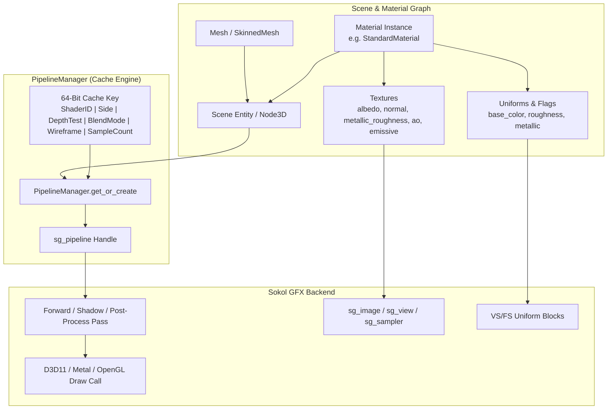
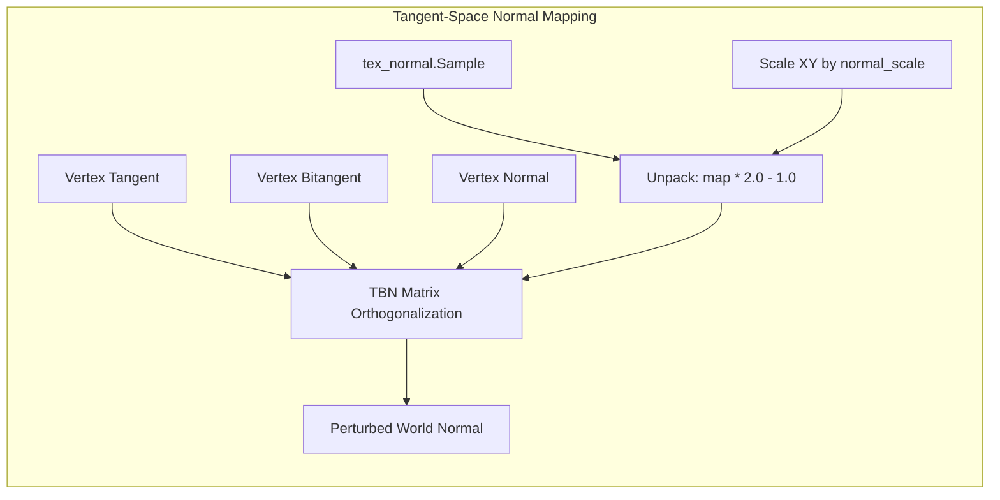
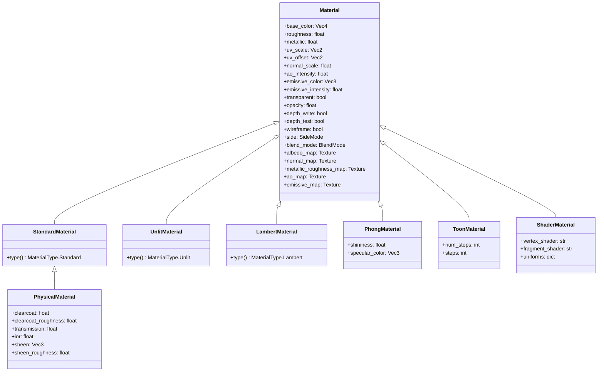
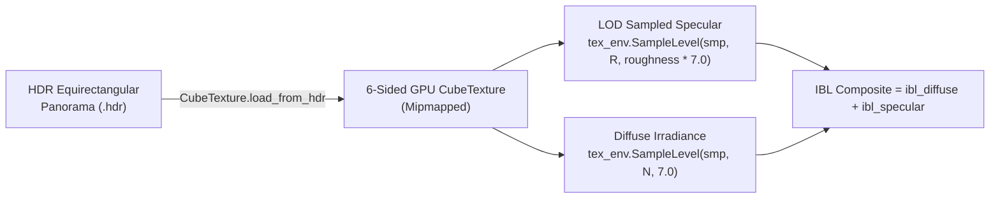

# Materials & Shaders Guide

This technical guide covers the material architecture, Physically Based Rendering (PBR) shading models, texture channels, material specializations, and Image-Based Lighting (IBL) in the **Velocity 3D Engine**.

---

## 1. Architectural Overview

Velocity 3D Engine features a multi-backend graphics architecture built upon C++20 and Sokol GFX (`sokol_gfx.h`), providing hardware-accelerated rendering across Direct3D 11, Metal, and Modern OpenGL.



### Key Architectural Pillars

- **Unified Shader Pipeline**: Shaders execute an uber-shader model with dynamic branching on material types (`MaterialType::Standard`, `Physical`, `Unlit`, `Lambert`, `Phong`, `Toon`, `CustomShader`), eliminating shader compilation stutters at runtime.
- **`PipelineManager` State Caching**: Render state permutations (depth testing, blend modes, face culling, wireframe mode, sample counts) are hashed into 64-bit integers (`PipelineManager::make_key()`) to guarantee zero redundant pipeline creations.
- **Pythonic Nanobind Integration**: All material properties expose typed Python bindings with instant synchronization to native memory structures.

---

## 2. Physically Based Rendering (PBR) Theory

Velocity 3D Engine implements a modern, energy-conserving microfacet specular BRDF based on the **Cook-Torrance** formulation combined with a **Lambertian** diffuse model.

The complete Bidirectional Reflectance Distribution Function (BRDF) $f_r$ is:

$$f_r = f_{\text{diffuse}} + f_{\text{specular}} = k_d \frac{c}{\pi} + \frac{D \cdot G \cdot F}{4 (N \cdot V)(N \cdot L)}$$

Where:
- $c$ is the surface albedo (base color).
- $k_d$ is the diffuse ratio of reflected light.
- $N$ is the surface normal unit vector.
- $V$ is the view direction vector towards the camera.
- $L$ is the light direction vector towards the light source.
- $H = \frac{V + L}{\|V + L\|}$ is the half-vector between view and light directions.

```
       Light (L)              Normal (N)             View (V)
            \                     |                     /
             \                    |   Half (H)         /
              \                   |     ^             /
               \                  |    /             /
                \                 |   /             /
                 \                |  /             /
                  \               | /             /
                   \              |/             /
                    v             +             v
       ---------------------------------------------------------
                     Rough Microfacet Surface
```

### 2.1 Lambertian Diffuse

Light penetrating the surface undergoes multiple internal scatterings before re-emerging diffusely in all directions:

$$f_{\text{diffuse}} = k_d \frac{c}{\pi}$$

To conserve energy, the diffuse reflection fraction $k_d$ must strictly account for the specular reflection fraction $k_s = F$:

$$k_d = (1.0 - k_s) \cdot (1.0 - \text{metallic})$$

Metals (conductors) possess no subsurface diffuse scattering; their diffuse term drops to zero as $\text{metallic} \rightarrow 1.0$.

### 2.2 Cook-Torrance Specular Microfacet Model

The specular reflection model comprises three primary components:

#### 1. Normal Distribution Function (NDF): Trowbridge-Reitz GGX ($D$)
Models the statistical orientation of microfacets aligned with the half-vector $H$:

$$D(N, H, \alpha) = \frac{\alpha^2}{\pi \left( (N \cdot H)^2 (\alpha^2 - 1) + 1 \right)^2}$$

Where $\alpha = \text{roughness}^2$. Squaring roughness produces a perceptually linear distribution when adjusting sliders in artists' tools.

#### 2. Geometric Masking & Shadowing: Smith Model ($G$)
Accounts for microfacets occluding or shadowing one another at grazing angles:

$$G(N, V, L, k) = G_1(N, V, k) \cdot G_1(N, L, k)$$

Using the Schlick-GGX approximation for direct lighting:

$$G_1(N, X, k) = \frac{N \cdot X}{(N \cdot X)(1 - k) + k}, \quad k = \frac{(\alpha + 1)^2}{8}$$

#### 3. Fresnel Reflectance: Schlick's Approximation ($F$)
Calculates the ratio of reflected versus transmitted light as the viewing angle changes:

$$F(V, H, F_0) = F_0 + (1.0 - F_0) \left(1.0 - \max(N \cdot V, 0)\right)^5$$

The characteristic base reflectance at normal incidence $F_0$ is defined as:
- **Dielectrics (non-metals)**: $F_0 \approx 0.04$ (constant 4% reflectance).
- **Conductors (metals)**: $F_0 = \text{lerp}(0.04, c, \text{metallic})$.

### 2.3 VelocityEngine Core Shader Implementation

```hlsl
// HLSL / GLSL implementation from core/src/app.cpp
float distribution_ggx(float3 N, float3 H, float roughness) {
    float a = roughness * roughness;
    float a2 = a * a;
    float NdotH = max(dot(N, H), 0.0);
    float NdotH2 = NdotH * NdotH;
    float denom = (NdotH2 * (a2 - 1.0) + 1.0);
    return a2 / (PI * denom * denom + 0.00001);
}

float geometry_schlick_ggx(float NdotV, float roughness) {
    float r = (roughness + 1.0);
    float k = (r * r) / 8.0;
    return NdotV / (NdotV * (1.0 - k) + k + 0.00001);
}

float geometry_smith(float3 N, float3 V, float3 L, float roughness) {
    float NdotV = max(dot(N, V), 0.0001);
    float NdotL = max(dot(N, L), 0.0);
    float ggx2 = geometry_schlick_ggx(NdotV, roughness);
    float ggx1 = geometry_schlick_ggx(NdotL, roughness);
    return ggx1 * ggx2;
}

float3 fresnel_schlick(float cos_theta, float3 F0) {
    return F0 + (1.0 - F0) * pow(clamp(1.0 - cos_theta, 0.0, 1.0), 5.0);
}
```

---

## 3. Texture Channels & Map Types

Materials accept 5 primary texture slots that drive the PBR pipeline:

| Texture Slot | Property Name | Format / Channels | Color Space | Description |
|:---|:---|:---|:---|:---|
| **Albedo** | `albedo_map` | RGBA (RGB: Color, A: Opacity) | sRGB | Base surface diffuse reflection color and opacity. |
| **Normal** | `normal_map` | RGB ($[X, Y, Z]$ encoded in $[0..1]$) | Linear | Tangent-space surface normal perturbations. |
| **Metallic-Roughness** | `metallic_roughness_map` | G: Roughness, B: Metallic | Linear | Follows standard glTF 2.0 green/blue packing. |
| **Ambient Occlusion** | `ao_map` / `occlusion_map` | Single channel (R or grayscale) | Linear | Pre-baked micro-cavity contact shadowing. |
| **Emissive** | `emissive_map` | RGB | sRGB | Self-illumination color boosted by `emissive_intensity`. |



### 3.1 Tangent-Space Normal Mapping & Gram-Schmidt Orthogonalization

When a mesh does not have explicit precomputed vertex tangents, Velocity 3D Engine dynamically derives an orthogonal tangent frame using Gram-Schmidt orthogonalization:

```hlsl
float3 norm_map = tex_normal.Sample(smp_normal, uv).rgb * 2.0 - 1.0;
norm_map.xy *= material_uv_offset.z; // normal_scale
norm_map = normalize(norm_map);

float3 T = inp.tangent;
if (dot(T, T) > 0.0001) {
    T = normalize(T);
} else {
    T = abs(N.y) > 0.99 ? cross(N, float3(0.0, 0.0, 1.0)) : cross(N, float3(0.0, 1.0, 0.0));
    T = normalize(T);
}

float3 B = inp.bitangent;
if (dot(B, B) > 0.0001) {
    B = normalize(B);
} else {
    B = cross(N, T);
}

// Transform tangent space normal to world space
N = normalize(norm_map.x * T + norm_map.y * B + norm_map.z * N);
```

### 3.2 Procedural Normal Map Generation with Sobel Filter

You can generate production-grade tangent-space normal maps from scalar grayscale heightmaps using a 2D central difference Sobel operator:

```python
import numpy as np

def heightmap_to_normal_map(height: np.ndarray, strength: float = 2.5) -> np.ndarray:
    """Generate high-quality tangent-space normal map using a Sobel operator.
    
    Args:
        height: 2D float32 array normalized to [0.0, 1.0].
        strength: Depth extrusion multiplier.
        
    Returns:
        RGBA uint8 array suitable for ve.Texture.create_data_texture().
    """
    h, w = height.shape
    # Central difference with wrap-around boundary condition
    dx = (np.roll(height, -1, axis=1) - np.roll(height, 1, axis=1)) * 0.5
    dy = (np.roll(height, -1, axis=0) - np.roll(height, 1, axis=0)) * 0.5

    nx = -dx * strength
    ny = -dy * strength
    nz = np.ones((h, w), dtype=np.float32)

    length = np.sqrt(nx * nx + ny * ny + nz * nz)
    nx /= length
    ny /= length
    nz /= length

    # Remap [-1.0, 1.0] -> [0, 255]
    r = ((nx * 0.5 + 0.5) * 255.0).astype(np.uint8)
    g = ((ny * 0.5 + 0.5) * 255.0).astype(np.uint8)
    b = ((nz * 0.5 + 0.5) * 255.0).astype(np.uint8)
    a = np.full((h, w), 255, dtype=np.uint8)

    return np.stack([r, g, b, a], axis=-1)
```

---

## 4. Core Material Types

Velocity 3D Engine provides 7 distinct material classes:



### 4.1 Class Reference & Attributes

| Class | Primary Properties | Typical Use Cases |
|:---|:---|:---|
| **`StandardMaterial`** | `roughness`, `metallic`, `base_color`, `albedo_map`, `normal_map`, `metallic_roughness_map`, `ao_map`, `emissive_map` | Realistic metals, stone, wood, plastics, machinery. |
| **`PhysicalMaterial`** | `clearcoat` ($0..1$), `clearcoat_roughness`, `transmission` ($0..1$), `ior` (e.g. $1.5$), `sheen`, `sheen_roughness` | Car lacquer paint, glass, gems, water, velvet, silk. |
| **`UnlitMaterial`** | `base_color`, `albedo_map`, `wireframe` | UI panels, health bars, crosshairs, laser beams, debug meshes. |
| **`LambertMaterial`** | `base_color`, `albedo_map` | Matte, unpolished surfaces (clay, chalk, cardboard). |
| **`PhongMaterial`** | `shininess` ($1..256$), `specular_color`, `base_color` | Retro / stylised glossy highlights without microfacet expense. |
| **`ToonMaterial`** | `num_steps` (typically $2..5$), `base_color`, `albedo_map` | Anime, comic, cel-shaded art styles with quantized light bands. |
| **`ShaderMaterial`** | `vertex_shader`, `fragment_shader`, `uniforms` | Custom post-effects, water waves, raymarching, holographic shields. |

### 4.2 Material Render Flags & Modes

Every material exposes essential GPU rasterizer states:

- **`side` (`ve.SideMode`)**:
  - `SideMode.Front`: Default counter-clockwise backface culling.
  - `SideMode.Back`: Inverts culling to render interior faces.
  - `SideMode.Double`: Disables backface culling (leaves, clothing, sheets).
- **`blend_mode` (`ve.BlendMode`)**:
  - `BlendMode.Opaque`: Direct write, no alpha blending.
  - `BlendMode.AlphaBlend`: Standard transparency equation ($\text{SrcAlpha} \times \text{Src} + (1 - \text{SrcAlpha}) \times \text{Dst}$).
  - `BlendMode.Additive`: Additive blending ($\text{Src} + \text{Dst}$), ideal for fire, magic sparks, and lasers.
  - `BlendMode.Multiply`: Subtractive stained-glass effect ($\text{Src} \times \text{Dst}$).
- **`alpha_test` / `alpha_cutoff`**: Enables hard pixel discard when `alpha < alpha_cutoff` (vital for foliage and chain-link fences).

---

## 5. Environment Cubemaps, HDR Panoramas & Image-Based Lighting (IBL)

Velocity 3D Engine supports environment cubemaps for realistic ambient reflections and diffuse irradiance.



### 5.1 `CubeTexture` Factory Methods

The `ve.CubeTexture` class provides GPU cubemap resources:

```python
import VelocityEngine as ve

# 1. Load from 6 separate 2D face images (+X, -X, +Y, -Y, +Z, -Z)
cube_faces = ve.CubeTexture.load_from_files(
    "sky_px.png", "sky_nx.png",
    "sky_py.png", "sky_ny.png",
    "sky_pz.png", "sky_nz.png"
)

# 2. Load from a high-dynamic-range equirectangular panorama (.hdr)
cube_hdr = ve.CubeTexture.load_from_hdr("assets/textures/studio_small_08.hdr", resolution=512)

# 3. Create a procedural sky gradient
cube_gradient = ve.CubeTexture.create_gradient(
    top_color=(0.15, 0.45, 0.85),
    horizon_color=(0.7, 0.8, 0.95),
    bottom_color=(0.12, 0.12, 0.15),
    resolution=256
)

# Assign cubemap to the scene environment
app.scene.environment = cube_gradient
```

### 5.2 Split-Sum IBL Shader Integration

In the forward PBR pass, ambient illumination is evaluated using pre-filtered environment maps:

```hlsl
// Calculate reflection vector and view vector
float3 V = normalize(eye_pos.xyz - inp.world_pos);
float3 R = reflect(-V, N);

// Sample environment cubemap at LOD proportional to surface roughness
float env_lod = roughness * 7.0;
float3 env_spec = tex_env.SampleLevel(smp_env, R, env_lod).rgb;

// Fresnel for environment reflection
float3 F0 = lerp(float3(0.04, 0.04, 0.04), albedo, metallic);
float3 F_env = fresnel_schlick(max(dot(N, V), 0.0), F0);

// Specular IBL
float env_intensity = eye_pos.w;
float3 ibl_specular = env_spec * F_env * env_intensity;

// Diffuse IBL (sampled at highest mip level to approximate irradiance)
float3 kS = F_env;
float3 kD = (float3(1.0, 1.0, 1.0) - kS) * (1.0 - metallic);
float3 env_diff = tex_env.SampleLevel(smp_env, N, 7.0).rgb;
float3 ibl_diffuse = kD * env_diff * albedo * ao * env_intensity;

float3 ambient = (ambient_and_count.rgb + hemi_light) * albedo * ao * (1.0 - 0.5 * metallic) 
                 + ibl_diffuse + ibl_specular;
```

---

## 6. Complete Executable Code Examples

### Example 1: PBR Metallic-Roughness Sphere Array

This script renders a $5 \times 5$ matrix of spheres demonstrating the transition from non-metal to pure metal across varying roughness levels:

```python
"""PBR Sphere Matrix: Visualizing Metallic-Roughness parameter space."""

import VelocityEngine as ve

def main():
    app = ve.App("Velocity Engine - PBR Sphere Grid", width=1280, height=720)
    scene = app.scene

    # Setup directional sun light
    scene.set_sun(direction=(-0.6, -1.2, -0.8), color=(1.0, 0.98, 0.95), intensity=2.0)

    # Setup procedural sky gradient for environment reflections
    scene.environment = ve.CubeTexture.create_gradient(
        top_color=(0.1, 0.4, 0.8),
        horizon_color=(0.6, 0.75, 0.9),
        bottom_color=(0.08, 0.08, 0.1),
        resolution=256
    )

    # Camera controller
    orb = ve.OrbitController(target=(0.0, 3.0, 0.0), distance=12.0)
    app.camera = orb

    sphere_mesh = ve.Mesh.create_sphere(radius=0.55, rings=32, sectors=32)

    rows = 5     # Metallic (0.0 to 1.0)
    cols = 5     # Roughness (0.05 to 1.0)
    spacing = 1.4

    for row in range(rows):
        metallic = float(row) / float(rows - 1)
        for col in range(cols):
            roughness = max(0.04, float(col) / float(cols - 1))

            mat = ve.StandardMaterial()
            mat.base_color = (0.95, 0.2, 0.2, 1.0) if row % 2 == 0 else (0.85, 0.75, 0.35, 1.0)
            mat.metallic = metallic
            mat.roughness = roughness

            x = (col - (cols - 1) * 0.5) * spacing
            y = (row - (rows - 1) * 0.5) * spacing + 3.0

            sphere = scene.create_entity(f"PBR_Sphere_{row}_{col}")
            sphere.mesh = sphere_mesh
            sphere.material = mat
            sphere.transform.position = (x, y, 0.0)

    app.run()

if __name__ == "__main__":
    main()
```

### Example 2: Procedural Tangent-Space Normal Map & Texturing

```python
"""Procedural Normal-Mapped Flagstone Material Example."""

import numpy as np
import VelocityEngine as ve

def generate_procedural_stone_textures(size: int = 256):
    """Generate procedural diffuse and normal map arrays using NumPy."""
    # 1. Heightmap generation
    y, x = np.ogrid[:size, :size]
    freq = 6.0
    height = 0.5 * (1.0 + np.sin(x * (freq * 2.0 * np.pi / size)) * np.cos(y * (freq * 2.0 * np.pi / size)))
    height = height.astype(np.float32)

    # 2. Tangent-space normal map via central difference Sobel
    dx = (np.roll(height, -1, axis=1) - np.roll(height, 1, axis=1)) * 0.5
    dy = (np.roll(height, -1, axis=0) - np.roll(height, 1, axis=0)) * 0.5
    strength = 3.0

    nx = -dx * strength
    ny = -dy * strength
    nz = np.ones((size, size), dtype=np.float32)
    norm = np.sqrt(nx * nx + ny * ny + nz * nz)
    nx /= norm
    ny /= norm
    nz /= norm

    normal_rgba = np.stack([
        ((nx * 0.5 + 0.5) * 255).astype(np.uint8),
        ((ny * 0.5 + 0.5) * 255).astype(np.uint8),
        ((nz * 0.5 + 0.5) * 255).astype(np.uint8),
        np.full((size, size), 255, dtype=np.uint8)
    ], axis=-1)

    # 3. Albedo texture
    albedo_gray = (height * 180 + 40).astype(np.uint8)
    albedo_rgba = np.stack([albedo_gray, albedo_gray, albedo_gray, np.full((size, size), 255, dtype=np.uint8)], axis=-1)

    # Convert to VelocityEngine DataTextures
    tex_albedo = ve.DataTexture(albedo_rgba.tobytes(), size, size, channels=4)
    tex_normal = ve.DataTexture(normal_rgba.tobytes(), size, size, channels=4)
    return tex_albedo, tex_normal

def main():
    app = ve.App("Procedural Normal Map Demo", width=1280, height=720)
    albedo_tex, normal_tex = generate_procedural_stone_textures(512)

    mat = ve.StandardMaterial()
    mat.albedo_map = albedo_tex
    mat.normal_map = normal_tex
    mat.normal_scale = 1.5
    mat.roughness = 0.35
    mat.metallic = 0.1
    mat.set_uv_scale(4.0, 4.0)

    plane = app.scene.create_entity("StoneFloor")
    plane.mesh = ve.Mesh.create_plane(width=10.0, depth=10.0)
    plane.material = mat
    plane.transform.position = (0.0, 0.0, 0.0)

    app.scene.set_sun(direction=(-0.8, -1.0, -0.4), color=(1.0, 0.95, 0.9), intensity=1.5)
    app.camera = ve.OrbitController(target=(0.0, 0.0, 0.0), distance=8.0)
    app.run()

if __name__ == "__main__":
    main()
```

### Example 3: Stylized Cel-Shading with `ToonMaterial`

```python
"""Stylized Anime Cel-Shading with ToonMaterial."""

import VelocityEngine as ve

def main():
    app = ve.App("Stylized Toon Shading Demo", width=1280, height=720, clear_color="#181a20")
    scene = app.scene

    # Directional Key Light
    scene.set_sun(direction=(-1.0, -1.5, -1.0), color=(1.0, 1.0, 1.0), intensity=1.8)

    # Create 3-step Toon Material
    toon = ve.ToonMaterial()
    toon.base_color = (0.2, 0.75, 0.9, 1.0)
    toon.num_steps = 3   # 3 distinct illumination bands

    torus = scene.create_entity("ToonKnot")
    torus.mesh = ve.Mesh.create_sphere(radius=1.8, rings=32, sectors=32)
    torus.material = toon
    torus.transform.position = (0.0, 2.0, 0.0)

    app.camera = ve.OrbitController(target=(0.0, 2.0, 0.0), distance=6.0)

    def update(dt):
        torus.transform.rotate_y(0.8 * dt)
        torus.transform.rotate_x(0.4 * dt)

    app.on_update(update)
    app.run()

if __name__ == "__main__":
    main()
```

---

## 7. Common Pitfalls & Best Practices

> [!WARNING]
> **Roughness Values Near Zero**
> Setting `material.roughness = 0.0` creates a specular singularity in Cook-Torrance BRDF ($\alpha^2 / 0$). The engine automatically clamps roughness to `0.04` in the shader. When authoring mirror reflections, use `roughness = 0.04` or `0.05`.

> [!IMPORTANT]
> **Linear vs. sRGB Color Spaces**
> - **Albedo and Emissive maps** must be decoded in sRGB gamma space.
> - **Normal, Roughness, Metallic, and AO maps** must be treated as Linear scalar data. Storing roughness or normal maps in sRGB introduces distorted curvature and specular blow-outs.

> [!TIP]
> **Avoid Shader Churn with Presets**
> Frequent dynamic additions of custom `ShaderMaterial` instances generate new GPU pipelines. For static assets, reuse shared `StandardMaterial` instances and modify instance transforms or tint uniforms. VelocityEngine ships with pre-baked material factories:
> ```python
> gold_mat = ve.gold(roughness=0.2)
> chrome_mat = ve.metal(roughness=0.1, color=(0.95, 0.95, 0.95))
> plastic_mat = ve.plastic(roughness=0.4, color=(0.8, 0.1, 0.1))
> rubber_mat = ve.rubber(roughness=0.85)
> ```

> [!NOTE]
> **Double-Sided Transparent Shading**
> Transparent meshes (leaves, cloth) should set `material.side = ve.SideMode.Double` and `material.blend_mode = ve.BlendMode.AlphaBlend`. If rendering foliage cutouts, enable `alpha_test = True` and `alpha_cutoff = 0.5` to write to the depth buffer and eliminate sorting artifacts.
