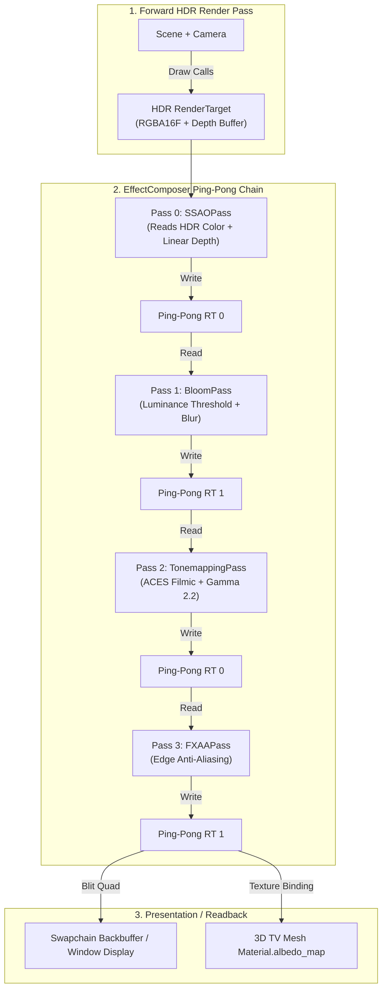
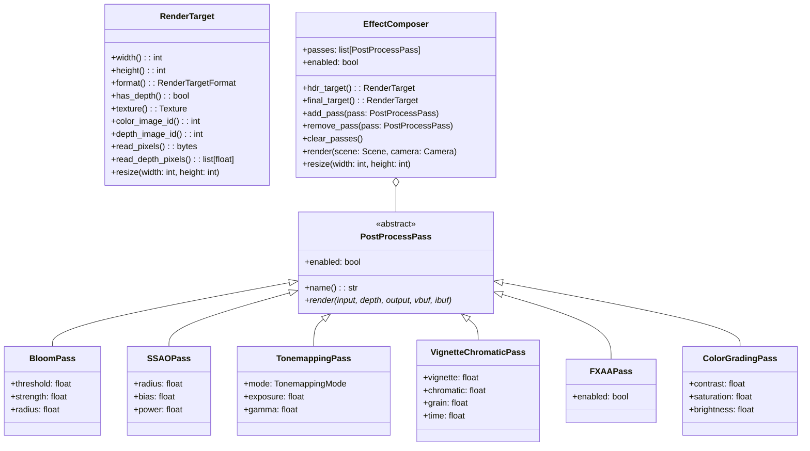
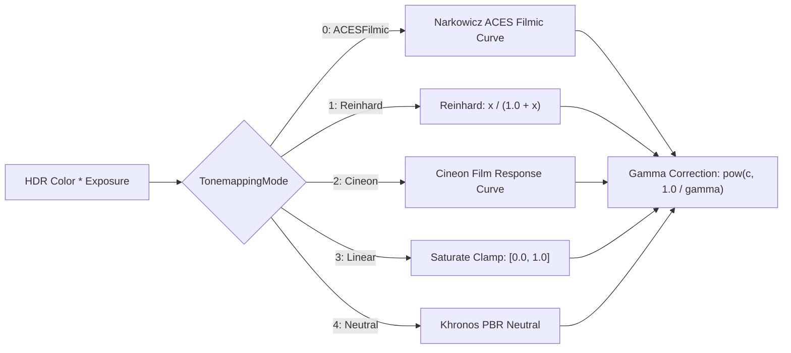
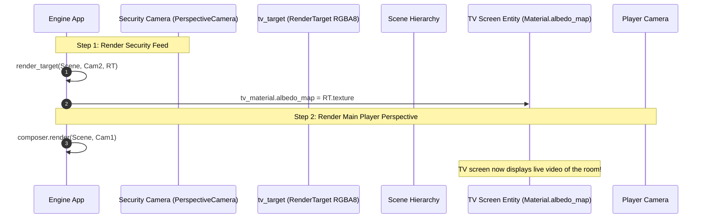

# Post-Processing & Compositing Guide

This technical guide details the post-processing architecture of the **Velocity 3D Engine**, including the `EffectComposer`, high-dynamic-range `RenderTarget` allocation (RGBA16F), ping-pong compositing buffers, HDR Gaussian Bloom, Screen-Space Ambient Occlusion (SSAO), tonemapping operators, chromatic aberration, vignette, and Fast Approximate Anti-Aliasing (FXAA).

---

## 1. Architectural Overview & Ping-Pong Pipeline

Post-processing effects operate on a 2D image of the rendered 3D scene. To prevent precision loss and clipping of intense light sources (e.g. emissive neon surfaces with intensities $>1.0$), VelocityEngine renders initial geometry into an off-screen floating-point HDR framebuffer (`RenderTarget` with `RenderTargetFormat::RGBA16F`).



### 1.1 The Ping-Pong Buffer Mechanism

In multi-pass image processing, reading from and writing to the exact same GPU texture simultaneously produces severe undefined behavior and race conditions. 

`EffectComposer` resolves this by allocating two identical intermediate buffers:
- `ping_pong_[0]`
- `ping_pong_[1]`

As each `PostProcessPass` executes:
1. Pass $N$ reads from buffer $A$ and writes to buffer $B$.
2. The pointers swap: buffer $B$ becomes the input for Pass $N+1$, while buffer $A$ becomes the output target.
3. Once all enabled passes have finished, the final target is blitted directly to the Sokol GFX swapchain.

---

## 2. Core Engine Classes & API Reference



### 2.1 Post-Processing Passes Reference

| Class | Key Attributes & Defaults | Description |
|:---|:---|:---|
| **`BloomPass`** | `threshold = 1.0`<br>`strength = 1.5`<br>`radius = 0.5` | Isolates high-luminance pixels beyond `threshold`, applies a 9-tap 2D Gaussian blur kernel, and composites additively onto the scene. |
| **`SSAOPass`** | `radius = 0.5`<br>`bias = 0.025`<br>`power = 1.0` | Approximates contact ambient occlusion by sampling the scene linear depth buffer in an 8-tap Poisson disk around each fragment. |
| **`TonemappingPass`** | `mode = ACESFilmic`<br>`exposure = 1.0`<br>`gamma = 2.2` | Compresses High Dynamic Range ($[0, \infty)$) colors into Low Dynamic Range ($[0, 1]$) display output with gamma curve correction. |
| **`VignetteChromaticPass`** | `vignette = 0.3`<br>`chromatic = 0.005`<br>`grain = 0.02`<br>`time = 0.0` | Adds cinematic camera lens distortion: dark radial perimeter edges, radial R/B chromatic separation, and procedural dynamic film grain. |
| **`FXAAPass`** | `enabled = True` | Fast Approximate Anti-Aliasing (FXAA 3.11). Analyzes luminance edge gradients to smooth jagged geometry lines with zero geometry overhead. |
| **`ColorGradingPass`** | `contrast = 1.0`<br>`saturation = 1.0`<br>`brightness = 1.0` | Performs post-tonemapping color adjustments (e.g. black-and-white mode with `saturation = 0.0` or high-contrast film aesthetics). |

---

## 3. Shader Math & Algorithms

### 3.1 BloomPass: Luminance Thresholding & Gaussian Filter

The bloom pass operates in three steps:
1. **Luminance Extraction**: Calculates perceptual luminance using ITU-R BT.709 coefficients:
   $$\text{Luminance}(C) = 0.2126 \cdot R + 0.7152 \cdot G + 0.0722 \cdot B$$
   Pixels with $\text{Luminance} \le \text{threshold}$ are discarded.
2. **Gaussian Filter**: Samples an expanded 9-tap 2D kernel weighted by normal distribution:
   $$\text{Weights} = \begin{bmatrix} 0.0625 & 0.125 & 0.0625 \\ 0.125 & 0.25 & 0.125 \\ 0.0625 & 0.125 & 0.0625 \end{bmatrix}$$
3. **Additive Blend**:
   $$C_{\text{final}} = C_{\text{base}} + C_{\text{bloom}} \times \text{strength}$$

```hlsl
// HLSL fragment shader from core/src/post_process.cpp
float4 main(float4 pos : SV_Position, float2 uv : TEXCOORD0) : SV_Target {
    float4 base_col = scene_tex.Sample(smp, uv);
    float3 bloom = float3(0.0, 0.0, 0.0);
    float2 step_uv = (radius * 0.003) * float2(1.0, 1.0);

    for (int i = 0; i < 9; ++i) {
        float3 s = scene_tex.Sample(smp, uv + offsets[i] * step_uv).rgb;
        float lum = dot(s, float3(0.2126, 0.7152, 0.0722));
        float bright = max(lum - threshold, 0.0);
        float3 bright_color = s * (bright / max(lum, 0.0001));
        bloom += bright_color * weights[i];
    }
    return float4(base_col.rgb + bloom * strength, base_col.a);
}
```

### 3.2 SSAOPass: Screen-Space Ambient Occlusion

The SSAO pass samples the depth buffer at 8 radial locations around the current pixel:

```hlsl
float center_d = depth_tex.Sample(depth_smp, uv).r;
float occlusion = 0.0;
float2 step = radius * float2(0.004, 0.004);

for (int i = 0; i < 8; ++i) {
    float d = depth_tex.Sample(depth_smp, uv + samples[i] * step).r;
    float diff = center_d - d;
    if (diff > bias && diff < radius * 0.1) {
        occlusion += 1.0;
    }
}
float ao = 1.0 - (occlusion / 8.0);
ao = clamp(pow(max(ao, 0.0), power), 0.0, 1.0);
return float4(col.rgb * ao, col.a);
```

### 3.3 TonemappingPass: Color Transformations

VelocityEngine provides 5 distinct tonemapping curves (`ve.TonemappingMode`):



#### ACES Filmic Operator (Academy Color Encoding System)
Narkowicz's fast analytical approximation of the ACES S-curve:

$$f(x) = \text{saturate}\left( \frac{x(2.51x + 0.03)}{x(2.43x + 0.59) + 0.14} \right)$$

This operator delivers rich contrast, natural filmic shoulder roll-off, and subtle desaturation of extreme highlights.

#### Reinhard Operator
Simple compressive rational function:

$$f(x) = \frac{x}{1.0 + x}$$

#### Khronos Neutral Operator
The official Khronos Group neutral PBR operator designed for e-commerce and product rendering where brand colors must be preserved without artificial tint shifts.

---

## 4. RenderTarget & Render-to-Texture (RTT)

`RenderTarget` represents an offscreen GPU framebuffer object (FBO).

### 4.1 Formats Supported (`ve.RenderTargetFormat`)
- `RenderTargetFormat.RGBA8`: 8-bit per channel uncompressed color buffer.
- `RenderTargetFormat.RGBA16F`: 16-bit half-float HDR buffer (essential for bloom and bright lighting).
- `RenderTargetFormat.R32F`: 32-bit single-channel float buffer (ideal for depth maps, shadow cascades, and distance fields).

### 4.2 Interactive 3D Security Camera & In-Game TV Portal

A secondary camera can render a different perspective into a `RenderTarget`, which is subsequently applied as an `albedo_map` to a 3D television or surveillance screen:



---

## 5. Complete Runnable Code Examples

### Example 1: Cyberpunk Chamber with Emissive Lights & BloomPass

```python
"""Dynamic Lights & BloomPass Example in VelocityEngine."""

import math
import VelocityEngine as ve

def main():
    app = ve.App("Cyberpunk Bloom Showcase", width=1280, height=720, clear_color="#07090e")
    scene = app.scene

    # Ambient night light
    hemi = ve.HemisphereLight("Ambient", sky=(0.04, 0.08, 0.15), ground=(0.01, 0.02, 0.03), intens=0.5)
    scene.add_light(hemi)

    # Floor plane
    floor = scene.create_plane(width=40.0, height=40.0)
    floor_mat = ve.StandardMaterial()
    floor_mat.base_color = (0.05, 0.06, 0.08, 1.0)
    floor_mat.metallic = 0.9
    floor_mat.roughness = 0.2
    floor.material = floor_mat

    # Neon columns with extreme emissive intensity
    pillar_mesh = ve.Mesh.create_box(0.5, 5.0, 0.5)
    neon_hues = [
        (0.0, 1.0, 0.9),   # Neon Cyan
        (1.0, 0.1, 0.8),   # Hot Magenta
        (0.2, 0.5, 1.0),   # Electric Blue
        (1.0, 0.7, 0.0),   # Neon Amber
    ]

    for i in range(12):
        angle = (2.0 * math.pi * i) / 12.0
        px = math.cos(angle) * 8.0
        pz = math.sin(angle) * 8.0

        col = neon_hues[i % len(neon_hues)]
        col_vec = ve.Vec3(col[0], col[1], col[2])
        pillar = scene.create_entity(f"Pillar_{i}")
        pillar.mesh = pillar_mesh

        mat = ve.StandardMaterial()
        mat.base_color = (0.1, 0.1, 0.1, 1.0)
        mat.emissive_color = (col[0], col[1], col[2])
        mat.emissive_intensity = 4.5
        pillar.material = mat
        pillar.transform.position = (px, 2.5, pz)

        # Dynamic point light placed at each pillar
        light = ve.PointLight(f"Light_{i}", col_vec, intens=3.0, rng=8.0)
        light.transform.position = (px, 2.5, pz)
        scene.add_light(light)

    # Setup EffectComposer with BloomPass
    composer = ve.EffectComposer(app.width, app.height)
    
    # 1. Bloom: highlights above 1.0 trigger strong glow
    bloom = ve.BloomPass(threshold=0.9, strength=2.5, radius=0.6)
    composer.add_pass(bloom)

    # 2. Tonemapping: ACES Filmic curve prevents washed-out highlights
    tonemap = ve.TonemappingPass(ve.TonemappingMode.ACESFilmic, exposure=1.0, gamma=2.2)
    composer.add_pass(tonemap)

    # 3. Vignette & subtle chromatic aberration
    vignette = ve.VignetteChromaticPass(vignette=0.35, chromatic=0.006, grain=0.015)
    composer.add_pass(vignette)

    # 4. Anti-aliasing
    fxaa = ve.FXAAPass()
    composer.add_pass(fxaa)

    app.composer = composer
    app.camera = ve.OrbitController(target=(0.0, 2.0, 0.0), distance=14.0)

    app.run()

if __name__ == "__main__":
    main()
```

### Example 2: In-Game Surveillance Monitor (Render-To-Texture)

```python
"""In-Game Security TV Screen using RenderTarget."""

import VelocityEngine as ve

def main():
    app = ve.App("In-Game TV Portal Demo", width=1280, height=720)
    scene = app.scene

    scene.set_sun(direction=(-0.5, -1.0, -0.5), color=(1.0, 1.0, 1.0), intensity=1.5)

    # 1. Rotating subject in the center of the room
    rotating_cube = scene.create_box(size=(1.5, 1.5, 1.5))
    cube_mat = ve.StandardMaterial()
    cube_mat.base_color = (0.9, 0.3, 0.1, 1.0)
    cube_mat.metallic = 0.5
    cube_mat.roughness = 0.3
    rotating_cube.material = cube_mat
    rotating_cube.transform.position = (0.0, 1.0, 0.0)

    # 2. Security Camera observing the cube from above
    security_cam = ve.PerspectiveCamera(fov=60.0, aspect_ratio=1.777, near_z=0.1, far_z=50.0)
    security_cam.set_position(0.0, 4.0, 4.0)
    security_cam.set_target(0.0, 1.0, 0.0)

    # 3. Create RenderTarget for the security feed
    tv_target = ve.RenderTarget(512, 288, ve.RenderTargetFormat.RGBA8, has_depth=True)

    # 4. In-Game TV Mesh inside the scene
    tv_screen = scene.create_plane(width=3.2, height=1.8)
    tv_screen.transform.position = (4.0, 2.0, -1.0)
    tv_screen.transform.rotate_y(-0.5)

    tv_mat = ve.StandardMaterial()
    tv_mat.base_color = (1.0, 1.0, 1.0, 1.0)
    tv_mat.roughness = 0.1
    # Bind the RenderTarget's GPU texture directly to the screen material!
    tv_mat.albedo_map = tv_target.texture
    tv_screen.material = tv_mat

    # Main spectator camera
    app.camera = ve.OrbitController(target=(1.0, 1.5, 0.0), distance=8.0)

    def update(dt: float):
        rotating_cube.transform.rotate_y(1.2 * dt)
        rotating_cube.transform.rotate_x(0.6 * dt)

        # Before main frame presentation, render security camera into the TV render target
        app.render_target(scene, security_cam, tv_target)

    app.on_update(update)
    app.run()

if __name__ == "__main__":
    main()
```

---

## 6. Common Pitfalls & Best Practices

> [!WARNING]
> **Pass Execution Order Matters**
> The sequence in which passes are added to `EffectComposer` directly impacts visual correctness:
> 1. Depth-dependent passes (`SSAOPass`) must execute **first** while depth buffers are uncorrupted.
> 2. HDR color-domain passes (`BloomPass`) must execute **before** tonemapping.
> 3. `TonemappingPass` must precede LDR grading and `FXAAPass`.
> 4. `FXAAPass` should always be the **final** pass to smooth high-contrast edge artifacts produced by tonemapping.

> [!IMPORTANT]
> **Window Resizing Synchronization**
> When the application window changes resolution, the `EffectComposer` internal ping-pong buffers and the main `hdr_target` must be resized:
> ```python
> def on_window_resize(new_width, new_height):
>     app.composer.resize(new_width, new_height)
> ```
> Failure to resize causes distorted aspect ratios and pixelation.

> [!TIP]
> **Selective Pass Disabling for Performance Tuning**
> Avoid destroying and recreating post-process passes when toggling graphic quality options. Simply toggle the `enabled` flag:
> ```python
> ssao_pass.enabled = user_settings.high_quality_ao
> bloom_pass.enabled = user_settings.enable_bloom
> ```
> The `EffectComposer` bypasses disabled passes at zero GPU cost.
