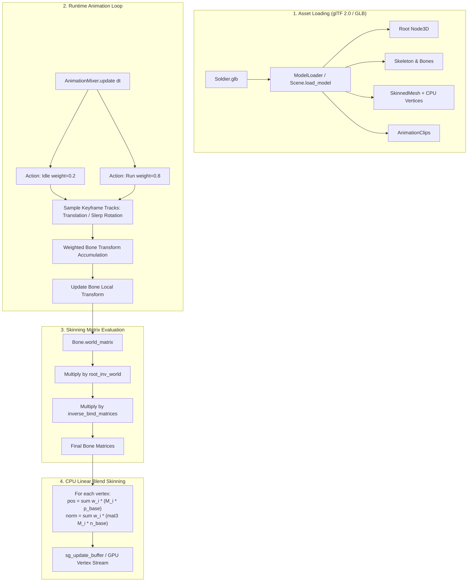
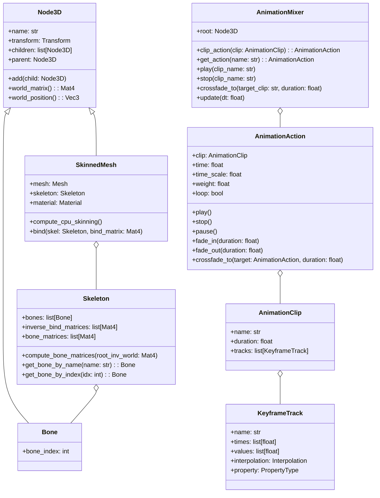
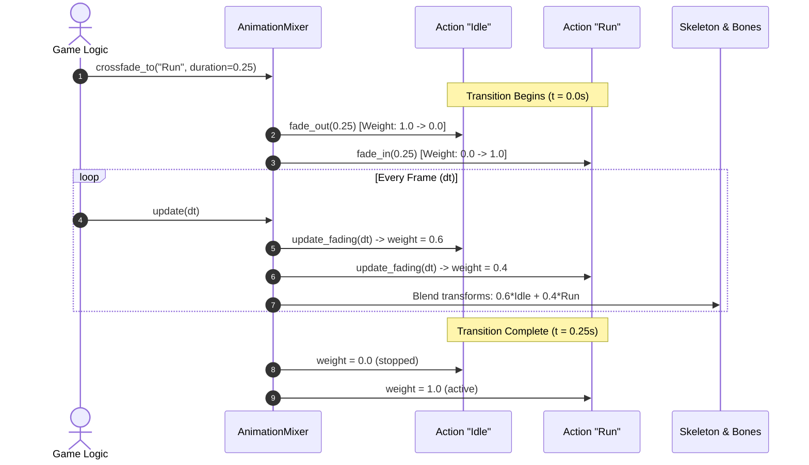
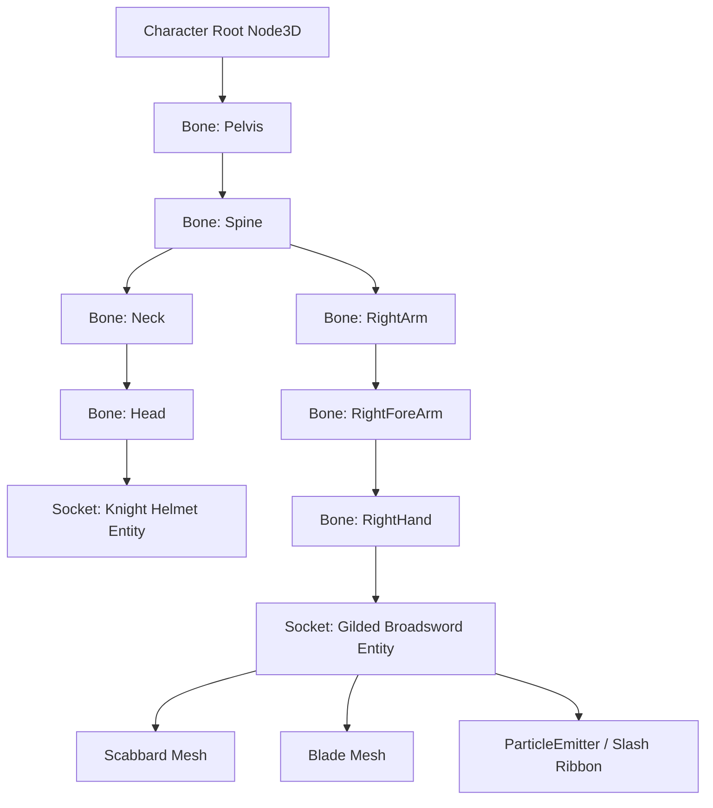

# Skeletal Animation & Skinned Meshes Guide

This technical guide provides a deep-dive into the skeletal animation system of the **Velocity 3D Engine**, including glTF 2.0 / GLB skinned asset loading, inverse bind matrices, bone hierarchies, CPU linear blend skinning, animation mixing with crossfading, and bone socket attachments.

---

## 1. Architectural Overview & Theory

Skeletal animation (also known as *skinning*) enables character meshes to deform smoothly based on an underlying hierarchical skeleton composed of *bones* (joints).



### 1.1 The Skinning Transform Pipeline

A vertex in a 3D model is originally authored in **Mesh Local Space** (also known as *Bind Pose* or *Rest Pose*). When a bone moves away from its rest pose, the vertex must be transformed by the relative change in that bone's pose.

The full transformation pipeline for each bone $j$ is:

$$M_{\text{bone}}[j] = M_{\text{root}}^{-1} \cdot M_{\text{world}}[j] \cdot M_{\text{inv\_bind}}[j]$$

Where:
1. **$M_{\text{inv\_bind}}[j]$ (Inverse Bind Matrix)**: Transforms the vertex from mesh rest-pose space into the local coordinate space of bone $j$ in its bind pose.
2. **$M_{\text{world}}[j]$ (Current World Transform)**: Transforms the vertex from bone $j$'s local space to current world space according to the current frame of animated joint transforms.
3. **$M_{\text{root}}^{-1}$ (Model Space Normalization)**: Converts the vertex back into model/mesh space so standard entity transformations (`transform.position`, `transform.rotation`) can be applied uniformly.

### 1.2 CPU Linear Blend Skinning (LBS)

For each vertex $i$, up to 4 joint indices $b_0, b_1, b_2, b_3$ and 4 scalar weights $w_0, w_1, w_2, w_3$ ($\sum_{j=0}^{3} w_j = 1.0$) determine the final position $p_i'$ and normal $n_i'$:

$$p_i' = \sum_{j=0}^{3} w_{i, j} \left( M_{\text{bone}}[b_{i, j}] \cdot \begin{bmatrix} p_i \\ 1 \end{bmatrix} \right)$$

$$n_i' = \frac{\sum_{j=0}^{3} w_{i, j} \left( \text{mat3}(M_{\text{bone}}[b_{i, j}]) \cdot n_i \right)}{\left\| \sum_{j=0}^{3} w_{i, j} \left( \text{mat3}(M_{\text{bone}}[b_{i, j}]) \cdot n_i \right) \right\|}$$

In VelocityEngine, this deformation is computed on the CPU and synchronized to Sokol GFX dynamic vertex buffers via `mesh->ensure_gpu_buffers()`.

---

## 2. Core Engine Classes & Hierarchy



### Class Reference Table

| Class | Responsibilities & Primary Methods | Key Attributes |
|:---|:---|:---|
| **`Bone`** | Specialization of `Node3D` representing an animated joint. Can host child attachments. | `bone_index`, `transform`, `world_matrix()` |
| **`Skeleton`** | Container for joint arrays and inverse bind matrices. Calculates runtime bone matrix palettes. | `bones`, `inverse_bind_matrices`, `bone_matrices`, `compute_bone_matrices()`, `get_bone_by_name()` |
| **`SkinnedMesh`** | Holds base rest-pose geometry, binds to a `Skeleton`, and executes CPU linear blend skinning. | `mesh`, `skeleton`, `material`, `compute_cpu_skinning()`, `bind()` |
| **`KeyframeTrack`** | Timed animation samples for Translation, Rotation (Quaternion), or Scale. | `name`, `times`, `values`, `interpolation`, `property` |
| **`AnimationClip`** | Immutable collection of keyframe tracks representing a single animation (e.g. "Idle", "Run"). | `name`, `duration`, `tracks` |
| **`AnimationAction`** | State controller for playing, pausing, fading, or looping a specific `AnimationClip`. | `time`, `time_scale`, `weight`, `loop`, `play()`, `stop()`, `fade_in()`, `fade_out()` |
| **`AnimationMixer`** | High-level playback driver. Samples tracks, blends multiple actions, and updates bone nodes. | `clip_action()`, `get_action()`, `crossfade_to()`, `update(dt)` |
| **`SkeletonHelper`** | Debug wireframe visualizer that draws lines between parent and child bones in the skeleton. | `bone_color`, `line_vertices`, `update()` |

---

## 3. Loading Rigged glTF 2.0 / GLB Characters

Velocity 3D Engine includes a built-in glTF 2.0 loader (via `cgltf`) that imports joint hierarchies, skin weights, materials, and embedded animation clips.

```python
import VelocityEngine as ve

app = ve.App("Skeletal Animation Loader", width=1280, height=720)

# Load rigged glTF / GLB binary model
model = app.scene.load_model("assets/Soldier.glb")

if model and model.root_entity:
    # Position character in the scene
    character_root = model.root_entity
    character_root.transform.position = (0.0, 0.0, 0.0)

    # Inspect imported animations
    print(f"Loaded {len(model.animations)} animation clips:")
    for clip in model.animations:
        print(f" - Clip: '{clip.name}', Duration: {clip.duration:.2f}s, Tracks: {len(clip.tracks)}")

    # Inspect skeleton
    if model.skeleton:
        print(f"Skeleton has {model.skeleton.num_bones} bones:")
        for bone in model.skeleton.bones:
            print(f"   [Bone {bone.bone_index}] {bone.name}")
```

---

## 4. Animation Blending & Crossfading

The `AnimationMixer` allows multiple clips to run simultaneously with independent weights, speeds, and loop modes.



### 4.1 Crossfade State Machine Implementation

```python
class CharacterLocomotion:
    def __init__(self, character_model, root_node):
        self.mixer = ve.AnimationMixer(root_node)
        self.actions = {}

        # Register clips from model
        for clip in character_model.animations:
            action = self.mixer.clip_action(clip)
            self.actions[clip.name] = action

        # Start in Idle state
        self.current_state = "Idle"
        if "Idle" in self.actions:
            self.actions["Idle"].play()

    def set_state(self, new_state: str, fade_duration: float = 0.2):
        if new_state == self.current_state:
            return
        if new_state in self.actions:
            self.mixer.crossfade_to(new_state, fade_duration)
            self.current_state = new_state

    def update(self, dt: float):
        self.mixer.update(dt)
```

### 4.2 Playback Speed & Looping Options

```python
action = mixer.get_action("Run")

# Double playback speed (sprint)
action.time_scale = 1.6

# Play once without looping (ideal for death or jump animations)
action.loop = False

# Reverse animation playback
action.time_scale = -1.0
```

---

## 5. Socket Attachments (Weapons, Props & Helmets)

In VelocityEngine, `Bone` is a direct subclass of `Node3D`. This design allows any scene `Entity` (such as a sword, torch, shield, or helmet) to be parented directly to a bone via `bone.add(child)`.



### 5.1 Attaching a Weapon to the Right Hand

```python
def attach_weapon_to_hand(scene: ve.Scene, skeleton: ve.Skeleton):
    """Create a 3D weapon entity and attach it to the character's right hand bone."""
    # 1. Locate the hand bone in the skeleton
    hand_bone = skeleton.get_bone_by_name("mixamorig:RightHand")
    if not hand_bone:
        # Fallback to alternative naming conventions
        hand_bone = skeleton.get_bone_by_name("RightHand")
    
    if not hand_bone:
        print("Warning: Hand bone not found in skeleton!")
        return None

    # 2. Build the weapon entity (e.g. Broadsword)
    sword = scene.create_entity("HeroBroadsword")
    sword.mesh = ve.Mesh.create_box(0.08, 1.1, 0.04)
    
    sword_mat = ve.StandardMaterial()
    sword_mat.base_color = (0.9, 0.9, 0.95, 1.0)
    sword_mat.metallic = 0.95
    sword_mat.roughness = 0.15
    sword.material = sword_mat

    # 3. Apply local socket offset relative to the palm/grip
    sword.transform.position = (0.0, 0.15, -0.05)
    sword.transform.rotation = (0.0, 90.0, 0.0)

    # 4. Attach weapon to the bone hierarchy!
    hand_bone.add(sword)
    print(f"Attached {sword.name} to {hand_bone.name}")
    return sword
```

---

## 6. Complete Runnable Code Examples

### Example 1: Full Skinned Character with Smooth Locomotion & Third-Person Camera

This complete standalone script loads `assets/Soldier.glb`, initializes the `AnimationMixer`, crossfades between `Idle` and `Run` on WASD input, and tracks the character with `FollowCamera`:

```python
"""Complete Skeletal Character Controller Example."""

from pathlib import Path
import math
import VelocityEngine as ve

def main():
    app = ve.App("Velocity Engine - Skeletal Animation", width=1280, height=720, clear_color="#0e1117")
    scene = app.scene

    # Sunlight and floor grid
    scene.set_sun(direction=(-0.8, -1.8, -1.0), color=(1.0, 0.95, 0.9), intensity=1.5)
    scene.create_grid(size=40.0, step=1.0, color=(0.15, 0.18, 0.24, 1.0))

    # Ground floor
    floor = scene.create_plane(width=50.0, height=50.0)
    floor_mat = ve.StandardMaterial()
    floor_mat.base_color = (0.1, 0.12, 0.16, 1.0)
    floor_mat.roughness = 0.8
    floor.material = floor_mat

    # 1. Load Rigged Character Model
    model_path = Path("assets/Soldier.glb")
    if not model_path.exists():
        model_path = Path("../assets/Soldier.glb")

    character = scene.load_model(str(model_path))
    if not character or not character.root_entity:
        print("Failed to load Soldier.glb asset.")
        return

    char_node = character.root_entity
    char_node.transform.position = (0.0, 0.0, 0.0)

    # 2. Setup AnimationMixer
    mixer = ve.AnimationMixer(char_node)
    for anim in character.animations:
        mixer.clip_action(anim)

    current_state = "Idle"
    idle_action = mixer.get_action("Idle")
    if idle_action:
        idle_action.play()

    # 3. Attach Socket Prop (Lantern / Weapon)
    if character.skeleton:
        hand_bone = character.skeleton.get_bone_by_name("mixamorig:RightHand")
        if hand_bone:
            lantern = scene.create_entity("HandLantern")
            lantern.mesh = ve.Mesh.create_sphere(radius=0.12, rings=16, sectors=16)
            lantern_mat = ve.StandardMaterial()
            lantern_mat.base_color = (1.0, 0.7, 0.2, 1.0)
            lantern_mat.emissive_color = (1.0, 0.7, 0.2)
            lantern_mat.emissive_intensity = 3.5
            lantern.material = lantern_mat
            lantern.transform.position = (0.0, 0.1, 0.0)
            hand_bone.add(lantern)

    # 4. Third-Person Spring-Arm Camera
    follow_cam = ve.FollowCamera(
        camera=app.camera,
        target_entity=char_node,
        offset=(0.0, 2.5, 5.0),
        look_at_offset=(0.0, 1.2, 0.0),
        stiffness=12.0,
        damping=0.85
    )
    app.camera = follow_cam

    # 5. UI Status Overlay
    app.ui.clear()
    app.ui.draw_text("Velocity 3D Engine | Skeletal Character & Crossfade", (24, 24), size=20, color=(1.0, 1.0, 1.0, 1.0))
    app.ui.draw_text("Controls: WASD to Move | Smooth Crossfade Idle <-> Run", (24, 52), size=14, color=(0.4, 0.8, 1.0, 1.0))
    app.ui.show_stats(True)

    char_speed = 4.5
    char_heading = 0.0

    def update(dt: float):
        nonlocal current_state, char_heading

        # Input gathering
        inp = app.input
        move_x = 0.0
        move_z = 0.0
        if inp.is_key_down(ve.Key.W): move_z -= 1.0
        if inp.is_key_down(ve.Key.S): move_z += 1.0
        if inp.is_key_down(ve.Key.A): move_x -= 1.0
        if inp.is_key_down(ve.Key.D): move_x += 1.0

        move_len = math.sqrt(move_x * move_x + move_z * move_z)
        is_moving = move_len > 0.01

        # Smooth crossfade between Idle and Run
        if is_moving:
            move_x /= move_len
            move_z /= move_len
            if current_state != "Run":
                mixer.crossfade_to("Run", 0.2)
                current_state = "Run"

            # Face movement direction
            char_heading = math.degrees(math.atan2(move_x, move_z)) + 180.0
            char_node.transform.rotation = (0.0, char_heading, 0.0)

            # Translation
            pos = char_node.transform.position
            char_node.transform.position = (
                pos.x + move_x * char_speed * dt,
                pos.y,
                pos.z + move_z * char_speed * dt
            )
        else:
            if current_state != "Idle":
                mixer.crossfade_to("Idle", 0.25)
                current_state = "Idle"

        # Advance skeletal animation
        mixer.update(dt)

    app.on_update(update)
    app.run()

if __name__ == "__main__":
    main()
```

### Example 2: Procedural Keyframe Track & AnimationClip Creation

You can construct custom procedural keyframe tracks directly in Python without external files:

```python
"""Procedural AnimationClip Generation in VelocityEngine."""

import VelocityEngine as ve

def create_floating_oscillation_clip(node_name: str, duration: float = 2.0) -> ve.AnimationClip:
    """Create a procedural Bob-and-Spin AnimationClip using Translation and Rotation tracks."""
    # 1. Vertical bounce keyframes
    times_pos = [0.0, 1.0, 2.0]
    values_pos = [
        0.0, 1.0, 0.0,   # t = 0.0s: Base
        0.0, 2.2, 0.0,   # t = 1.0s: Crest
        0.0, 1.0, 0.0    # t = 2.0s: Return
    ]
    track_pos = ve.KeyframeTrack(
        f"{node_name}.position",
        times_pos,
        values_pos,
        ve.Interpolation.Linear,
        ve.PropertyType.Translation
    )

    # 2. 360-degree continuous Y-axis rotation keyframes (quaternion: x, y, z, w)
    times_rot = [0.0, 1.0, 2.0]
    values_rot = [
        0.0, 0.0, 0.0, 1.0,    # 0 deg
        0.0, 1.0, 0.0, 0.0,    # 180 deg
        0.0, 0.0, 0.0, -1.0    # 360 deg
    ]
    track_rot = ve.KeyframeTrack(
        f"{node_name}.rotation",
        times_rot,
        values_rot,
        ve.Interpolation.Linear,
        ve.PropertyType.Rotation
    )

    # 3. Create clip
    clip = ve.AnimationClip("HoverSpin", duration, [track_pos, track_rot])
    return clip
```

---

## 7. Common Pitfalls & Best Practices

> [!WARNING]
> **Updating the World Matrix Before Bone Matrix Computation**
> Skeletons rely on parent world matrices being updated. If you manually reposition or rotate the root entity, always call `root_node.update_world_matrix(True)` or ensure the engine scene graph step runs before calling `skeleton.compute_bone_matrices()`.

> [!IMPORTANT]
> **Socket Scale Inheritance**
> When attaching props (e.g. weapons, lanterns) to bones, the child node inherits the bone's scale. In many rigged 3D models (e.g., Mixamo rigs), bones may carry non-uniform scaling or an armature scale of `0.01` (centimeters to meters conversion). If your attached weapon appears microscopic or oversized, set `weapon.transform.scale = (100.0, 100.0, 100.0)` or normalize bone scales in your modeling package.

> [!TIP]
> **Joint & Weight Normalization**
> Every vertex in a `SkinnedMesh` expects the sum of its 4 blend weights to equal 1.0:
> $$\sum_{j=0}^{3} w_j = 1.0$$
> If vertex weights sum to less than 1.0, the vertex will shrink towards the origin when animated. VelocityEngine provides safety normalization in `SkinnedMesh::compute_cpu_skinning()`, but authoring normalized weights in Blender prevents deformation artifacts.

> [!NOTE]
> **Visualizing Bone Structures**
> For debugging rig alignments, instantiate a `ve.SkeletonHelper`:
> ```python
> helper = ve.SkeletonHelper(character_root, character.skeleton)
> helper.bone_color = (0.2, 1.0, 0.4, 1.0) # Bright green lines
> app.scene.add_helper(helper)
> ```
