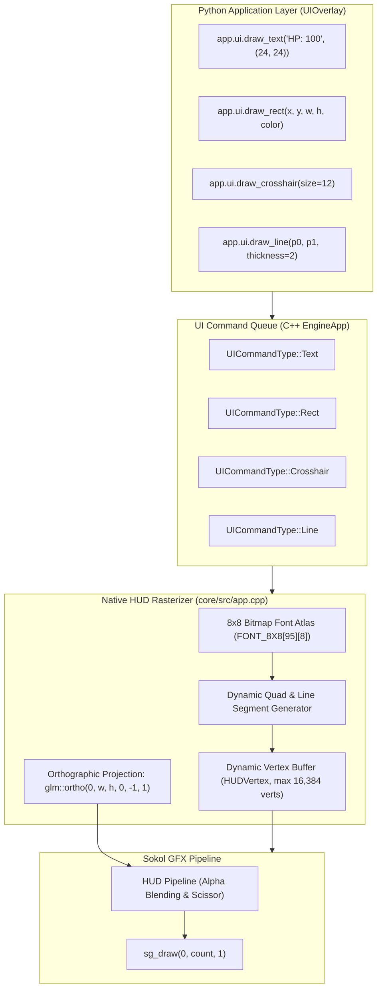

# 2D UI Overlay & HUD Rendering

Velocity 3D Engine features a lightweight, high-speed 2D UI overlay system designed for in-game heads-up displays (HUDs), crosshairs, health meters, score counters, radar cards, and diagnostic overlays. 

The UI pipeline executes in screen-space pixels using an orthographic projection pass, powered by an embedded 8x8 ASCII bitmap font atlas and a dynamic command queue that merges text, rectangles, lines, and crosshairs into a single GPU draw call.



---

## 1. Coordinate Conventions & Projection Mathematics

### 1.1 Screen-Space Pixel Coordinates

Unlike 3D scene rendering which uses normalized device coordinates (NDC) in range $[-1.0, +1.0]$, the 2D UI system operates in **screen-space pixel coordinates**:

- **Origin $(0, 0)$**: Top-left corner of the window.
- **$+X$ Direction**: Extends horizontally to the **right** ($0 \to \text{screen\_width}$).
- **$+Y$ Direction**: Extends vertically **downward** ($0 \to \text{screen\_height}$).
- **$(W, H)$**: Bottom-right corner of the window.

```text
(0, 0) Top-Left -----------------------------------------> +X (Width)
  |
  |     +-------------------------+
  |     |  [HUD Card: Score/FPS]  |
  |     +-------------------------+
  |
  |                  + (cx, cy) Screen Center Crosshair
  |
  |
  V
 +Y (Height)                                          (Width, Height)
```

### 1.2 The Orthographic Projection Matrix

In `core/src/app.cpp`, the engine transforms 2D screen-space pixel coordinates into GPU clip space using an orthographic projection matrix:

$$\mathbf{M}_{\text{ortho}} = \text{glm::ortho}(0.0f, \text{screen\_w}, \text{screen\_h}, 0.0f, -1.0f, 1.0f)$$

$$\mathbf{M}_{\text{ortho}} = \begin{bmatrix}
\frac{2}{W} & 0 & 0 & -1 \\
0 & -\frac{2}{H} & 0 & 1 \\
0 & 0 & -1 & 0 \\
0 & 0 & 0 & 1
\end{bmatrix}$$

Notice the negative scale on $Y$ ($-\frac{2}{H}$): this flips the vertical axis so that pixel coordinate $Y = 0$ corresponds to top clip boundary $+1.0$, and $Y = H$ corresponds to bottom clip boundary $-1.0$.

---

## 2. Bitmap Font Atlas & Glyph Rasterization

### 2.1 The Embedded 8x8 ASCII Font Atlas

Velocity avoids dependencies on heavy FreeType or external TTF files for core HUDs by baking an optimized **8x8 bitmapped ASCII font table** (`FONT_8X8[95][8]`) directly into the native C++ binary.

The table covers standard ASCII characters from code 32 (Space `' '`) through 126 (Tilde `'~'`). Each character consists of 8 bytes (one byte per row), where each bit represents a pixel:

```text
Character 'A' (ASCII 65, Index = 65 - 32 = 33):
Row 0: 0x18  ->  0 0 0 1 1 0 0 0
Row 1: 0x3C  ->  0 0 1 1 1 1 0 0
Row 2: 0x66  ->  0 1 1 0 0 1 1 0
Row 3: 0x66  ->  0 1 1 0 0 1 1 0
Row 4: 0x7E  ->  0 1 1 1 1 1 1 0
Row 5: 0x66  ->  0 1 1 0 0 1 1 0
Row 6: 0x66  ->  0 1 1 0 0 1 1 0
Row 7: 0x00  ->  0 0 0 0 0 0 0 0
```

### 2.2 Text Scaling & Quad Assembly

When `add_string()` or `ui.draw_text()` is executed:
1. The string is iterated character by character.
2. If `\n` is encountered, $Y$ advances by $10.0 \times \text{scale}$ and $X$ resets.
3. For each active bit in the glyph bitmap, a 2D quad (2 triangles, 6 vertices) is emitted into the dynamic HUD vertex buffer:
   $$\text{scale} = \frac{\text{size}}{8.0}$$
   $$\text{px}_0 = \text{cur\_x} + \text{col} \times \text{scale}, \quad \text{py}_0 = \text{cur\_y} + \text{row} \times \text{scale}$$
4. Horizontal cursor advances by $8.0 \times \text{scale}$ pixels per character.

This approach guarantees crisp, pixel-perfect text rendering at any resolution with zero texture filtering blur or mipmap bleeding.

---

## 3. UI Primitives & Widget Composition

The `UIOverlay` command queue accepts four primitive operations that can be combined into complex HUD interfaces:

### 3.1 Primitives Overview

1. **Text (`draw_text`)**:
   - Renders strings with arbitrary font sizes and RGBA colors.
   - Multiline support via newline `\n`.
2. **Solid Rectangles (`draw_rect`)**:
   - Emits 2 triangles covering $[x, y] \to [x + w, y + h]$.
   - Used for health bars, background cards, progress meters, and divider rules.
3. **Line Segments (`draw_line`)**:
   - Emits a quad extruded along the segment normal $\mathbf{n} = \frac{(-dy, dx)}{\|(dx, dy)\|} \cdot \frac{\text{thickness}}{2}$.
   - Used for radar indicators, trajectory arcs, and bounding frames.
4. **Aiming Reticle (`draw_crosshair`)**:
   - Emits a high-contrast crosshair with outline shadows and center dot.
   - Defaults to $(W/2, H/2)$ if no custom coordinate is provided.

---

## 4. Core Engine Classes & Methods

### 4.1 Python API (`VelocityEngine.ui`)

| Class / Method | Signature | Description |
| :--- | :--- | :--- |
| `app.ui` / `app.overlay` | `-> UIOverlay` | Accesses the primary 2D UI overlay facade attached to `App`. |
| `draw_text(text, pos, size, color)` | `(str, tuple, size=16.0, color=WHITE) -> None` | Enqueues a 2D text drawing command at screen-space pixel position $(x, y)$. |
| `draw_rect(x, y, w, h, color, thickness)`| `(float, float, float, float, color=WHITE) -> None` | Enqueues a colored rectangle in screen pixels. |
| `draw_crosshair(size, color, pos, thickness)` | `(size=10.0, color=WHITE, pos=(0,0)) -> None` | Enqueues a centered or custom-positioned aiming reticle. |
| `draw_line(p0, p1, thickness=1.0, color=WHITE)` | `(tuple, tuple, float, color) -> None` | Enqueues an extruded 2D line segment between two points. |
| `show_stats(show)` | `(show: bool = True) -> None` | Toggles the built-in performance statistics (FPS, draw calls, triangles) overlay. |
| `clear()` | `() -> None` | Clears all pending draw commands in the Python buffer. |
| `flush(app)` | `(app: Optional[App] = None) -> list` | Converts Python commands into native C++ `UICommand` objects and pushes them to the renderer. |

### 4.2 Built-in HUD Configuration (`VelocityEngine.App`)

| Method / Property | Type | Description |
| :--- | :--- | :--- |
| `app.show_hud` | `bool` | Enables or disables the top-left HUD title/score card and bottom controls hint card. |
| `app.show_crosshair` | `bool` | Enables or disables the central high-contrast tactical crosshair. |
| `app.set_hud_title(title)` | `(title: str) -> None` | Configures the title header text in the top-left HUD card (e.g., `"Velocity Deathmatch"`). |
| `app.set_hud_score(score)` | `(score: int) -> None` | Configures the score counter integer displayed in the top-left HUD card. |
| `app.set_hud_hint(hint)` | `(hint: str) -> None` | Configures the help/controls text in the bottom banner (e.g., `"[TAB] Lock Mouse"`). |

---

## 5. Runnable Code Examples

### 5.1 Tactical Game HUD: Health, Shield, Ammo & Radar Cards

This self-contained script creates a 3D scene accompanied by an advanced combat HUD featuring:
- Smooth animated health bar with damage lag.
- Segmented shield capacity gauge.
- Tactical crosshair.
- Translucent dark radar card with glowing cyan accent border.

```python
"""Velocity 3D Engine: Advanced Combat HUD Showcase."""

import math
import VelocityEngine as ve


def main():
    app = ve.App(
        title="Velocity - Combat HUD Showcase",
        width=1280,
        height=720,
        clear_color=(0.08, 0.10, 0.14, 1.0),
    )

    # 1. 3D Scene Background
    scene = app.scene
    scene.set_sun(direction=(0.5, -1.0, 0.4), color=ve.WARM_WHITE, intensity=1.3)

    ground = scene.create_plane(size=40.0)
    ground.material = ve.Material.plastic(roughness=0.8, color=(0.15, 0.18, 0.22))

    cube = scene.create_cube()
    cube.transform.position = (0.0, 1.0, 2.0)
    cube.material = ve.Material.metal(roughness=0.2, color=(0.9, 0.3, 0.2))

    # 2. Player Combat Stats State
    player_hp = 85.0
    max_hp = 100.0
    shield = 60.0
    max_shield = 100.0
    ammo = 24
    max_ammo = 30

    time_elapsed = 0.0

    def on_update(dt: float):
        nonlocal time_elapsed, player_hp, shield
        time_elapsed += dt

        # Rotate background cube
        cube.transform.rotation = (0.0, time_elapsed * 45.0, 0.0)

        # Pulse health slightly for visual demonstration
        sim_hp = 70.0 + math.sin(time_elapsed * 2.0) * 25.0
        hp_ratio = max(0.0, min(1.0, sim_hp / max_hp))
        shield_ratio = max(0.0, min(1.0, shield / max_shield))

        # Clear previous frame's dynamic UI commands
        ui = app.ui
        ui.clear()

        # ====================================================================
        # 1. Bottom-Left: Vital Health & Shield Meters
        # ====================================================================
        hud_x = 32.0
        hud_y = app.height - 96.0
        bar_w = 260.0
        bar_h = 16.0

        # Background plate for health card
        ui.draw_rect(hud_x - 12.0, hud_y - 32.0, bar_w + 24.0, 88.0, color=(0.04, 0.06, 0.10, 0.85))
        # Top cyan accent line
        ui.draw_rect(hud_x - 12.0, hud_y - 32.0, bar_w + 24.0, 2.0, color=(0.2, 0.7, 1.0, 0.95))

        # Health Label & Bar
        ui.draw_text(f"HEALTH: {int(sim_hp)} / {int(max_hp)}", (hud_x, hud_y - 24.0), size=12, color=ve.WHITE)
        # Empty health slot (dark grey)
        ui.draw_rect(hud_x, hud_y - 8.0, bar_w, bar_h, color=(0.2, 0.2, 0.25, 0.8))
        # Filled health bar (dynamic green to red gradient based on health)
        hp_color = (1.0 - hp_ratio * 0.7, 0.2 + hp_ratio * 0.7, 0.2, 1.0)
        ui.draw_rect(hud_x, hud_y - 8.0, bar_w * hp_ratio, bar_h, color=hp_color)

        # Shield Label & Bar
        ui.draw_text(f"SHIELD: {int(shield)} / {int(max_shield)}", (hud_x, hud_y + 14.0), size=12, color=ve.CYAN)
        # Empty shield slot
        ui.draw_rect(hud_x, hud_y + 30.0, bar_w, 8.0, color=(0.15, 0.2, 0.3, 0.8))
        # Filled shield bar (neon blue)
        ui.draw_rect(hud_x, hud_y + 30.0, bar_w * shield_ratio, 8.0, color=(0.1, 0.6, 1.0, 1.0))

        # ====================================================================
        # 2. Bottom-Right: Tactical Ammo & Weapon Counter
        # ====================================================================
        ammo_card_w = 180.0
        ammo_card_h = 72.0
        ammo_x = app.width - ammo_card_w - 32.0
        ammo_y = app.height - ammo_card_h - 24.0

        # Ammo card background
        ui.draw_rect(ammo_x, ammo_y, ammo_card_w, ammo_card_h, color=(0.04, 0.06, 0.10, 0.85))
        ui.draw_rect(ammo_x, ammo_y, ammo_card_w, 2.0, color=(1.0, 0.65, 0.15, 0.95))

        ui.draw_text("PLASMA RIFLE", (ammo_x + 14.0, ammo_y + 10.0), size=12, color=ve.LIGHT_GRAY)
        ui.draw_text(f"{ammo} / {max_ammo}", (ammo_x + 14.0, ammo_y + 28.0), size=24, color=ve.YELLOW)

        # ====================================================================
        # 3. Center Screen: Tactical Crosshair Reticle
        # ====================================================================
        cx = app.width / 2.0
        cy = app.height / 2.0
        ui.draw_crosshair(size=10.0, color=(1.0, 1.0, 1.0, 0.9), thickness=1.5)

        # Corner indicator ticks around crosshair
        tick_dist = 22.0
        tick_len = 6.0
        tick_color = (0.2, 0.8, 1.0, 0.7)
        ui.draw_line((cx - tick_dist, cy - tick_dist), (cx - tick_dist + tick_len, cy - tick_dist), thickness=1.5, color=tick_color)
        ui.draw_line((cx - tick_dist, cy - tick_dist), (cx - tick_dist, cy - tick_dist + tick_len), thickness=1.5, color=tick_color)
        ui.draw_line((cx + tick_dist, cy - tick_dist), (cx + tick_dist - tick_len, cy - tick_dist), thickness=1.5, color=tick_color)
        ui.draw_line((cx + tick_dist, cy - tick_dist), (cx + tick_dist, cy - tick_dist + tick_len), thickness=1.5, color=tick_color)

        # ====================================================================
        # 4. Top-Left: System Telemetry Card
        # ====================================================================
        ui.draw_rect(32.0, 24.0, 320.0, 48.0, color=(0.04, 0.06, 0.10, 0.85))
        ui.draw_rect(32.0, 24.0, 320.0, 2.0, color=(0.3, 0.9, 0.4, 0.95))
        ui.draw_text("VELOCITY ENGINE v0.2 | COMBAT HUD", (44.0, 34.0), size=12, color=ve.WHITE)
        ui.draw_text("[LMB] Shoot   [TAB] Mouse Lock   [F2] Editor", (44.0, 52.0), size=11, color=ve.LIGHT_GRAY)

    app.set_update_callback(on_update)
    app.run()


if __name__ == "__main__":
    main()
```

### 5.2 2D Radar Mini-Map Widget

This example projects 3D entity world coordinates into a 2D screen-space circular radar card positioned in the top-right corner.

```python
"""Velocity 3D Engine: 2D Radar Mini-Map Widget."""

import math
import random
import VelocityEngine as ve


def main():
    app = ve.App(
        title="Velocity - 2D Radar Mini-Map",
        width=1280,
        height=720,
    )

    camera = app.camera
    camera.set_position(0.0, 2.0, -10.0)

    # 1. Spawn simulated enemy blips in 3D world
    scene = app.scene
    scene.set_sun(direction=(0.5, -1.0, 0.5), color=ve.WHITE, intensity=1.2)

    rng = random.Random(999)
    enemies = []
    for _ in range(6):
        ex = rng.uniform(-30.0, 30.0)
        ez = rng.uniform(-30.0, 30.0)
        box = scene.create_cube()
        box.transform.position = (ex, 0.5, ez)
        box.material = ve.Material.plastic(roughness=0.4, color=(0.9, 0.2, 0.2))
        enemies.append((box, ex, ez))

    def on_frame(dt: float):
        ui = app.ui
        ui.clear()

        # Radar Card Geometry (Top-Right)
        radar_size = 140.0
        radar_x = app.width - radar_size - 32.0
        radar_y = 32.0
        center_x = radar_x + radar_size / 2.0
        center_y = radar_y + radar_size / 2.0
        radar_range = 40.0 # meters

        # Background Disc
        ui.draw_rect(radar_x, radar_y, radar_size, radar_size, color=(0.05, 0.08, 0.12, 0.85))
        ui.draw_rect(radar_x, radar_y, radar_size, 2.0, color=(0.2, 0.8, 0.4, 0.95))
        ui.draw_text("RADAR (40m)", (radar_x + 8.0, radar_y + 8.0), size=10, color=ve.GREEN)

        # Cross hairs inside radar
        ui.draw_line((radar_x, center_y), (radar_x + radar_size, center_y), thickness=1.0, color=(0.2, 0.3, 0.4, 0.5))
        ui.draw_line((center_x, radar_y), (center_x, radar_y + radar_size), thickness=1.0, color=(0.2, 0.3, 0.4, 0.5))

        # Center Player Blip (Cyan)
        ui.draw_rect(center_x - 3.0, center_y - 3.0, 6.0, 6.0, color=ve.CYAN)

        # Render enemy blips relative to player camera position
        cam_p = camera.position
        for _, ex, ez in enemies:
            dx = ex - cam_p.x
            dz = ez - cam_p.z
            dist = math.sqrt(dx * dx + dz * dz)

            if dist <= radar_range:
                # Map world delta (dx, dz) to radar pixels
                norm_x = dx / radar_range
                norm_z = dz / radar_range
                blip_x = center_x + norm_x * (radar_size * 0.42)
                blip_y = center_y + norm_z * (radar_size * 0.42)

                # Draw enemy blip (Red dot)
                ui.draw_rect(blip_x - 3.0, blip_y - 3.0, 6.0, 6.0, color=ve.RED)

    app.set_update_callback(on_frame)
    app.run()


if __name__ == "__main__":
    main()
```

---

## 6. Common Pitfalls & Best Practices

### 6.1 Calling `ui.clear()` in Render Loops

> [!IMPORTANT]
> The `UIOverlay` accumulates draw commands in its internal list until `flush()` is called. If you submit commands inside an `update(dt)` callback without calling `app.ui.clear()`, the commands will accumulate frame after frame, causing memory growth and degraded rendering performance. Always call `app.ui.clear()` at the start of your frame update logic.

### 6.2 Dynamic Buffer Vertex Limit (16,384 Vertices)

The native HUD pipeline allocates a streaming vertex buffer capped at **16,384 vertices** per frame:
- Each character in `draw_text` emits up to 8–15 rectangle quads (48–90 vertices).
- Long blocks of text (thousands of words) can exhaust this limit and will be safely clamped to 16,384 vertices by `std::min(verts.size(), static_cast<size_t>(16384))`.
- **Best Practice**: For extensive dialogue or multi-page in-game logs, paginate text or utilize the Dear ImGui editor overlay (`app.editor`).

### 6.3 Window Resizing and Responsive Coordinates

Always calculate widget positions using dynamic window dimensions (`app.width`, `app.height`) rather than hardcoded constant values:

```python
# Responsive Bottom-Right placement:
card_x = app.width - card_width - 24.0
card_y = app.height - card_height - 24.0
```
