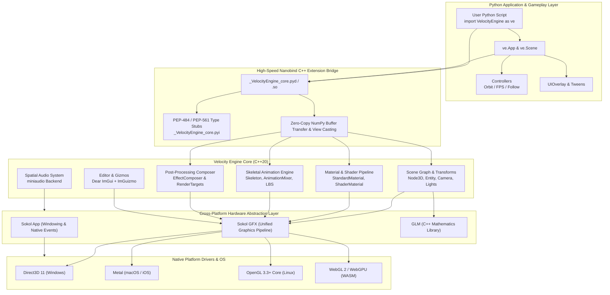

# Velocity 3D Engine

<div class="badge-container">
    <a href="https://github.com/fortestaccountQ/velocity-3d-engine"></a>
    <a href="https://en.wikipedia.org/wiki/C%2B%2B20"></a>
    <a href="https://www.python.org/"></a>
    <a href="https://github.com/floooh/sokol"></a>
    <a href="https://github.com/wjakob/nanobind"></a>
    <a href="https://opensource.org/licenses/MIT"></a>
</div>

**Velocity 3D Engine** is a high-performance, modern 3D rendering and game engine built from the ground up to fuse the blazing raw execution speed of **C++20** and **Sokol GFX** with the rapid prototyping, elegance, and expressiveness of **Python**.

Whether you are crafting real-time simulations, interactive games, architectural visualizations, or procedural generative art, Velocity provides a complete ecosystem: an ergonomic scene graph, physically based rendering (PBR), GPU instancing, skeletal animation, spatial audio, and post-processing pipelines.

---

## 🚀 Quick Navigation

<div class="grid cards" markdown>

-   :material-rocket-launch:{ .lg .middle } **[Getting Started](getting-started/index.md)**

    ---

    Install the engine on Windows, Linux, or macOS, build via `pip` or `CMake`, and run your first 3D scene in under 5 minutes.

    [:octicons-arrow-right-24: Quickstart Guide](getting-started/quickstart.md)

-   :material-engine:{ .lg .middle } **[Architecture Deep-Dive](architecture/overview.md)**

    ---

    Explore the hybrid C++20 / Nanobind / Sokol GFX multi-backend architecture, scene graph transforms, and memory model.

    [:octicons-arrow-right-24: Engine Architecture](architecture/overview.md)

-   :material-book-open-variant:{ .lg .middle } **[Guides & Manuals](guides/materials-and-shaders.md)**

    ---

    In-depth practical guides for PBR materials, skeletal rigs, multi-pass bloom, spatial audio, instancing, and UI overlays.

    [:octicons-arrow-right-24: Browse Guides](guides/materials-and-shaders.md)

-   :material-code-braces:{ .lg .middle } **[API Reference](api-reference/python/app.md)**

    ---

    Exhaustive documentation and PEP-484 typing signatures for every class, method, property, and mathematical primitive.

    [:octicons-arrow-right-24: Python API Reference](api-reference/python/app.md)

-   :material-gamepad-variant:{ .lg .middle } **[Showcase Games](examples/index.md)**

    ---

    Fully playable standalone reference games including 3D Mario Platformer, Arcade Circuit Racing, and Flappy Bird 3D.

    [:octicons-arrow-right-24: Explore Examples](examples/index.md)

-   :material-translate:{ .lg .middle } **[Multilingual Docs](translations/README_en.md)**

    ---

    Read engine specifications and guides localized in Arabic, German, Spanish, French, Japanese, Portuguese, Russian, and Chinese.

    [:octicons-arrow-right-24: Select Language](translations/README_ru.md)

</div>

---

## 🌟 Key Technical Features

| Subsystem | Specification & Capabilities | Performance Characteristics |
| :--- | :--- | :--- |
| **Rendering Core** | Sokol GFX cross-backend rendering: Direct3D 11 (Windows), Metal (macOS), OpenGL 3.3+ Core (Linux), WebGL 2 (WASM). Unified depth range `[0.0, 1.0]`. | Zero-driver-overhead static and dynamic pipelines; sub-millisecond draw pass orchestration. |
| **PBR Shading** | Cook-Torrance GGX microfacet specular BRDF, Lambertian diffuse, Sobel normal mapping, metallic-roughness workflow, ambient occlusion, and HDR cubemap Image-Based Lighting (IBL). | Physically accurate light attenuation, dynamic environment reflection probe integration. |
| **Scene Graph** | Hierarchical `Node3D` tree with local-to-world transform propagation, quaternion orientations, Euler rotations, and automatic bounding volume hierarchy (`AABB`, `BoundingSphere`). | Optimized cache-friendly traversal with dirty transform flags. |
| **GPU Instancing** | `InstancedMesh` pipeline capable of rendering **50,000+** animated or static entities in a single draw call with per-instance 4x4 transform matrices and tint colors. | Draw-call bottleneck elimination for foliage, asteroid fields, and debris systems. |
| **Skeletal Animation** | Full glTF 2.0 skeletal loader with joint hierarchy propagation, inverse bind matrices, linear blend skinning (LBS), multi-clip animation blending, and smooth crossfades. | Sub-millisecond joint updates with socket attachments for weapons and equipment. |
| **Post-Processing** | Modular `EffectComposer` pipeline featuring HDR Gaussian Bloom, ACES / Reinhard tonemapping, vignette, chromatic aberration, SSAO, and custom fullscreen shader passes. | Ping-pong HDR floating-point render targets (`rgba16f`) with configurable downsample blits. |
| **Spatial 3D Audio** | Integrated `miniaudio` engine supporting 2D streaming music, polyphonic sound effects, 3D spatial attenuation, distance roll-off, and listener orientation. | Low-latency asynchronous audio mixing on a dedicated native thread. |
| **2D HUD & Overlay** | Orthographic 2D drawing queue with built-in bitmap font atlas for text rendering, crosshairs, meters, health gauges, and radar minimaps. | Direct batched orthographic quad pass flushed at frame end without interfering with 3D depth passes. |
| **Dear ImGui Editor** | Integrated visual scene editor toggleable via `F2` featuring interactive hierarchy tree, property inspector, entity spawner, and ImGuizmo 3D translation/rotation gizmos. | Native C++ immediate mode GUI rendered in the main frame pass. |

---

## 🏛️ System Architecture

Velocity 3D Engine is engineered as a decoupled, multi-layered architecture where native C++20 handles hardware access, math vectorization, and GPU command encoding, while Python directs high-level gameplay logic, procedural generation, and scene composition.



---

## ⚡ A Taste of Velocity: 15-Line 3D Scene

Creating an interactive, illuminated 3D scene in Velocity requires minimal boilerplate:

```python
from __future__ import annotations
import VelocityEngine as ve

# 1. Initialize window application with dark blue clear background
app = ve.App(title="Velocity 3D Engine Preview", width=1280, height=720, clear_color="#10131a")

# 2. Position camera and illuminate scene with warm sunlight
app.camera.set_position(0.0, 2.0, 4.5)
app.camera.set_target(0.0, 0.5, 0.0)
app.scene.set_sun(direction=(-1.0, -2.0, -1.0), color=ve.WARM_WHITE, intensity=2.0)

# 3. Create a golden metallic PBR sphere
gold_mat = ve.StandardMaterial()
gold_mat.base_color = ve.Vec4(1.0, 0.84, 0.0, 1.0)
gold_mat.metallic = 0.95
gold_mat.roughness = 0.15

sphere_mesh = ve.Mesh.create_sphere(radius=1.0, rings=32, sectors=32)
entity = ve.Entity()
entity.mesh = sphere_mesh
entity.material = gold_mat
app.scene.add_entity(entity)

# 4. Spin entity dynamically and run the native event loop
@app.on_update
def frame(dt: float) -> None:
    entity.transform.rotate_y(45.0 * dt)

app.run()
```

---

## 🛠️ Getting Started in 3 Steps

1. **Install Prerequisites**: Ensure you have Python 3.10–3.13, CMake >= 3.24, and a C++20 compiler (Visual Studio 2022 on Windows, GCC 12+ on Linux, Apple Clang 14+ on macOS).
2. **Build and Install**:
    ```bash
    pip install scikit-build-core nanobind ninja pytest numpy
    pip install -e . --no-build-isolation
    ```
3. **Verify Installation**:
    ```bash
    pytest tests -q
    ```

Ready to dive deeper? Head over to the **[Installation Guide](getting-started/installation.md)** or follow our **[5-Minute Quickstart](getting-started/quickstart.md)**!
